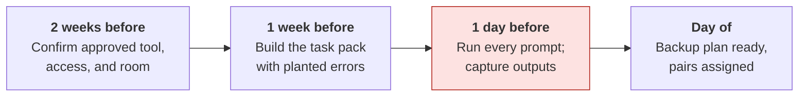
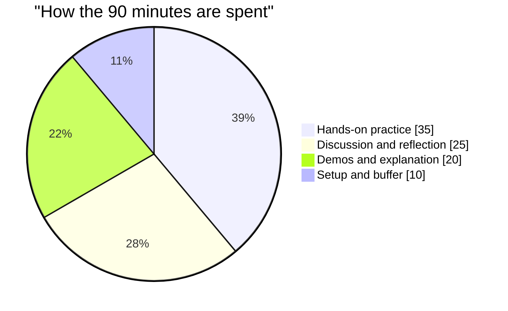
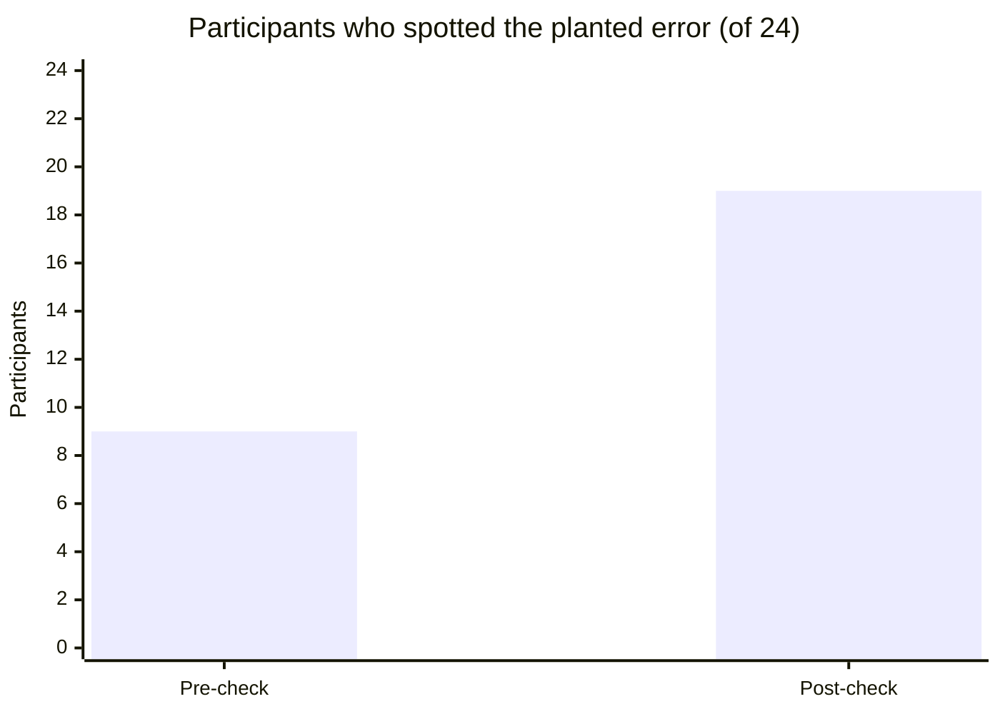

# Running an AI workshop
{: .no_toc }

A facilitator's guide to a 90-minute, hands-on AI-fluency session for students, faculty, or staff, built around practicing judgment rather than collecting prompts.
{: .fs-6 .fw-300 }

<details open markdown="block">
  <summary>On this page</summary>
  {: .text-delta }
1. TOC
{:toc}
</details>

## Scenario

A program director asks you to run a 90-minute "AI for business" session for 24 people: a mix of students and staff, some who use AI every day and some who've never opened a chat assistant. Last term's session was a slideshow of impressive demos and a handout of "50 prompts that will change your work." Attendees enjoyed it. A month later, no one could name anything they did differently.

## Why it matters

Workshops are often the first structured AI training people get, and in many organizations they're how AI literacy expectations get met (see [AI regulation and frameworks]()). A demo-heavy session builds enthusiasm and over-trust in about equal measure. A session where people **catch an AI error themselves** builds the habit that matters most: checking before relying.

The design rule for this guide's workshops: **at least half the time is hands-on, and every hands-on task contains something to catch.**

## AI-assisted approach

### Before the session



1. **Confirm the tool and access (Use).** Use a tool your organization has approved for the data in the exercises. Check that every participant can sign in, or plan to pair people.
2. **Use fictional data only (Use).** No real student, customer, or employee data in exercises. See [Creating cases and data packs]().
3. **Build the task pack with planted problems (Use).** Each hands-on task should give AI a realistic job where it's likely to make a catchable mistake, such as the [break-even]() fee error, an invented citation, or a [marketing claim]() that isn't supported.
4. **Run every prompt the day before (Verify).** Outputs vary. Capture screenshots of good examples, including at least one with the error, in case the live run comes out clean.
5. **Plan for access problems.** If the tool goes down, participants can critique the captured outputs instead.
6. **Check accessibility.** Materials readable on screen and on paper, captions for any video, and enough time for people who type slowly. See [Accessible and inclusive materials]().

### The 90-minute agenda

| Minutes | Segment | What happens | Rubric habit |
|:--|:--|:--|:--|
| 0–5 | Welcome and norms | Purpose, data rules ("fictional data only"), pairs | — |
| 5–15 | What AI is, in 10 minutes | One live example, using the [quick start]() | Use |
| 15–25 | **Pre-check** and live failure demo | Participants try to spot an error in an AI answer, then you show a confident mistake live | Verify |
| 25–45 | Hands-on task 1 | Pairs give AI a task with full context, using the [five essentials]() | Use |
| 45–60 | Hands-on task 2: verify | Pairs swap outputs and check them against a checklist, outside the chat | Verify |
| 60–75 | Disclose and decide | Write a disclosure statement; discuss which calls stayed human | Disclose, Decide |
| 75–85 | **Post-check** and commitments | A second error-spotting check; each person writes one thing they'll do differently | Decide |
| 85–90 | Buffer and close | Questions, resources, feedback form | — |



### Facilitation moves that work

- **Show a failure early.** A confident, wrong answer in the first 25 minutes resets expectations better than any warning.
- **Pair experienced and new users.** Ask the experienced person to type and the new person to direct. Both learn more.
- **Ask "How do you know?"** whenever someone reports a result. The answer should point outside the chat.
- **Collect prompts at the end, not the start.** The point is the judgment around the prompt.
- **Be honest about limits.** If a participant asks something you don't know, such as whether a tool keeps their data, say so and point to where to check.

## Prompt template

Use AI to draft the task pack, then check it yourself:

```text
I'm running a 90-minute AI-fluency workshop for [AUDIENCE] on [TOPIC].
Create two hands-on tasks, each taking 15–20 minutes in pairs.

For each task:
- A short, realistic scenario with a fictional organization and complete,
  internally consistent data (show all calculations so I can check them).
- What participants should ask the AI to do.
- One mistake an AI tool is likely to make on this task, and how
  participants could catch it without asking the AI.
- A 5-item verify checklist.
- Two debrief questions.

Also write a 3-question error-spotting check I can use before and after
the session, each with a short AI answer that contains one error.
```

Then recompute every number, and run each task yourself in the tool participants will use. If the tool doesn't make the expected mistake, use your captured example or plant the error in a provided output.

## Verify checklist

- [ ] The tool is approved for the exercise data, and every participant has access or a partner.
- [ ] All exercise data is fictional, and every number in it has been recomputed.
- [ ] Every prompt was run the day before, and example outputs, including one with the error, are saved.
- [ ] At least half the session is hands-on.
- [ ] Each hands-on task has something participants can catch by checking outside the chat.
- [ ] The pre- and post-checks measure spotting errors, not just confidence.
- [ ] Materials meet basic accessibility standards.
- [ ] There's a short follow-up, such as a knowledge check a week later.

## Common failure modes

| Failure | What it looks like | How to catch it |
|:--|:--|:--|
| **Demo theater** | An hour of impressive outputs, no practice | Hold to at least half hands-on. |
| **The demo that won't fail** | The planted error doesn't appear live | Use your captured output. Explain that this is what "outputs vary" means. |
| **Real data in exercises** | A participant pastes a real student list | State the data rule at the start. Provide all the data they need. |
| **Access chaos** | 15 minutes lost to sign-in problems | Test access in advance. Pair people. Have a printed backup. |
| **Prompt collecting** | People leave with a list of prompts and no habits | End with commitments, not a prompt sheet. |
| **Measuring enjoyment only** | "4.8 out of 5!" and no change in behavior | Use the pre/post error check and a follow-up. |

## Worked example

The director's session runs with **24 participants** in 12 pairs. The pre-check (minute 15) shows three short AI answers, each with one error: a wrong break-even figure, an invented statistic, and a summary that drops a key exception.

| Measure | Pre-check | Post-check |
|:--|--:|--:|
| Spotted the error in the break-even answer | 9 of 24 (37.5%) | 19 of 24 (79.2%) |
| Could say *how* they'd verify it, outside the chat | 6 of 24 (25.0%) | 18 of 24 (75.0%) |



The live run of hands-on task 1 came out clean: the tool got the fee right that day. The facilitator used it: *"Same prompt, different answer from yesterday. That's why we check every time."* They then showed the captured output with the error.

Commitments people wrote included *"Recalculate any AI number before it goes in a slide"* and *"Ask for the source and open it."* A five-question knowledge check went out one week later (see [Scenario knowledge checks]()).

The post-check is a short-term measure on a small group, so it's evidence the session worked that day, not proof of lasting change. The one-week follow-up is a better test.

## Disclose and decide notes

**Disclose:** Tell participants which parts of the materials you drafted with AI and how you checked them. It models the habit you're teaching: *"I used AI to draft the case, recalculated every number, and planted the error myself."*

**Decide:** You decide what participants practice, what data is allowed, and what counts as success. Participants decide what they'll change in their own work. Their commitments are theirs, not the tool's.

## For educators: turn this into a challenge

Turn the workshop design itself into the activity: teams of educators or student leaders design a 30-minute mini-workshop for a specific audience using this agenda pattern, including one task with a planted error and a pre/post check. Each team runs it for another team, and the hosts score whether their check showed an improvement. Debrief: *Did the planted error appear live? What did you do when it didn't?* See [Designing an AI-fluency challenge]().
