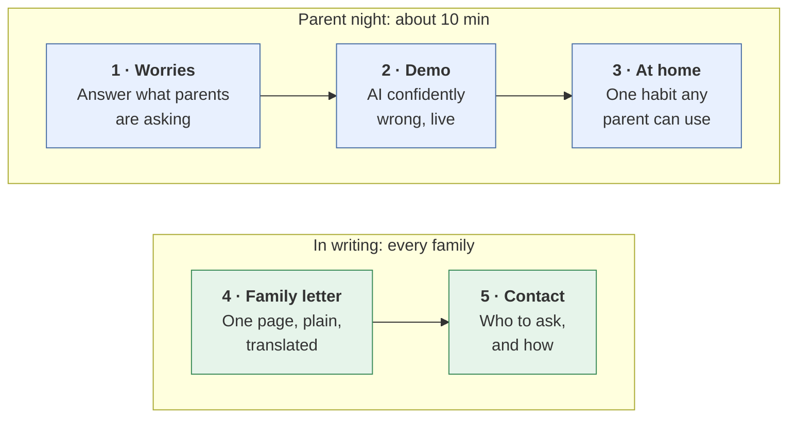
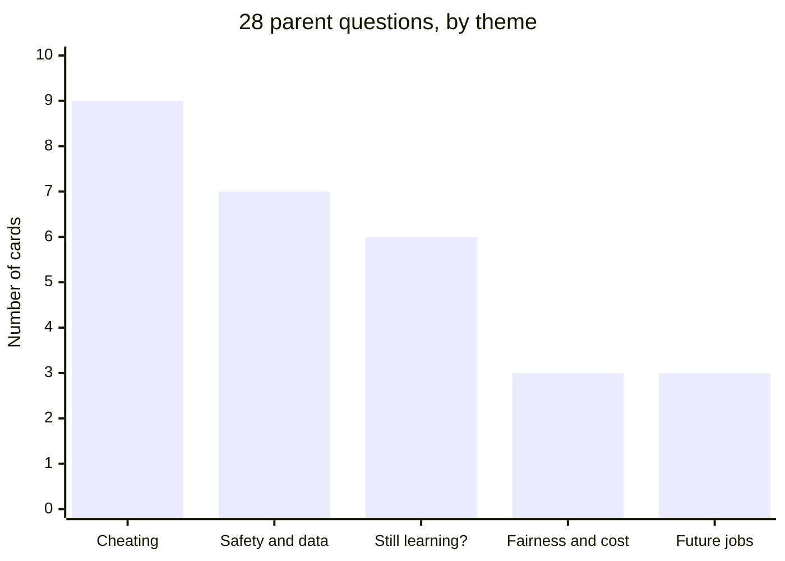

# Explaining AI to parents
{: .no_toc }

How teachers and schools can explain their approach to AI to families: answer what parents worry about, show them a real failure, give them one habit to use at home, and put it in writing.
{: .fs-6 .fw-300 }

<details open markdown="block">
  <summary>On this page</summary>
  {: .text-delta }
1. TOC
{:toc}
</details>

## Scenario

A business teacher at **Quillfield High School** (fictional) teaches Grade 10 Introduction to Business. This year, the school approved an AI tool for students, and the teacher has set clear rules for each assignment (see [Explaining AI to students]()).

Two weeks into term, the emails start. One parent writes that their child "is letting a robot do their homework." Another asks what happens to their child's information. A third asks why the class uses AI at all, since they've read it's dangerous for teenagers. Parent night is next week, and the teacher has ten minutes.

## Why it matters

Parents aren't using the tool and aren't setting the policy, but they're responsible for their child. They want to know their child is **learning, safe, and treated fairly**. When a school says nothing, parents fill the gap with news stories and their own child's partial account.

Parents also start in very different places. Some use AI every day at work. Some have only seen headlines. Some speak a different language at home. A good explanation works for all of them: plain, specific, and honest about what the school can and can't guarantee.

Most of this page applies to schools. Parents of university students are less often involved, but the same approach works for orientation sessions and family information pages. For other audiences, see [Explaining AI to others]().

## AI-assisted approach



### 1. Answer what parents are worried about

| What they're thinking | What to tell them |
|:--|:--|
| "Is my child just letting AI do their homework?" | Your rule for each type of assignment, and why some work must be done without AI. Then how you check learning: in-class work, drafts, and asking students to explain their thinking. |
| "Is my child still learning?" | The work is how learning happens, so assignments are designed so students still do it. See the "gym" comparison in [Explaining AI to students](#2-explain-why-learning-still-matters). |
| "What happens to my child's information?" | Which tool students use, that it's approved by the school, how students sign in, what they're told never to type in, and who to ask for the vendor's terms. Student privacy laws may apply, and the school or district decides which tools meet them. |
| "Could it show them something inappropriate, or become a crutch?" | What safeguards the approved tool has, what it doesn't, and that adults stay involved. Don't promise more filtering than exists. |
| "Will my child be falsely accused of cheating?" | That a detector score is never treated as proof on its own, because detection tools are often wrong (Weber-Wulff et al., 2023), and that any concern starts with a conversation. |
| "Is it fair if other families pay for better tools?" | What the school provides, and that no assignment requires a paid tool or home internet beyond what's already expected. |
| "Will this matter for their future?" | If they use AI at work, they'll be responsible for what it produces, and they can only check what they understand. That's why the subject still matters. |

### 2. Show them a real failure

Use the same kind of live demo you'd use with students: one thing the AI explains well, then a question from your subject that it gets confidently wrong. Test it the day before and bring a backup, since AI tools change. Then ask parents: *"How would your child know?"* That question explains your rules better than any policy.

### 3. Give them one habit for home

Most parents can't check the subject content, and they shouldn't have to. Give them one habit that works whatever their background:

> **Ask your child to explain their work to you, without the screen.** If they can explain how they got the answer, they've learned it, whether or not AI helped along the way.

It also gives children a regular, low-stakes reason to say their thinking out loud.

### 4. Put it in a one-page family letter

Not everyone comes to parent night. A one-page letter, sent home and posted online, should cover:

- which tool students use, and for what
- the rule for each type of assignment, with a reason
- how student information is protected, and what students must never type in
- what happens if there's a concern about AI use
- the "explain it to me" habit
- who to contact

Keep it plain and specific. Translate it into the languages your families use, and have a fluent speaker check the translation. See [Accessible and inclusive materials]().

### 5. Make it easy to ask

Name one person to contact, and say how quickly they'll reply. Parents who know where to ask are less likely to rely on rumor.

## Prompt template

**Draft the family letter from your real policy:**

```text
Draft a one-page letter to families of [GRADE / COURSE] students
explaining how AI is used in this class. Use only the facts below.
Write in plain language at about a Grade 6 reading level, warm but
not salesy. Don't make AI sound magical or dangerous, and don't
promise any safety feature that isn't listed.

Sections: what tool and why; the rule for each type of assignment
(with one-sentence reasons); student information; what happens if
there's a concern; one thing you can do at home ("ask your child to
explain their work without the screen"); who to contact.

If something a parent would expect to know is missing from my facts,
write "MISSING:" and what I should find out.

FACTS:
- Approved tool and how students sign in: [ ]
- What students must never type in: [ ]
- Rules by assignment type: [ ]
- What happens if there's a concern: [ ]
- Contact and reply time: [ ]
```

**Rehearse parents' hard questions:**

```text
Act as a parent at a high school parent night. You're worried about AI:
you've read news stories about teenagers and chatbots, you're not sure
your child is still learning, and you want to know what happens to
their data. Ask me your questions one at a time, the way a real parent
would, including one that's hard to answer. After each answer, tell me
whether it reassured you and what was unclear.
```

Check the letter line by line against your school's real policy and the tool's actual settings. If the letter will be translated, have a fluent speaker review it: AI translation can change the meaning of rules in ways that matter.

## Worked example

The Quillfield teacher gets ten minutes at parent night. Twenty-eight families attend, and each writes one question on a card at the door. The teacher sorts them while the principal speaks:



**Worries first.** Cheating came up most, so the teacher starts with the rule for each assignment type: AI as a tutor only on homework practice, AI with disclosure on the business-plan project, and no AI on tests. Then safety and data: students use the school-approved tool with school accounts, and they're taught never to type in their full name, address, or anything about another student. The teacher is careful about what they can't promise: *"The tool has content filters, but no filter is perfect. That's one reason we use it in class, where I can see it."*

**The demo.** The teacher had tested several questions the night before. On the screen: *"A shop buys a hoodie for $20, marks it up 50%, then puts it on sale at 50% off. What's the sale price?"* The tool answers **$20**, confidently, saying the markup and discount "cancel out." The correct answer is **$15**: a 50% markup takes $20 to $30, and 50% off $30 is $15. A parent near the front gets it first. The teacher asks the room: *"How would your child know the AI was wrong?"* Then: *"Only if they understand percentages. That's why they still do the math."*

**At home.** The teacher ends with the one habit: ask your child to explain their work without the screen.

**The family letter** (sent home the next day, and posted on the class page):

```text
Dear families,

This year, students in Introduction to Business can use an AI tool
approved by Quillfield High School. Here's how it works in our class.

WHAT IT'S FOR
Students use it to get explanations and practice questions, like a
tutor. It is not used to write their work for them.

THE RULES
- Homework practice: AI as a tutor only. The answers must be theirs,
  because practice is how they learn.
- Business-plan project: AI allowed, and students describe how they
  used it, as they would at work.
- Tests: no AI. Tests show what students can do on their own.

YOUR CHILD'S INFORMATION
Students sign in with their school account. They are taught never to
type their full name, address, or anything about another student.
Ask me if you'd like to see the tool's privacy terms.

IF THERE'S A CONCERN
If I'm unsure whether work is a student's own, I talk with the
student first. I don't rely on AI-detection scores, which are often
wrong.

ONE THING YOU CAN DO AT HOME
Ask your child to explain their work to you without the screen. If
they can explain it, they've learned it.

QUESTIONS?
Email me at [school email]. I reply within two school days.
```

**What happened next.** Two families asked for the letter in Spanish. The school's translated version, checked by a Spanish-speaking colleague, went out the following week. One parent who works in IT offered to talk to the class about how their team checks AI-generated work. The teacher reused the index-card exercise at the spring parent night, when "safety and data" had dropped to two cards.

## Verify checklist

- [ ] I answered parents' main worries before explaining how the tool works.
- [ ] I said exactly which tool students use, how they sign in, and what they must never type in.
- [ ] I didn't promise any safety feature the tool doesn't have.
- [ ] Each type of assignment has a rule and a one-sentence reason.
- [ ] I explained that detector scores aren't treated as proof, and what happens instead.
- [ ] Parents got one habit they can use at home, whatever their background.
- [ ] There's a one-page letter, posted online and translated where needed, with a named contact.
- [ ] Every line in the letter matches the school's real policy and the tool's real settings.

## Common failure modes

| Failure | What it looks like | How to catch it |
|:--|:--|:--|
| **Promising safety you can't guarantee** | "The tool blocks anything inappropriate" | Say what safeguards exist and that no filter is perfect. |
| **Leading with cheating** | Parents hear "your child is a suspect" | Start with learning and the reasons for the rules. |
| **Jargon** | "LLMs," "hallucinations," "prompts" | Use plain words and one demo. |
| **Silence** | Parents learn about AI from the news | Send the letter early in the term, before the questions arrive. |
| **Asking parents to police it** | "Please make sure your child doesn't use AI at home" | Give them the explain-it habit instead. They can't check the tool, but they can listen. |
| **One language, one format** | A long English-only policy document | One page, translated, posted where families already look. |
| **Overselling** | "AI will prepare your child for the future" | Say what students actually do with it, and what they don't. |

## Disclose and decide notes

**Disclose:** If AI helped draft the family letter or translations, say so in your own notes, and make sure a person checked every line. Families are trusting the school's word, not the tool's.

**Decide:** The school or district decides which tools are approved and how student data is protected. Teachers decide the rule for each assignment. Parents decide what happens at home, and they should always have a person to ask. When a concern arises about a student's work, a conversation comes first.

## For educators: turn this into a challenge

In a staff meeting or teacher-education course, participants each draft a one-page family letter for one of their own classes using the prompt above, then check it against the real policy and the tool's settings. In pairs, one plays a worried parent using the themes from the worked example (cheating, data, learning, fairness, the future), and the other answers in two minutes. Score on honesty (no promises the tool can't keep), plain language, and whether the parent leaves with one thing to do at home. Debrief: *Which parent question was hardest to answer without over-promising?* See [Designing an AI-fluency challenge]().

---

**References**

- Weber-Wulff, D., Anohina-Naumeca, A., Bjelobaba, S., Foltýnek, T., Guerrero-Dib, J., Popoola, O., Šigut, P., & Waddington, L. (2023). Testing of detection tools for AI-generated text. *International Journal for Educational Integrity, 19*, 26. https://doi.org/10.1007/s40979-023-00146-z
