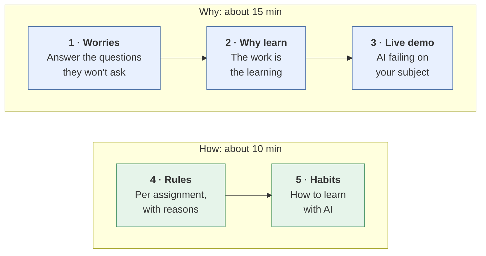
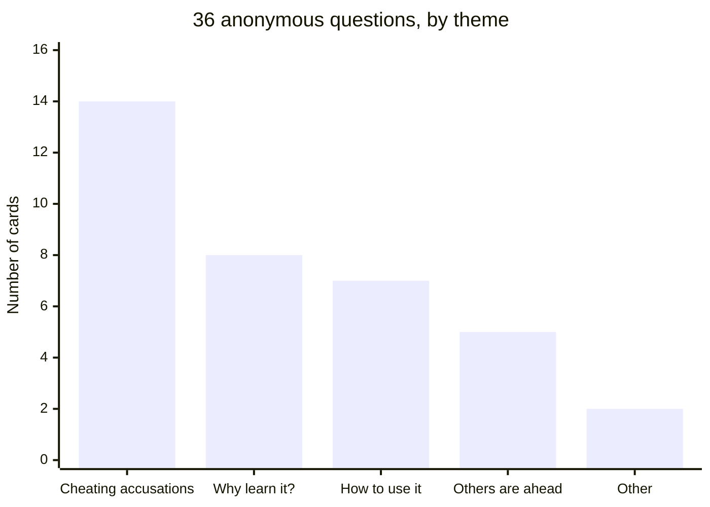

# Explaining AI to students
{: .no_toc }

What to say in the first week of a course: answer students' worries honestly, explain why learning still matters, show AI failing on your own subject, and make the rules concrete for each assignment.
{: .fs-6 .fw-300 }

<details open markdown="block">
  <summary>On this page</summary>
  {: .text-delta }
1. TOC
{:toc}
</details>

## Scenario

An instructor teaching **BUS 210: Introduction to Managerial Accounting** (a fictional course) has written a clear AI policy for each assignment (see [Writing a course AI policy]()). It's in the syllabus. In week two, the questions arrive anyway: one student asks whether using AI to check their grammar counts as cheating, another has submitted a problem set that's clearly AI-written, and a third admits they've been afraid to use AI at all.

The policy answered *what's allowed*. Nobody had explained *why*, or what using AI well looks like in this course. Next term, the instructor plans 25 minutes of the first class for that conversation.

## Why it matters

Students are in a different position from staff or leaders. At work, AI doing a task faster is often the goal. In a course, **the work is how the learning happens.** If AI does the problem set, the problems get solved and the student doesn't learn to solve them.

People have always handed mental work to tools, which researchers call **cognitive offloading** (Risko & Gilbert, 2016). It's often sensible. But a skill you always hand off is a skill you stop practicing. Students need to hear that from someone they trust, with a reason that makes sense to them. Otherwise they fill the gap with guesses: some use AI for everything, some avoid it out of fear, and most never learn to use it well.

A first-week conversation also shapes trust. Students who expect to be accused will hide their AI use. Students who know the rules and the reasons will usually follow them and ask when unsure.

To explain your approach to families, see [Explaining AI to parents](). For other audiences, see [Explaining AI to others]().

## AI-assisted approach



### 1. Answer the worries first

| What students are thinking | What to say |
|:--|:--|
| "Will I be accused of cheating?" | Exactly what's allowed on each assignment, and how to disclose. Tell them you won't treat an AI-detector score as proof: detection tools are often wrong, including on genuine work (Weber-Wulff et al., 2023). |
| "Is everyone else using it? Am I behind?" | "Some of you use it a lot and some never have. Both are fine starting points. We'll practice using it well." |
| "Why learn this if AI can do it?" | The honest answer in step 2. |
| "Is using AI wrong?" | "No. The question is whether it helps you learn or does the learning for you." |
| "What if I'm not sure it's allowed?" | "Ask me, or disclose what you did. Asking is never penalized." |

### 2. Explain why learning still matters

One comparison students tend to accept:

> **Using AI to do your assignment is like sending someone else to the gym for you.** The weights get lifted, but you don't get stronger.

Then connect it to their future. If they use AI at work, they'll be responsible for what it produces, and they can only check what they understand. Knowing the subject is what lets them catch the mistake before their manager or client does. See [Trusting your own judgment]().

### 3. Show AI failing on your own subject

A warning is easy to forget. A mistake students watched happen is not. Before class, try several questions from your course on an AI tool until you find one it gets confidently wrong: a calculation, a course-specific rule, or a citation. In class:

1. Ask it something it answers well, such as explaining a key concept.
2. Ask the question you prepared, and let students read the confident wrong answer.
3. Ask the class: *"Is this right? How would you know?"*

Prepare a backup. AI tools change, and a question that failed last week may work today. If it does, say so: that's a lesson too, because it means students can't predict when it will be wrong.

### 4. Make the rules concrete, with reasons

Use the four levels from [Writing a course AI policy](): **No AI**, **AI for prep only**, **AI with disclosure**, and **AI expected**. For each assignment, give the level and one sentence on *why*. "No AI on the exam, because it checks what you can do on your own" gets more cooperation than "no AI."

Show a real disclosure statement, not just the instruction to write one:

> *"I used AI to explain contribution margin when I got stuck, and to check my grammar. All calculations and the recommendation are my own."*

### 5. Give them habits for learning with AI

- **Try first, then ask.** Write your own answer before prompting.
- **Use it as a tutor, not an answer machine.** Ask it to quiz you, give hints, or explain your mistake. See [Setting up an AI tutor]() and the [Socratic tutor prompt]().
- **Check everything you hand in.** Facts, numbers, and especially sources.
- **The explain-it test.** If you can't explain it without the chat open, it isn't yours yet.

## Prompt template

**Find a question your subject's AI answers get wrong** (run it before class, then test the candidates yourself):

```text
I teach [COURSE AND LEVEL]. I want a short in-class demonstration of
AI being confidently wrong on our subject. Suggest 8 questions from
these topics: [LIST 3–5 TOPICS]. Focus on the kinds of questions AI
tools often get wrong: multi-step calculations, course-specific
conventions, exact definitions that differ between textbooks, and
requests for sources. For each, give the correct answer and explain
the likely mistake.
```

Then ask each candidate question in a **fresh** chat, without the explanation, and keep the ones that actually fail. Check the "correct answers" yourself too: the same tool may be wrong about its own mistakes.

**Rehearse students' hard questions:**

```text
Act as a first-year business student in my course. You're anxious about
AI: you've heard people get accused of cheating, you're not sure what
counts as AI use, and part of you wonders why you should learn
accounting at all. Ask me your questions one at a time, the way a real
student would, including one I might find uncomfortable. After each
answer, tell me whether it would have reassured you and what was unclear.
```

## Worked example

The instructor runs the 25-minute session in the first class of BUS 210, with 36 students.

**Worries first.** Each student writes one anonymous question about AI in the course on an index card. The instructor sorts them during a short break:



Fourteen of 36 cards were about being accused of cheating, more than any other theme. So the instructor starts there: the exact rule for each assignment, what disclosure looks like, and that no detector score will be treated as proof.

**The live demo.** The instructor had tested several break-even questions the day before (see [Break-even analysis]()). In class, AI explains contribution margin clearly. Then they ask: *"Fixed costs are $24,000, the selling price is $40 per unit, and variable cost is $25 per unit. How many units to break even?"* The tool answers **960 units**, confidently, dividing $24,000 by the $25 variable cost. The correct answer divides by the **contribution margin**, $40 − $25 = $15, giving **1,600 units**. A student in the second row spots it. The instructor's point: *"You caught it because you knew the concept. That's why we still learn it."*

**The rules.** One slide, one line per assignment:

| Assignment | Level | Why |
|:--|:--|:--|
| Weekly problem sets | AI for prep only | Practice is how you learn the methods. Use AI as a tutor, not to produce answers. |
| Case analysis (weeks 5 and 10) | AI with disclosure | Like real work: use it for research and feedback, and tell me how. |
| Midterm and final exams | No AI | Checks what you can do on your own. |
| AI-fluency challenge (week 8) | AI expected | Using AI well, and catching its errors, is the skill being graded. |

**What changed.** On the week-5 case analysis, 33 of 36 students included a disclosure statement. The other three forgot, added one when asked, and lost no marks. Questions about whether something was allowed came to the instructor *before* deadlines rather than after. The instructor kept the index-card exercise and repeats a five-minute version before each new type of assignment.

## Verify checklist

- [ ] I answered students' worries before explaining rules or features.
- [ ] I explained why learning still matters, in terms of their future work.
- [ ] I showed AI failing on a question from my own subject, and had a backup.
- [ ] Each assignment has an AI level and a one-sentence reason.
- [ ] Students saw a real example of a disclosure statement.
- [ ] I said how unsure students can ask, and that asking is never penalized.
- [ ] I said I won't rely on AI-detector scores alone.
- [ ] I've planned to return to the topic when new assignment types start.

## Common failure modes

| Failure | What it looks like | How to catch it |
|:--|:--|:--|
| **Leading with fear** | "AI is cheating and I will catch you" | Start with their worries and the reasons for the rules. Fear pushes use out of sight. |
| **Silence** | A syllabus line and nothing else | Spend part of the first class on it. |
| **One rule for the whole course** | "AI is not permitted" or "AI is fine" | Set a level for each assignment, based on what it's meant to build. |
| **Rules without reasons** | "No AI on problem sets" | Add one sentence on why. |
| **A demo that doesn't fail** | The prepared question works fine on the day | Test the day before, and bring a backup question. |
| **Assuming everyone's the same** | Pitching to complete beginners, or to experts | Pair students with different experience in the first activity. |
| **Not modeling it** | Using AI for course materials without saying so | Disclose your own use, and how you checked it. |
| **One talk, never revisited** | Week-one rules forgotten by week six | Revisit before each new type of assignment. |

## Disclose and decide notes

**Disclose:** Tell students how you use AI in the course, for example: *"I used AI to draft practice questions, then checked every answer and rewrote about a third of them."* It shows them the disclosure habit you're asking for, and it shows that disclosing is normal rather than a confession.

**Decide:** You decide each assignment's level, based on what it's meant to teach. Students decide how to learn within those rules, and they're responsible for what they submit. When something is unclear, a conversation comes before any misconduct process, and no detector score is the only evidence.

## For educators: turn this into a challenge

In a faculty or teaching-assistant workshop, participants bring one course. In 20 minutes, each one finds a question from their subject that AI gets confidently wrong (using the prompt above), then writes a one-line rule and reason for each of their assignments. In pairs, one plays an anxious or skeptical student, using the hardest questions from the index-card themes, while the other gives their first-week explanation. Then swap. Debrief: *Which student question was hardest to answer honestly, and what would you change in your policy because of it?* See [Running an AI workshop]() and [Designing an AI-fluency challenge]().

---

**References**

- Risko, E., & Gilbert, S. (2016). Cognitive offloading. *Trends in Cognitive Sciences, 20*(9), 676–688. https://doi.org/10.1016/j.tics.2016.07.002
- Weber-Wulff, D., Anohina-Naumeca, A., Bjelobaba, S., Foltýnek, T., Guerrero-Dib, J., Popoola, O., Šigut, P., & Waddington, L. (2023). Testing of detection tools for AI-generated text. *International Journal for Educational Integrity, 19*, 26. https://doi.org/10.1007/s40979-023-00146-z
