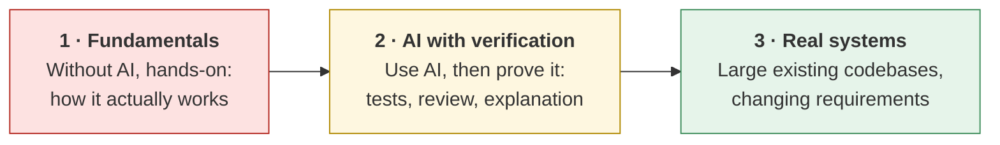
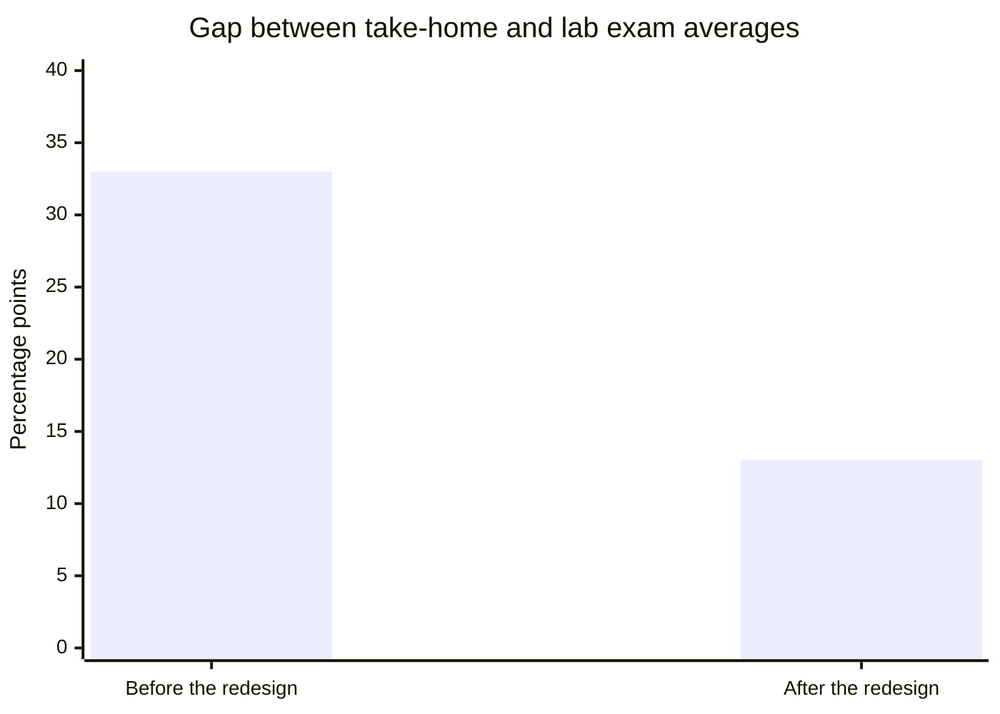

# Teaching computing when AI writes code
{: .no_toc }

AI tools can now complete many traditional programming assignments. What computing programs should teach harder, how to assess it, and how to keep fundamentals from being skipped.
{: .fs-6 .fw-300 }

<details open markdown="block">
  <summary>On this page</summary>
  {: .text-delta }
1. TOC
{:toc}
</details>

## Scenario

The instructor for **CS 210: Data Structures** at **Marrowfield College** (fictional) tries something before the new term: they give each of the course's eight programming assignments to an AI coding assistant, pasting in only the assignment brief. Seven of the eight pass every test in the autograder on the first attempt.

Last term's grades tell the same story from the other side. Students averaged **94%** on take-home programming assignments and **61%** on the in-lab exam, where they wrote code by hand on similar problems. The assignments were still being completed. They had stopped showing who could do them.

## Why it matters

Computing is hit by AI earlier and harder than most fields, because writing routine code is exactly what AI coding tools do well. They tend to do best on small, self-contained, well-specified problems, which describes most traditional programming assignments.

But programming was never mainly about typing code. The field's core is **understanding systems well enough to build them, check them, and take responsibility for them.** That's in more demand when AI writes more of the code, not less: someone has to specify what's needed, read what the tool produced, test it, find what's wrong, and decide whether it's safe to ship.

That creates a trap for students. You can't check code you don't understand. Students who let AI write their code through the fundamentals may get through the assignments and arrive at their first job unable to do the part that's left for people. Handing mental work to tools is often sensible, but a skill you always hand off is a skill you stop practicing (see [Trusting your own judgment]()).

For the program-level picture across all disciplines, see [What a degree is for when AI can do the coursework]().

## Key ideas

### Three stages: without AI, with AI and checking, in real systems



The point isn't to keep AI away from students. It's to make sure they have something to check AI's work *with* before they rely on it.

### What to teach harder

| Skill | Why it matters more now | How to practice it |
|:--|:--|:--|
| **Fundamentals** (data structures, algorithms, memory, how computers run code) | The basis for checking anything AI writes | Hands-on lab work without AI early in the program |
| **Reading and reviewing code** | When AI writes more of the code, more of a developer's time goes to reading and reviewing it | Review exercises: find the bug, explain the change, critique a pull request |
| **Testing and evaluation** | Proving a change works becomes the central skill | Write tests before the code; grade the tests as well as the code. See [Building an evaluation test set](). |
| **Working in large existing codebases** | Real jobs mostly involve big, older systems with history; AI tends to do best on small, fresh problems | Assignments that change a codebase students didn't write |
| **Specifications and communication** | A vague request produces confident, wrong code | Turn an unclear request into a spec with acceptance criteria before coding |
| **Security** | AI can introduce vulnerabilities and new risks such as prompt injection | Review AI-written code for security issues. See [AI security and prompt injection](). |
| **Building with AI** (retrieval, evaluation, agents, cost, monitoring) | A growing share of software includes AI components | Build and evaluate a small AI feature, with tests and an eval set |
| **Professional responsibility** | Someone is accountable for AI-written code that fails | Disclosure, code review, and incident write-ups as graded work |

### Assessment that still shows ability

- **Explain-the-code checks.** The instructor or a teaching assistant picks two or three lines or decisions from a student's submission and asks *why*, without notes. Five minutes per student is usually enough to tell whether the code is theirs in the sense that matters.
- **Live debugging and in-lab practicals** for fundamentals, where the skill itself is what's assessed.
- **Graded tests, not just graded code.** A student who writes good tests has shown they understand what the code should do, whoever wrote the code.
- **Process evidence.** Commit history, a short design note, test results, and an AI-use disclosure, graded with a rubric that weights them alongside correctness.
- **Capstones that look like jobs.** An existing codebase, tickets that change partway through, code review from someone playing a senior engineer, and an incident to handle.

Set the AI level for each assignment, with a reason, as in [Writing a course AI policy](). For example, *No AI* for fundamentals labs, *AI with disclosure* for projects, and *AI expected* for a unit on building AI features.

## Worked example

The CS 210 instructor redesigns the course using the three stages.

**Weeks 1–5: fundamentals, without AI.** Weekly in-lab practicals on lists, stacks, queues, trees, and hashing, done on lab machines with AI tools unavailable. Students who struggle get help from teaching assistants in the room, not from a chat assistant.

**Weeks 6–12: AI with verification.** Take-home assignments allow AI, with disclosure. For each one, students write the **tests first** and submit them before the implementation. The implementation is graded on whether it passes the student's own tests *and* a hidden set. Each assignment ends with a five-minute explain-the-code check for a third of the class. Students don't know in advance whose turn it is, and the rotation is set so every student gets exactly two checks over the six assignments.

**Weeks 13–15: a real system.** Teams get a 3,000-line existing codebase for a fictional library-booking service, with three tickets: a bug, a performance problem in a data structure, and a feature request that changes halfway through. Pull requests are reviewed against a rubric before they're merged.

**The grade weights change:**

| Component | Before | After |
|:--|--:|--:|
| Take-home programming assignments (graded on passing tests) | 60% | — |
| In-lab exam | 40% | 10% (final lab exam) |
| In-lab practicals, weeks 1–5 | — | 25% |
| Assignments: tests, code, and disclosure | — | 30% |
| Explain-the-code checks | — | 15% |
| Capstone in an existing codebase | — | 20% |
| **Total** | **100%** | **100%** |

**The cost.** With 45 students, checking a third of the class (15 students) at five minutes each is **75 minutes per assignment**. Across six assignments, that's **7.5 hours** a term, split between the instructor and two teaching assistants.

**After one term.** The take-home average fell to **85%**, and the final lab exam average rose to **72%**. The gap between them shrank from **33 points to 13**.



The instructor reports this carefully: one term, one section, a different group of students, and a changed exam. It's a sign that the grades mean more, not proof that students learned more. The instructor will keep tracking the gap and compare results in the next course, which builds on this one.

Two things surprised the instructor. Students' tests were the best early warning: a student whose tests missed obvious edge cases almost always struggled in the explain-the-code check. And the capstone's changed requirement caused more trouble than any data structure. Several teams had AI rewrite large parts of their code and broke features that had worked, which turned into the most useful code-review discussion of the term.

## Prompt template

**Stress-test an assignment before the term starts:**

```text
Here is a programming assignment from my course, with its tests.
Complete it as a student would, using only the brief.

[PASTE BRIEF]
[PASTE OR DESCRIBE TESTS]
```

Run this in a fresh chat with one or two AI coding tools, then run their code against your autograder. If it passes, the assignment no longer shows who can do it on their own, and needs redesigning.

**Generate explain-the-code questions from a submission:**

```text
Below is a student's submission for [ASSIGNMENT]. Suggest five short
questions an instructor could ask in a five-minute conversation to check
whether the student understands this code. Focus on specific choices in
this submission: why this data structure, what happens at this edge
case, what this line does if the input is empty, what they would change
if [REQUIREMENT] changed. Don't include the answers in a form the
student could see.

[PASTE SUBMISSION]
```

Pick the questions yourself and adjust them. Check that student code shared with an AI tool is allowed by your institution's rules and goes only into approved tools.

## Verify checklist

- [ ] I tried each assignment with AI tools before the term, against the real tests.
- [ ] Fundamentals are practiced hands-on, without AI, before students rely on it.
- [ ] Students write and are graded on tests, not just code that passes mine.
- [ ] Every student gets at least one explain-the-code check, and I've budgeted the time.
- [ ] Students read and change code they didn't write, in a codebase bigger than one file.
- [ ] Each assignment has an AI level, a reason, and a disclosure requirement where AI is allowed.
- [ ] Security review of AI-written code is part of at least one assignment.
- [ ] I'm tracking whether grades and in-person performance line up, term over term.

## Common failure modes

| Failure | What it looks like | How to catch it |
|:--|:--|:--|
| **Autograder as proof** | Full marks from tests alone | Add student-written tests and explain-the-code checks. |
| **AI ban everywhere** | No AI in any course, so graduates have never used it well | Ban it where the skill is assessed; teach it with verification elsewhere. |
| **AI everywhere, from day one** | Students who can prompt but can't trace a loop | Fundamentals first, hands-on. |
| **Only fresh, small problems** | Every assignment starts from an empty file | Include existing codebases students didn't write. |
| **Checks without a time budget** | Oral checks promised but quietly dropped | Sample, calculate the hours, and share them across the teaching team. |
| **Testing taught as an afterthought** | Tests written last, to satisfy a rubric | Tests first, graded on their own. |
| **Overclaiming results** | "Our redesign improved learning by 11 points" | One term is a signal. Track it over time. |

## Disclose and decide notes

**Disclose:** Students disclose AI use on assignments where it's allowed: which tool, for what, and what they checked. Instructors should say how they use AI in the course too, for example to generate test cases or explain-the-code questions, and who reviewed them.

**Decide:** Which skills students must have without AI, and when they can rely on it, are curriculum decisions the faculty owns. AI can help generate assignments, tests, and questions. Whether a student's code is good enough, and whether they understand it, are judgments people make.

## For educators: turn this into a challenge

In a department workshop, each instructor brings one programming assignment with its tests. In 20 minutes, they run the stress-test prompt with an AI coding tool and record whether it passes. Then pairs redesign one assignment that failed the stress test using the three stages: what part must be done without AI, what's allowed with verification, and how the student shows understanding. Each pair writes three explain-the-code questions for it. Debrief: *How many assignments passed the stress test? Which redesign protects the fundamentals without banning AI?* See [Designing an AI-fluency challenge]().
