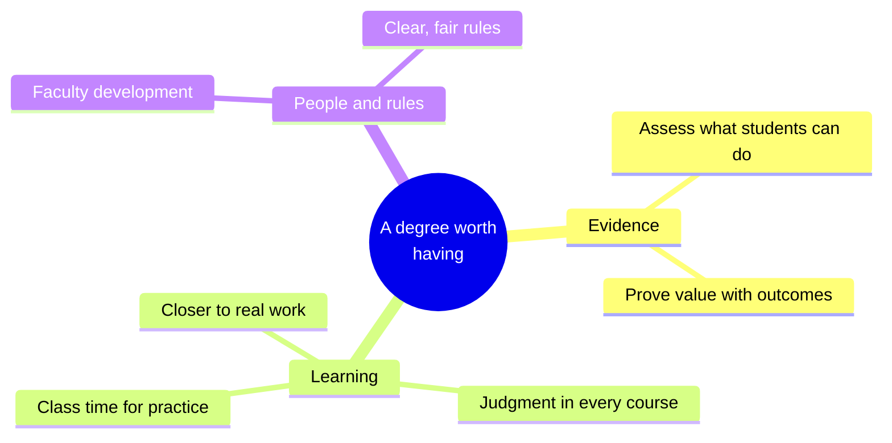
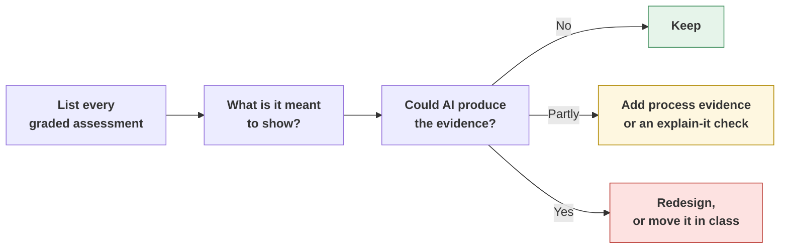
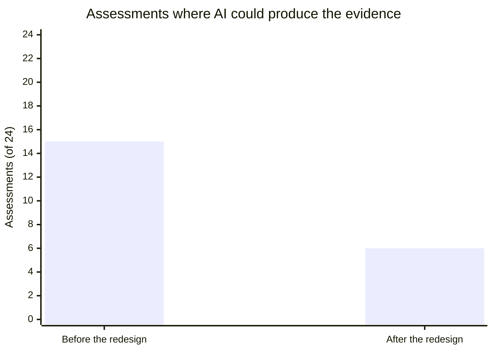

# What a degree is for when AI can do the coursework
{: .no_toc }

AI undermines one part of what higher education does: delivering content and grading take-home work as proof of learning. The rest matters as much as ever. How programs can build on what AI can't replace, and show it.
{: .fs-6 .fw-300 }

<details open markdown="block">
  <summary>On this page</summary>
  {: .text-delta }
1. TOC
{:toc}
</details>

## Scenario

The business faculty at **Marrowfield College** (fictional) meets for its annual program review. One instructor reports that the average grade on take-home case analyses has risen steadily while scores on in-class exams haven't. Another says students can't explain recommendations they "wrote." A third asks the question everyone has been avoiding: *"If AI can do most of our assignments, what exactly is our degree certifying?"*

Someone suggests banning AI. Someone else suggests adding an AI course. Neither answers the question.

## Why it matters

Higher education has always done several things at once. AI affects them very differently:

| What a program does | What AI changes |
|:--|:--|
| **Explains content** | Explanations are now free, instant, and available at any hour. A lecture that only explains competes with a patient tutor. |
| **Grades take-home work as evidence of learning** | An essay or problem set no longer reliably shows what the student can do. |
| **Gives structured practice with expert feedback** | Unchanged. AI can add practice and feedback, but people who know the field still judge what's good. |
| **Builds judgment** | More important. Deciding what's true, what matters, and what to do is exactly what AI leaves to people. |
| **Teaches people to work together on real problems** | Unchanged, and harder to fake. |
| **Provides mentorship, motivation, and community** | Unchanged. Many learners find it hard to keep going alone, however good the tools. |
| **Certifies what graduates can do** | At risk, unless the evidence behind the credential is something AI can't produce for them. |

The first two rows are where AI hits. The rest is where a program's value now lies. A program that mainly explains content and grades take-home products has a real problem. A program built on practice, feedback, judgment, and trustworthy evidence of ability doesn't, but it has to show it.

## Key ideas

### Seven program-level moves



1. **Assess what students can do, not what they can submit.** Use in-class work, short oral explanations, process evidence such as drafts and decision logs, and authentic tasks. Do it across the program, not in scattered courses. See [AI-resilient assessment]() for redesigning individual assignments.
2. **Teach judgment with AI in every discipline.** A single "AI course" can't do it, because judgment depends on knowing the subject. Each course should include work where students use AI and must check it. See [the rubric]().
3. **Use class time for practice, not explanation.** Students attempt real tasks first and get feedback from people. A meta-analysis of 53 studies found that, on average, learners who tried problems before instruction learned more than those taught first, though not for young children (Sinha & Kapur, 2021). AI makes explanations cheap. Expert feedback on practice is what students can't get elsewhere.
4. **Move closer to real work.** Projects with real constraints, internships, simulations of real jobs, and industry partners. Work that involves messy data, changing requirements, and other people is hard for AI to do on a student's behalf, and it's what employers need.
5. **Invest in faculty.** Instructors can't teach AI judgment they haven't practiced. Hands-on workshops and time to redesign courses work better than policy memos. See [Running an AI workshop]().
6. **Make the rules clear and fair.** Set an AI level for each assignment, with a reason. Don't rely on detectors, which are often wrong (Weber-Wulff et al., 2023). Make sure no student needs a paid tool to keep up. See [Writing a course AI policy]().
7. **Prove value with evidence, not claims.** Show what graduates can do: portfolios, recorded presentations, project outcomes, and employer feedback. "AI-ready graduates" in a brochure proves nothing.

### The program assessment audit

Start by finding out where the program's evidence of learning actually comes from. For each graded assessment, ask one question: **could a student produce this evidence with AI, without being able to do the work themselves?**



The audit isn't about catching students. It's about whether the degree's evidence still means what it claims to mean.

### What to avoid

- **Blanket bans.** They're hard to enforce, can push AI use out of sight, and leave students unprepared for work that expects it.
- **Relying on detectors** as evidence of misconduct.
- **Renaming instead of redesigning.** "AI-powered" in a program title, with the same assessments underneath.
- **Assuming today's tools are the end state.** Design around what AI makes cheap (explanations, drafts, routine work), not around a specific tool's current weaknesses.
- **Leaving it to individual instructors.** Course-by-course fixes leave gaps between courses and inconsistency for students.

## Worked example

Marrowfield's business faculty runs the audit on the **24 graded assessments** across its six core courses. For each one, two instructors independently answer the audit question, then agree on a rating.

| Rating | Before the redesign | After the redesign |
|:--|--:|--:|
| AI could produce the evidence (take-home product only) | 15 | 6 |
| AI could partly produce it (take-home with process evidence) | 5 | 8 |
| AI couldn't produce it (in class, oral, or live) | 4 | 10 |
| **Total** | **24** | **24** |



**What they changed:**

- **Six assessments stayed take-home with AI allowed**, but the grade now rests on the student's judgment: which sources they trusted, what they checked, and the decision they made. AI use is disclosed.
- **Three moved to "partly":** each take-home case now includes a decision log and a **five-minute explain-it check**, where the instructor asks the student to defend two choices in their submission, without notes.
- **Six moved in class or became oral:** in-class analyses, a live presentation with questions, and a timed spreadsheet task in the computer lab.

**The cost, stated honestly.** The explain-it checks take time. In a 40-student section, five minutes per student is **200 minutes, about 3.3 hours** per assessment. The faculty decided to run one check per course per term rather than one per assignment, and freed the time by dropping one written assignment from each of the six courses.

**What they'll measure.** The faculty agreed to track three things each year: the gap between take-home and in-class grades, how well students do on explain-it checks, and feedback from internship supervisors. One year of data won't settle anything, so they'll report trends, not a verdict.

**The answer to the original question.** The faculty wrote a one-sentence statement for the program page: *"Our graduates can analyze a business problem, use AI and other tools to work on it, check what those tools produce, and defend a recommendation in person."* Every core course now has at least one assessment that provides evidence for that sentence.

## Prompt template

**Rate an assessment for the audit:**

```text
I'm auditing assessments in a [PROGRAM] program. For the assessment
below, answer:
1. What is it meant to show the student can do?
2. Could a student produce acceptable evidence using AI tools, without
   being able to do this themselves? Answer Yes, Partly, or No, and
   explain.
3. Suggest two redesigns that keep the learning goal but make the
   evidence harder to produce without the skill: one that keeps it
   take-home, and one that moves part of it into class.
4. Estimate the extra instructor time per student for each redesign.

ASSESSMENT:
[PASTE THE ASSIGNMENT BRIEF AND RUBRIC]
```

Try the assignment yourself with an AI tool before trusting the rating: an AI tool's guess about what AI can do isn't reliable. And have two instructors rate each assessment independently, because ratings are judgment calls.

## Verify checklist

- [ ] Every graded assessment in the program has been rated with the audit question.
- [ ] Each course has at least one assessment AI can't complete on a student's behalf.
- [ ] Take-home work that allows AI is graded on the student's judgment and process, not just the product.
- [ ] The extra instructor time for any redesign has been calculated, and found somewhere.
- [ ] Students have clear AI rules for every assignment, and no one needs a paid tool.
- [ ] Faculty have had hands-on time with AI tools, not just a policy.
- [ ] The program can state, in one sentence, what graduates can do, and show evidence for it.
- [ ] A few measures are tracked over time, rather than one result treated as proof.

## Common failure modes

| Failure | What it looks like | How to catch it |
|:--|:--|:--|
| **The ban** | "AI use is prohibited in all coursework" | Ask how it would be enforced, and what students will need at work. |
| **The bolt-on course** | One "AI for business" elective, everything else unchanged | Check whether core courses changed their assessments. |
| **The detector strategy** | Integrity cases built on detection scores | Use assessment design and conversations instead. |
| **Hidden workload** | Oral checks added everywhere with no time budget | Calculate the hours, and drop something to make room. |
| **Rebranding** | "AI-ready graduates" with no evidence | Write the one-sentence claim, then show the evidence. |
| **Designing around today's tool** | Assignments that rely on a current AI weakness | Assume AI will do routine work well, and assess what's left. |
| **Course-by-course fixes** | Strict rules in one class, none in the next | Audit at the program level. |

## Disclose and decide notes

**Disclose:** Tell students and prospective students how the program approaches AI, and why. If AI helped with the audit or redesign, note it in the review documents, and say who checked the ratings.

**Decide:** What the degree certifies is a faculty and institutional decision, not a technical one. So is the trade-off between instructor time and assessment quality. AI can help rate and redesign assessments; it can't decide what a graduate should be able to do. For computing programs, see [Teaching computing when AI writes code]().

## For educators: turn this into a challenge

In a faculty retreat or department meeting, each instructor brings the assessments from one course. In 30 minutes, pairs rate each other's assessments with the audit question (Yes, Partly, No), first without AI and then by trying each assessment with an AI tool. Then each instructor redesigns their highest-rated assessment and calculates the extra time it would take. Debrief: *How many ratings changed after you actually tried AI on the assignment? What does our program's evidence say about what graduates can do?* See [Designing an AI-fluency challenge]().

---

**References**

- Sinha, T., & Kapur, M. (2021). When problem solving followed by instruction works: Evidence for productive failure. *Review of Educational Research, 91*(5), 761–798. https://doi.org/10.3102/00346543211019105
- Weber-Wulff, D., Anohina-Naumeca, A., Bjelobaba, S., Foltýnek, T., Guerrero-Dib, J., Popoola, O., Šigut, P., & Waddington, L. (2023). Testing of detection tools for AI-generated text. *International Journal for Educational Integrity, 19*, 26. https://doi.org/10.1007/s40979-023-00146-z
