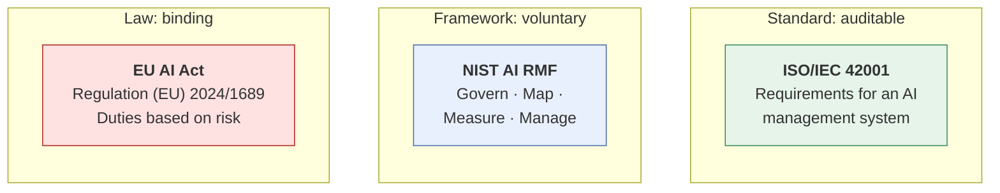
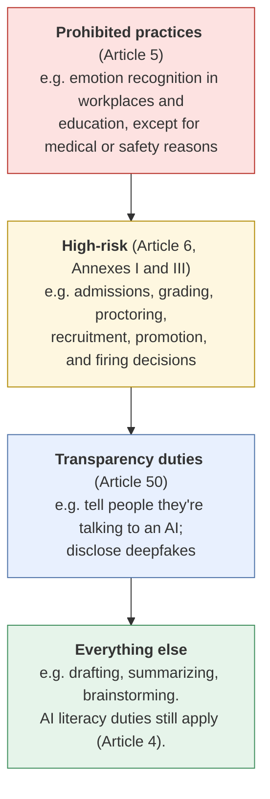
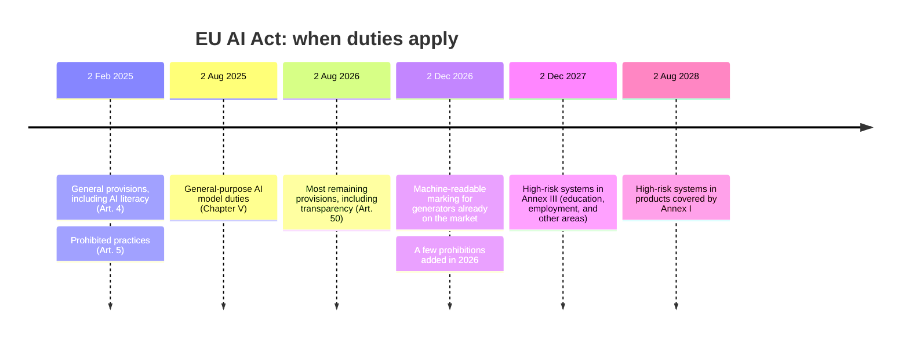
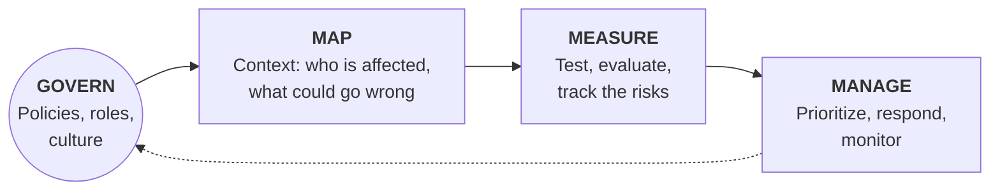
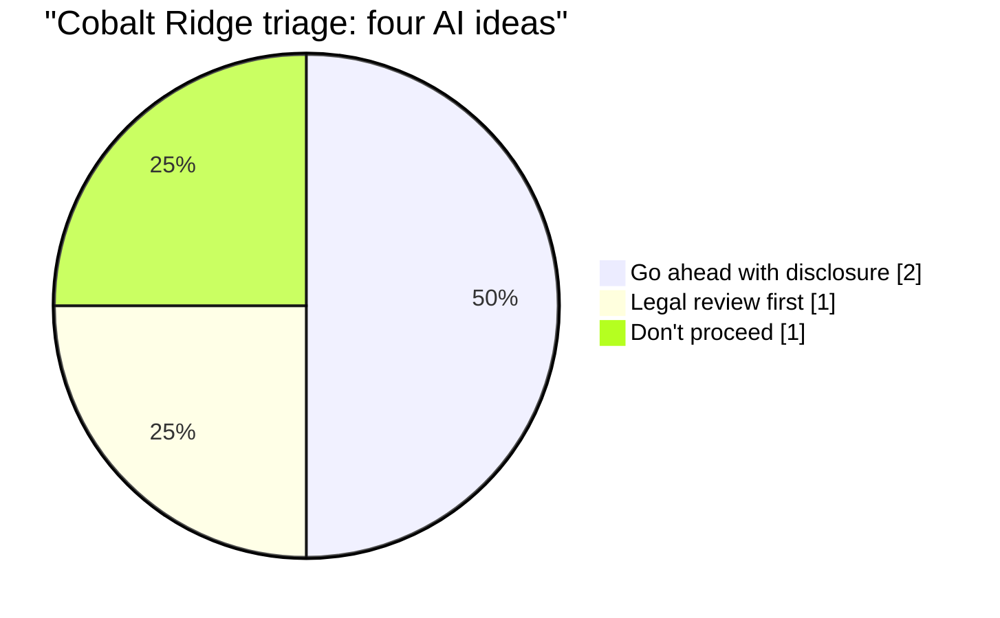

# AI regulation and frameworks
{: .no_toc }

A plain-language map of the EU AI Act, the NIST AI Risk Management Framework, and ISO/IEC 42001: what each one is, who it applies to, and what it asks of everyday AI users.
{: .fs-6 .fw-300 }

  
On this page

  {: .text-delta }
1. TOC
{:toc}

{: .warning }
This page is an orientation, not legal advice. Laws change, and the EU AI Act was amended in July 2026. Everything here was checked against official sources on **2026-10-25**. Before you rely on any rule or date, check the current official text and talk to your organization's legal or compliance team.

## Scenario

**Cobalt Ridge Consulting** (fictional) is a 40-person firm with clients in the United States and the European Union. In one week, three AI ideas land on the managing partner's desk:

1. A chat assistant on the website to answer questions from prospective clients.
2. A tool that screens job applications and ranks candidates for interviews.
3. A short marketing video with an AI-generated presenter who looks like a real person.

A vendor also offers an add-on that "reads candidates' emotions" from video interviews. The partner asks: *Are any of these regulated? Which ones need more than a quick yes?*

## Why it matters

Most everyday AI use, such as drafting an email or summarizing your own notes, isn't specifically regulated. But some uses are, especially when AI affects **people's access to jobs, education, credit, or services**, or when it creates content that could **deceive** people. Business students will meet these rules as employees and managers. Educators already work in one of the areas the EU treats as high-risk: admissions, grading, and exam proctoring.

You don't need to be a lawyer to use AI responsibly. You do need to recognize when a use **might** be regulated, so you can ask the right people before you launch rather than after.

## Key ideas

### Three kinds of rules

| | EU AI Act | NIST AI RMF | ISO/IEC 42001 |
|:--|:--|:--|:--|
| **What it is** | A law of the European Union | A voluntary framework from the U.S. National Institute of Standards and Technology | An international standard for an "AI management system" |
| **Binding?** | Yes, for organizations within its scope | No. NIST describes it as "intended for voluntary use." | Voluntary, unless a contract or customer requires it |
| **Who it's for** | Providers and deployers of AI systems, including some outside the EU whose AI is used there | Any organization that designs, develops, uses, or evaluates AI | Organizations of any size that develop, provide, or use AI |
| **Main idea** | Rules scale with risk: some uses are banned, some are high-risk, some need transparency | Four functions for managing AI risk: Govern, Map, Measure, Manage | Policies, roles, risk assessment, and continual improvement, like other management-system standards |
| **Status (checked 2026-10-25)** | In force since 2024, applying in stages, amended in 2026 | Version 1.0 released 2023-01-26. NIST says it is being revised. | First edition published 2023-12 |

Existing laws still apply to AI too: privacy, consumer protection, anti-discrimination, employment, and copyright law don't stop applying because a tool did the work. In the U.S., rules vary by state and by sector and change often, so check with your organization rather than relying on a summary.

### The EU AI Act's risk tiers

The Act sorts AI uses by risk. Most of what students and educators do with chat assistants falls in the bottom tier, but you should know what sits above it.

Parts that matter most to business and education:

- **AI literacy (Article 4).** Providers and deployers of AI systems must take measures to support the AI literacy of staff and others who operate or use AI systems on their behalf. The Act says this doesn't require guaranteeing any specific level for each person. This guide is one way to build that literacy.
- **Education is a high-risk area (Annex III, point 3).** AI used to decide admissions, evaluate learning outcomes, assess the level of education someone will receive, or monitor students for prohibited behavior during tests.
- **Employment is a high-risk area (Annex III, point 4).** AI used to recruit or select people, filter applications, evaluate candidates, make promotion or termination decisions, allocate tasks based on personal traits, or monitor and evaluate workers' performance.
- **Transparency (Article 50).** People must be told when they're interacting with an AI system, unless it's obvious. Providers of AI that generates synthetic audio, images, video, or text must mark outputs in a machine-readable way. Deployers must disclose deepfakes, and must disclose AI-generated text published to inform the public on matters of public interest.
- **General-purpose AI models (Chapter V).** Separate duties apply to the companies that provide the underlying models. Users of chat assistants usually aren't the ones these duties fall on.

### Key EU AI Act dates

From the consolidated text as amended by Regulation (EU) 2026/1744 (checked 2026-10-25):

{: .note }
The high-risk dates moved in 2026. Older articles, slides, and AI tools trained before the amendment may give the original dates, which is a good example of [knowledge with a date]().

### The NIST AI RMF's four functions

NIST's framework is a useful checklist even where no law requires it, because it describes good practice in plain management terms. NIST has also published a **Generative AI Profile** (NIST-AI-600-1, July 2024) that applies the framework to generative AI.

| NIST function | Where this guide covers it |
|:--|:--|
| Govern | [Third principles](), [Skills and roles]() |
| Map | [Data classification](), [Bias, fairness, and ethics]() |
| Measure | [Building an evaluation test set]() |
| Manage | [Operating AI](), [Human-in-the-loop design]() |

### ISO/IEC 42001 in one paragraph

ISO/IEC 42001:2023 sets out requirements for establishing, implementing, maintaining, and continually improving an **AI management system**. It works like other management-system standards (such as ISO/IEC 27001 for information security): an organization defines policies, assigns responsibilities, assesses risks, and reviews results on a cycle. Because it states requirements, organizations can be audited against it, which is why some customers ask suppliers whether they follow it. Most individuals will never use it directly, but you may work inside an organization that does.

## Worked example

Cobalt Ridge's partner uses a first-pass triage before calling counsel. It's a way to spot which uses need expert review, not a legal conclusion.

| Idea | Likely EU AI Act tier | What it means in practice |
|:--|:--|:--|
| Website chat assistant | Transparency (Art. 50) | Tell visitors they're talking to an AI. The [persona spec]() already requires this. |
| Application screening and ranking | **High-risk** (Annex III, point 4) | Major obligations, applying from 2 December 2027 under the current text. Needs legal review, vendor documentation, human oversight, and [bias testing]() before any EU use. |
| AI presenter who looks like a real person | Transparency (Art. 50) | If the video would look authentic to viewers, disclose that it's AI-generated. Never imitate a real person without consent. See [Images, audio, and video](). |
| "Emotion reading" in interviews | **Possibly prohibited** (Art. 5) | Emotion recognition in the workplace is banned except for medical or safety reasons. Ask counsel whether hiring is covered. Until then, don't buy it. |

**Result:** one idea goes ahead with a disclosure, one goes ahead with a disclosure plus an honesty check on the video, one goes to legal review, and one is dropped. The partner also notes that Cobalt Ridge, as a deployer, has AI literacy duties already in effect, and schedules a training session (see [Running an AI workshop]()).

## Verify checklist

- [ ] I checked whether the use affects people's access to jobs, education, credit, housing, or public services. If yes, I treated it as possibly high-risk and asked for expert review.
- [ ] I checked whether people will interact with the AI or see content it generated, and planned the disclosure.
- [ ] I read the **current** official text or an official summary, not a blog post or an AI answer, and noted the date I checked.
- [ ] I asked the vendor for documentation on how the system was tested, including for bias.
- [ ] I confirmed which laws apply where our users and customers are, not just where we are.
- [ ] I recorded who in the organization owns compliance for this use.

## Common failure modes

| Failure | What it looks like | How to catch it |
|:--|:--|:--|
| **Asking the AI for the law** | A chat assistant gives the original 2024 dates for high-risk duties | Go to the official consolidated text. Regulations change after models are trained. |
| **"We're not in the EU"** | A U.S. firm assumes the Act can't apply, though its EU clients use the tool | Check scope based on where the AI's users and outputs are, and ask counsel. |
| **Treating voluntary as optional** | "NIST is voluntary, so we can skip risk assessment" | Frameworks describe good practice. Customers, insurers, and auditors increasingly expect it. |
| **The vendor said it's compliant** | Relying on a sales claim for a high-risk use | Ask for documentation. As the deployer, you have your own duties. |
| **Regulation as the only ethics test** | "It's legal, so it's fine" | Legal is the minimum. Use the [four ethical questions]() too. |

## Disclose and decide notes

**Disclose:** The transparency rules and this guide's Disclose habit point the same way: people should know when they're dealing with AI and when content is AI-generated. A clear disclosure is good practice even where no law requires it.

**Decide:** Whether a use is legal is a question for qualified people with the current text in front of them. Whether a legal use is a *good idea* is still a business decision someone has to own.

## For educators: turn this into a challenge

Give teams six short AI use cases from a fictional company, such as a chatbot, an application screener, a proctoring tool, a meeting summarizer, a synthetic-voice ad, and an internal drafting tool. Teams place each one in an EU AI Act tier, cite the article or annex, and say what they'd check next. The twist: give half the teams a "summary" handout with the original 2024 dates, and the other half a link to the current consolidated text. Debrief: *Which teams caught the date change? Where did AI tools agree with the outdated handout?* See [Designing an AI-fluency challenge]().

---

**Sources** (checked 2026-10-25)

- Regulation (EU) 2024/1689 (Artificial Intelligence Act), consolidated version including amendments by Regulation (EU) 2026/1744. EUR-Lex: https://eur-lex.europa.eu/eli/reg/2024/1689/oj
- National Institute of Standards and Technology. AI Risk Management Framework (AI RMF 1.0, 2023) and Generative AI Profile (NIST-AI-600-1, 2024): https://www.nist.gov/itl/ai-risk-management-framework
- International Organization for Standardization. ISO/IEC 42001:2023, Information technology — Artificial intelligence — Management system: https://www.iso.org/standard/42001
