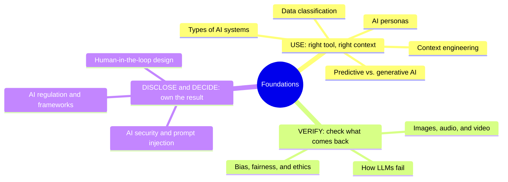

# Foundations

The concepts underneath every task in this guide. Read these when a task page sends you here, or all at once if you want the full picture.
{: .fs-6 .fw-300 }

Each foundation is grouped under the rubric habit it supports most. Most support more than one.

**Use: choose the right tool and give it the right context**

- **Context engineering:** what to give the tool so it can do the job well.
- **Data classification:** what may go into which tool.
- **Types of AI systems:** rules, predictive, perception, generative, and optimization, plus how generative systems are assembled, from plain chat to agents.
- **Predictive models vs. generative AI:** when you need a tested score or forecast, not a chat answer.
- **AI personas:** what role prompts change and don't, designing app personas, and simulated users.

**Verify: check what comes back**

- **How LLMs fail:** hallucination, bad math, stale data, and how to catch each.
- **Images, audio, and video:** reading and generating media, deepfakes, and how to verify.
- **Bias, fairness, and ethics:** swap tests, proxies, ownership, and accountability.

**Disclose and decide: be open about AI's role, and own the result**

- **Human-in-the-loop design:** where people must check, approve, or decide.
- **AI security and prompt injection:** the lethal trifecta, least access, and safe connectors.
- **AI regulation and frameworks:** the EU AI Act, the NIST AI RMF, and ISO/IEC 42001 in plain language.
