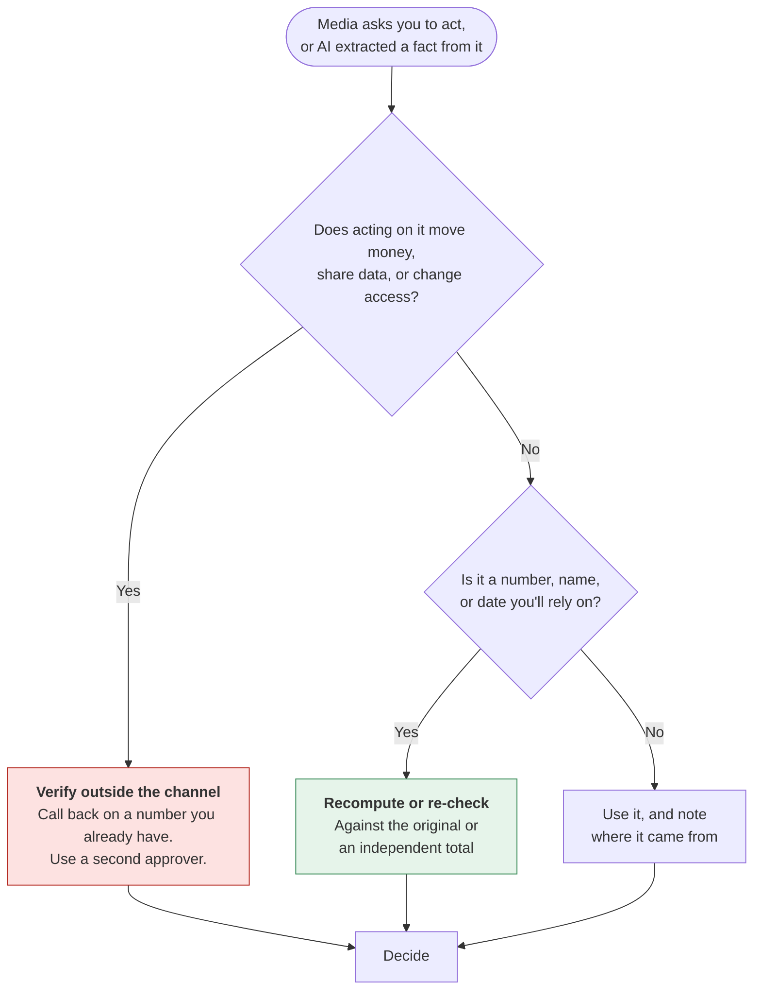
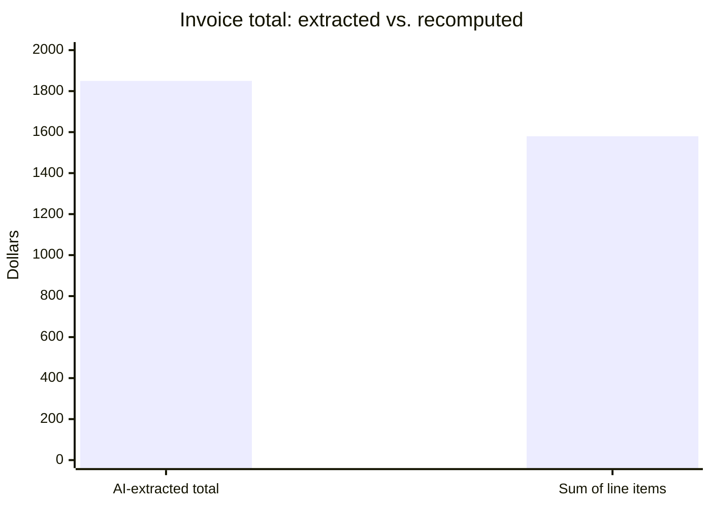

# Images, audio, and video
{: .no_toc }

How AI reads and creates pictures, sound, and video, where each kind fails, and how to check media that might be fake.
{: .fs-6 .fw-300 }

  
On this page

  {: .text-delta }
1. TOC
{:toc}

## Scenario

A busy Monday at **Larkspur Events** (fictional), a small event-planning company:

- The office manager photographs a vendor invoice and asks an AI tool to extract the total for the payment run. It reads **$1,850**.
- An account manager has AI transcribe a client call. The transcript says the client expects **fifty** guests.
- At 4:45 p.m., the finance assistant gets a voicemail that sounds exactly like the owner: *"I'm about to board a flight. Please wire $24,000 to our new venue's account today, details by text. Don't let this slip."*

All three are AI and media problems. Only one involves a deepfake. All three needed the same habit: **check against something outside the media itself**.

## Why it matters

Many AI tools now work with more than text. They can **read** images (receipts, charts, screenshots, handwriting), **listen** (transcription, meeting notes), and **create** images, voices, and video. These features save real time, and they fail in ways that are easy to miss:

- An image reader turns a 5 into an 8 and carries on confidently.
- A transcript reads smoothly even where the audio didn't. Names, numbers, and negatives ("can" vs. "can't") are the usual casualties.
- Generated media can look and sound like real people, which makes fraud cheaper and makes genuine media easier to doubt.

## Key ideas

### What AI does with each kind of media

| Task | Examples | Typical failures | Check against |
|:--|:--|:--|:--|
| **Reading images** | Receipts, invoices, charts, screenshots, whiteboards | Misread digits, wrong row or column, invented values from blurry areas | The original, and any total or cross-check you can recompute |
| **Transcribing audio** | Meetings, interviews, voice notes | Names, numbers, jargon, accents, crosstalk; "fifteen" vs. "fifty" | The recording at that timestamp, or the speaker |
| **Describing video** | Summarizing a lecture or a product demo | Missing what's on screen, confusing who did what | The video itself, at the cited moment |
| **Generating images** | Illustrations, mockups, social graphics | Garbled text, wrong details, look-alikes of real people or brands | Your brief, brand rules, and rights |
| **Generating voice and video** | Narration, avatars, translations | Mispronunciation, a likeness that implies endorsement, deception | Consent, disclosure rules, and your brief |

### The verification habit for media

The general rule from [How LLMs fail]() applies with extra force: **media can't vouch for itself**. A clear voice, a realistic face, or a crisp extracted number is not evidence that it's right or real.

### Deepfakes and voice cloning

A **deepfake** is AI-generated or AI-altered image, audio, or video that makes it look as if a real person said or did something they didn't. For businesses, the most common threat isn't a viral video. It's a **familiar voice or face asking for an urgent exception**: a payment to a new account, a gift-card purchase, a password reset.

Defenses that work don't depend on spotting the fake:

1. **Callback rule.** Any request to move money or change payment details is confirmed by calling a number already on file, never a number in the message.
2. **Two-person rule.** Payments above a threshold need a second approver, whoever asks.
3. **Code words.** Small teams can agree on a phrase for urgent requests.
4. **Permission to slow down.** Leaders say in advance that they'll never punish someone for verifying.

Tools that claim to detect deepfakes give probabilities, not proof, and they miss new techniques. <!-- TODO: source --> Treat a detector as one signal, never as the deciding check.

### Provenance and labels

Some cameras, editing tools, and AI generators can attach **content credentials**, a record of where media came from and how it was edited, using the open C2PA standard. Platforms may also add their own "AI-generated" labels. Both help, but neither is universal yet: a missing label doesn't prove media is real, and labels can be stripped. In the EU, the AI Act requires providers of AI generators to mark synthetic output in a machine-readable way, and requires deployers to disclose deepfakes (see [AI regulation and frameworks]()).

### Creating media responsibly

- **No real people without consent.** Don't generate or clone the likeness or voice of a real person, including colleagues, celebrities, and customers, without their clear permission.
- **No fake evidence.** No AI-generated "customer photos," testimonials, screenshots, or event pictures presented as real.
- **Check rights.** Read the tool's terms on commercial use, and avoid prompts that copy a living artist's style or another company's brand.
- **Check the details.** Look for wrong text, extra fingers, impossible products, and anything that misrepresents what you actually sell.
- **Disclose.** Label AI-generated images, voices, and video where viewers could mistake them for real.

## Worked example

Larkspur's three Monday problems, resolved.

**1. The invoice.** The office manager compares the extracted total with the line items on the same photo:

| Line item | Amount |
|:--|--:|
| Catering | $1,200 |
| Equipment rental | $260 |
| Delivery | $120 |
| **Sum of line items** | **$1,580** |
| AI-extracted total | $1,850 |

The line items add up to **$1,580**, not $1,850. The AI swapped two digits, a **$270 overpayment** if no one had checked. The fix is a standing rule: *extracted totals must equal the sum of extracted line items, or the invoice goes to manual review.*

**2. The transcript.** At $40 per head for catering, fifty guests would cost $2,000 and fifteen would cost $600. The account manager replays that moment of the recording: the client said **fifteen**. Numbers in transcripts that drive costs get checked against the audio, or confirmed by email with the client.

**3. The voicemail.** The finance assistant follows the callback rule and phones the owner on the number in the staff directory. The owner is at their desk and never left the message. No money moves. The team reports the attempt and reminds everyone that payment-detail changes always need a callback and a second approver. See [AI security and prompt injection]() for the same "don't trust the channel" idea applied to AI agents.

## Verify checklist

- [ ] Numbers extracted from images are reconciled with a total or cross-check, or compared with the original.
- [ ] Names, numbers, and commitments in transcripts are checked against the recording or confirmed with the speaker.
- [ ] Requests to move money, share data, or change access are verified through a channel I already trust.
- [ ] Generated media shows no real person, brand, or artwork without permission.
- [ ] Generated images and video were checked for wrong text and misleading details.
- [ ] AI-generated media that could be mistaken for real is labeled.

## Common failure modes

| Failure | What it looks like | How to catch it |
|:--|:--|:--|
| **Trusting a clean extraction** | A neat table from a blurry photo of a receipt | Reconcile totals. Flag low-quality images for manual entry. |
| **Smooth transcript, wrong number** | "Fifty" for "fifteen," "can" for "can't" | Check numbers and negatives against the audio. |
| **Verifying by replying** | Texting the number in the suspicious message to "confirm" | Call back on a number you already have. |
| **Detector as judge** | "The detector says 92% real, so it's fine" | Use process controls (callbacks, approvals) rather than detection alone. |
| **Fake "real" photos** | AI-generated customers in an ad presented as actual customers | Label it, or use real photos with permission. |
| **Look-alike content** | A generated spokesperson who resembles a celebrity | Check likeness and brand resemblance before publishing. |

## Disclose and decide notes

**Disclose:** Say when images, audio, or video are AI-generated or substantially AI-edited, for example: *"Illustration created with an AI image tool and edited by our team."* For extracted data, note the source: *"Figures transcribed from photographed invoices by AI and reconciled with line items."*

**Decide:** People decide what counts as verified, who may approve exceptions, and whether a piece of generated media is honest enough to publish. A convincing voice is never an approval.

## For educators: turn this into a challenge

Prepare a packet of six items: two photographed receipts (one with an extraction error), a short audio clip with an AI transcript containing one wrong number, an AI-generated product image with garbled text, and a fictional "urgent request from the dean" email with a voice-note link. Teams decide what to trust, what to check, and how, and write the standing rule they'd adopt for each. Debrief: *Which checks depended on spotting the fake, and which worked even if you couldn't tell?* See [Designing an AI-fluency challenge]().
