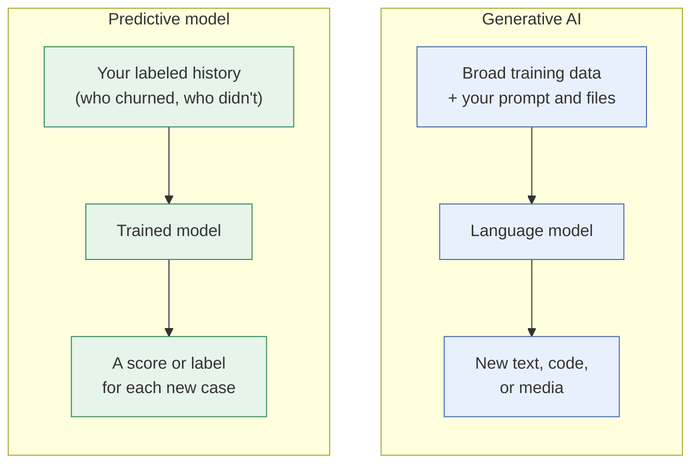
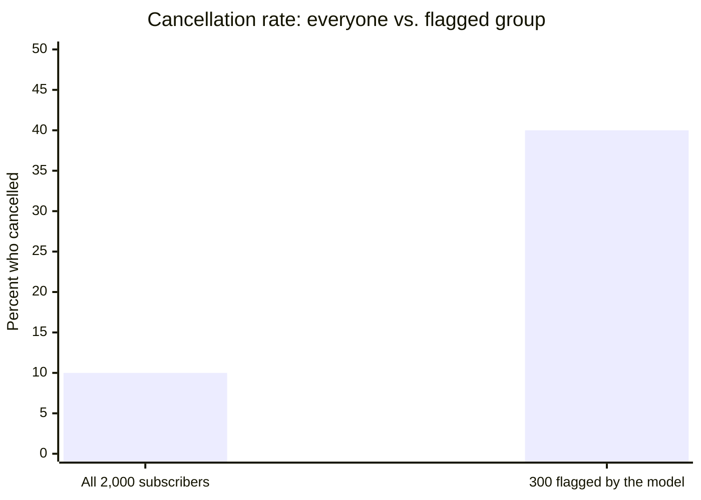

# Predictive models vs. generative AI
{: .no_toc }

Two kinds of AI that solve different problems: when you need a model that scores, classifies, or forecasts from your own data, and when a chat assistant is the right tool.
{: .fs-6 .fw-300 }

  
On this page

  {: .text-delta }
1. TOC
{:toc}

## Scenario

The subscriptions manager at **Pinecrest Pet Supply** (fictional) wants to know which subscribers are likely to cancel next month, so the team can offer them a discount first. They paste 50 rows of customer data into a chat assistant and ask, *"Which of these customers will churn?"*

The assistant returns a confident list of 12 names, each with a reason: "only two orders in the last quarter," "recently contacted support." It reads well. But no one can say how often lists like this are right, because it has never been tested against what actually happened.

## Why it matters

"AI" covers two families of tools that are easy to confuse:

- **Predictive models** (traditional machine learning) learn patterns from your own historical data to produce a **number or a label**: a churn probability, a fraud flag, a sales forecast, a product recommendation.
- **Generative AI** (including large language models) learns from huge amounts of general text and media to produce **new content**: drafts, summaries, code, explanations, images.

Business decisions such as who to call, what to stock, and which transactions to review usually need the first kind, and they need it **measured**. A chat assistant can *talk about* your data convincingly without being a tested predictor of it.

## Key ideas

### Two families, compared

| | Predictive model | Generative AI |
|:--|:--|:--|
| **Output** | A number, probability, or category | Text, code, images, audio |
| **Learns from** | Your organization's historical examples with known outcomes | Broad public and licensed data, plus whatever you provide in context |
| **How you judge it** | Accuracy on data it hasn't seen, compared with a simple baseline | Human review, and a [test set]() for repeated tasks |
| **Repeatability** | The same input gives the same score | Outputs can vary between runs |
| **Typical uses** | Churn, fraud, credit risk, demand forecasts, recommendations, anomaly detection | Drafting, summarizing, explaining, coding, tagging text |
| **Who usually builds it** | A data analyst or data scientist, or a feature built into business software | Anyone, through an app or API |

### Common predictive tasks

| Task | Question it answers | Business example |
|:--|:--|:--|
| **Classification** | Which group does this belong to? | Will this subscriber cancel: yes or no? |
| **Regression** | How much? | What will this customer spend next year? |
| **Forecasting** | What happens next over time? | How many units will we sell each week next quarter? See [Forecasting and A/B tests](). |
| **Clustering** | Which cases are similar? | What customer segments do we have? |
| **Anomaly detection** | What's unusual? | Which expense claims look out of pattern? |
| **Recommendation** | What will this person want? | Which product to show next? |

### Where generative AI helps with prediction

Generative AI is a strong **assistant** to predictive work even when it shouldn't be the predictor:

- Writing and explaining the code or spreadsheet formulas for a model.
- Suggesting possible features (inputs), which you then test.
- Turning messy text into structured data, such as tagging support tickets by topic, which then becomes an input to a model. See [Customer feedback analysis]().
- Explaining model results in plain language for a business audience, which you then check.

### Five ideas that decide whether a prediction is any good

1. **Hold-out testing.** Judge a model on past cases it wasn't trained on, where you already know what happened.
2. **A baseline.** Compare it with a simple rule, such as "predict that nobody churns" or "next month equals last month." A model that can't beat the baseline isn't worth using.
3. **Base rate.** If only 10% of customers churn, a list of "likely churners" should do much better than 10% to be useful.
4. **Precision and recall.** *Precision:* of the cases flagged, how many were right? *Recall:* of the real cases, how many were flagged? Improving one usually costs some of the other.
5. **Leakage.** A model that sees information it wouldn't have at prediction time, such as a "cancellation reason" field, looks brilliant in testing and fails in real use.

## Worked example

Pinecrest's analyst builds a simple predictive model on two years of subscriber history, then tests it on **2,000 subscribers** from a recent month it didn't train on. In that month, **200 of them (10%)** actually cancelled.

The model flags **300** subscribers as at risk. **120** of those actually cancelled.

| | Actually cancelled | Stayed | Total |
|:--|--:|--:|--:|
| **Flagged** | 120 | 180 | 300 |
| **Not flagged** | 80 | 1,620 | 1,700 |
| **Total** | 200 | 1,800 | 2,000 |

- **Precision:** 120 ÷ 300 = **40%** of flagged subscribers cancelled, four times the 10% base rate.
- **Recall:** 120 ÷ 200 = **60%** of cancellations were caught.
- **Accuracy:** (120 + 1,620) ÷ 2,000 = **87%**, which is *lower* than the 90% you'd get by predicting that nobody cancels.

That last line is the classic trap: **accuracy is misleading when one outcome is rare.** The useful question is what the model is worth to the business.

**The business case.** A retention offer costs **$10** per subscriber who gets it. The team estimates that the offer keeps **25%** of the subscribers who would otherwise cancel, and that each one kept is worth **$120** in margin.

| Plan | Offer cost | Subscribers kept | Value kept | Net |
|:--|--:|--:|--:|--:|
| No offers | $0 | 0 | $0 | $0 |
| Offer to the 300 flagged | $3,000 | 120 × 25% = 30 | $3,600 | **+$600** |
| Offer to all 2,000 | $20,000 | 200 × 25% = 50 | $6,000 | **−$14,000** |

Targeting with the model comes out ahead; blanket discounts lose money. The result also depends heavily on the **25% estimate**, so the team plans a small test to measure it (see [Forecasting and A/B tests]()).

**And the chat assistant's list of 12?** It may contain good hunches, but it can't be trusted until it's been tested the same way: on past customers whose outcomes are known. The manager keeps the assistant for what it's good at: explaining the model's results and drafting the retention email.

## Verify checklist

- [ ] I'm clear whether this task needs a score or label (predictive) or content (generative).
- [ ] The model was tested on data it wasn't trained on, with known outcomes.
- [ ] It was compared with a simple baseline, and it beats it.
- [ ] I looked at precision and recall, not just accuracy, especially for rare outcomes.
- [ ] No input contains information that wouldn't be available at prediction time.
- [ ] The business value was calculated, including the cost of false alarms.
- [ ] Predictions about people were checked for bias across groups. See [Bias, fairness, and ethics]().

## Common failure modes

| Failure | What it looks like | How to catch it |
|:--|:--|:--|
| **Chat assistant as predictor** | "The AI says these 12 customers will churn" | Test any predictor on past cases with known outcomes. |
| **The accuracy trap** | "87% accurate!" when doing nothing scores 90% | Compare with the baseline. Use precision and recall. |
| **Leakage** | A near-perfect test score that collapses in real use | For each input, ask: would we know this at prediction time? |
| **Ignoring the cost of errors** | Flagging many customers without counting wasted offers | Put both kinds of error into the business case. |
| **Stale models** | Last year's model, used after prices and products changed | Re-test on recent data on a schedule. See [Operating AI](). |
| **Proxies for protected traits** | A credit or hiring model that relies on zip code | Test outcomes across groups, and remove proxies. Hiring and credit uses may also be regulated. See [AI regulation and frameworks](). |

## Disclose and decide notes

**Disclose:** When you present predictions, say how the model was tested and how often it was right: *"Of subscribers the model flagged last month, 40% cancelled, compared with 10% overall."* That's more honest, and more persuasive, than "the AI predicts."

**Decide:** A model produces a score. People decide the threshold, what action follows, and what happens to the people affected by a wrong score. When the decision affects someone's job, credit, or education, a person should be able to review it. See [Human-in-the-loop design]().

## For educators: turn this into a challenge

Give teams the confusion table above with the numbers removed, plus the offer cost, save rate, and margin. Ask them to (1) compute precision, recall, and accuracy, (2) explain why accuracy misleads here, and (3) find the save rate at which targeting the 300 flagged subscribers breaks even. The answer is $3,000 ÷ (120 × $120), or about **20.8%**: below that, even targeted offers lose money. Debrief: *Which number would you show a manager first, and why?* See [Designing an AI-fluency challenge]().
