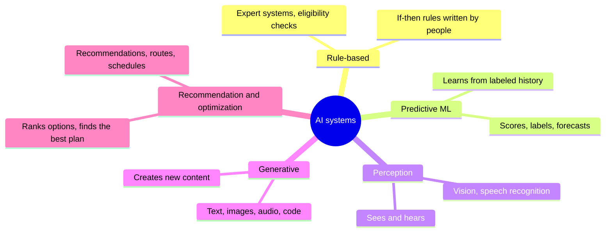
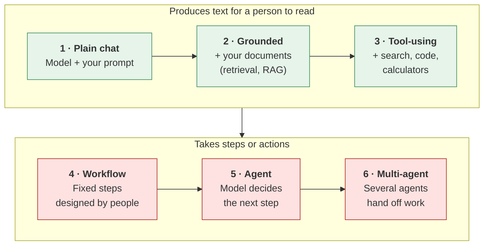

# Types of AI systems
{: .no_toc }

A map of the systems people call "AI": what each kind does, how it's assembled, how it fails, and the one question to ask before you trust it.
{: .fs-6 .fw-300 }

  
On this page

  {: .text-delta }
1. TOC
{:toc}

## Scenario

In one month, **Pinecrest Pet Supply** (fictional) hears "AI" in six different pitches and meetings: a fraud-flagging feature from the payment processor, a camera system that checks warehouse orders, product recommendations on the website, a customer-support chat assistant, a delivery route planner, and an email tool advertised as "AI-powered sorting."

The operations director's question is simple: *Are these the same kind of thing? Do we check them all the same way?* The answer is no, and treating them as one category is how organizations end up over-trusting some and under-using others.

## Why it matters

"AI" is a label, not a description. The systems behind it differ in what they learn from, what they produce, and how they go wrong:

- A **predictive model** can be measured precisely against past outcomes.
- A **generative model** can sound right while being wrong, and needs human review.
- A **rule-based** system does exactly what it was told, including the mistakes in its rules.
- An **agent** can take actions, so its errors can have effects, not just produce wrong words.

Knowing which kind you're dealing with tells you what to ask a vendor, how to check the output, and how much oversight it needs. The rest of this guide focuses on generative AI; this page shows where it sits among the others.

## Key ideas

### Lens 1: how it works

| Family | What it does | Business examples | How it typically fails | How to check it |
|:--|:--|:--|:--|:--|
| **Rule-based** | Follows if-then rules people wrote | Eligibility checks, approval routing, email filters | Rules miss cases or go out of date | Test edge cases. Review the rules when policies change. |
| **Predictive (machine learning)** | Learns patterns from historical examples to score or label new cases | Churn, fraud, credit risk, demand forecasts | Learns past bias. Drifts as conditions change. Leakage. | Hold-out testing against a baseline. See [Predictive models vs. generative AI](). |
| **Perception** | Turns images, video, or audio into data | Barcode and defect checks, receipt reading, transcription | Lighting, accents, unusual items. Confident misreads. | Reconcile with totals. Spot-check samples. See [Images, audio, and video](). |
| **Generative** | Produces new text, images, audio, or code | Drafting, summarizing, chat assistants, coding help | Fluent but wrong: hallucination, agreeableness, stale facts | Human review and a test set. See [How LLMs fail](). |
| **Recommendation and optimization** | Ranks options or searches for the best plan under constraints | Product recommendations, delivery routes, staff schedules | Optimizes the wrong goal. Popularity loops. Ignores unstated constraints. | Check the objective and constraints. Compare with a simple plan. |

Many real products **combine** families. A support assistant might use perception (reading a photo of a damaged item), generative AI (writing the reply), and rules (refunds over $50 go to a person).

{: .note }
A rule-based system isn't a worse kind of AI. When the logic is clear and stable, rules are cheaper, more predictable, and easier to audit than a model. Some tools marketed as "AI" are rules, and that can be a good thing. See [Should you use AI here?]().

### Lens 2: how a generative AI system is put together

Most generative AI you'll meet at work isn't a bare model. It's a model wrapped in other parts. Each step up this ladder adds capability, and adds something to check.

| Level | What's added | New thing to check | Where this guide covers it |
|:--|:--|:--|:--|
| 1 · Plain chat | Nothing: the model and your prompt | Facts, math, and sources | [Context engineering]() |
| 2 · Grounded | Retrieval from documents you provide | Did it find the right passage, and stay within it? | [Software and infrastructure]() |
| 3 · Tool-using | Web search, code execution, calculators | Which sources and code did it actually use? | [Research-to-brief]() |
| 4 · Workflow | A fixed sequence of AI and non-AI steps | Errors carried from one step to the next | [Automate or judge?]() |
| 5 · Agent | The model chooses steps and uses tools on its own | What can it reach and change, and can you undo it? | [AI security and prompt injection]() |
| 6 · Multi-agent | Several agents with different roles | Who is accountable for the combined result? | [Human-in-the-loop design]() |

Two other forms are common:

- **AI features inside software you already use**, such as a "summarize" button in email or a "suggest formula" option in a spreadsheet. These are usually levels 1–3 under the hood. The same checks apply, even though it doesn't feel like "using AI."
- **Custom assistants**: a model plus standing instructions and files (level 2), set up for one job. See [Building a custom assistant]().

### Five questions for any "AI" pitch

1. **What kind of system is it?** Rules, predictive, perception, generative, optimization, or a mix?
2. **What does it learn from, or what does it read?** Our data, public data, or both? Where does our data go?
3. **How was it tested, and against what baseline?** Ask for results on cases like ours.
4. **What happens when it's wrong?** Who notices, how fast, and what's the cost?
5. **Who can override it, and can we undo what it does?**

## Worked example

The operations director sorts Pinecrest's six "AI" systems with the two lenses, then picks the check each one needs:

| System | Family | How it's assembled | The check that fits |
|:--|:--|:--|:--|
| Payment fraud flags | Predictive | Vendor model, scores each order | Ask the vendor for precision and recall. Review a monthly sample of flagged and unflagged orders. |
| Warehouse camera checks | Perception | Camera + vision model | Compare with manual counts on a weekly sample of orders. |
| Website product recommendations | Recommendation | Ranks products for each visitor | Check what it optimizes (clicks? margin?). Compare sales with a simple "bestsellers" list in a test. |
| Support chat assistant | Generative + rules | Level 2, grounded in the help center, with refund rules | Test set of 20 conversations. See [AI personas](). |
| Delivery route planner | Optimization | Searches routes under time windows | Check the constraints it knows about (driver breaks, truck size). Compare with last month's routes. |
| "AI-powered" email sorting | Rule-based | Keyword rules, no model | Review the rules. It's useful, predictable, and doesn't need model monitoring. |

**What changed:** before, all six were filed under "AI" and nobody owned their checks. After sorting, each system has a named owner and a check that fits its family. Two findings stood out: the recommendation engine was optimizing **clicks**, not margin, so it kept promoting low-margin toys; and the "AI" email sorter turned out to be keyword rules, which the team kept because it worked and needed no monitoring.

## Verify checklist

- [ ] I can say which family (or families) a system belongs to.
- [ ] For generative systems, I know the assembly level: plain, grounded, tool-using, workflow, agent, or multi-agent.
- [ ] The check I'm using fits that family: hold-out testing for predictive, sample reconciliation for perception, human review and test sets for generative, objective and constraint review for optimization.
- [ ] I asked the vendor the five questions, and got answers in writing.
- [ ] Systems that can take actions have limited access and an undo path.
- [ ] Each system has a named owner.

## Common failure modes

| Failure | What it looks like | How to catch it |
|:--|:--|:--|
| **One label, one check** | Reviewing a fraud model's output the way you'd proofread an email | Identify the family first, then choose the check. |
| **Chat assistant as a calculator or predictor** | Asking a generative tool to forecast or score | Use predictive models or a spreadsheet. See [second principle C](). |
| **"AI-washing"** | A rules engine sold at an AI price, or as smarter than it is | Ask what kind of system it is and what it learns from. |
| **Wrong objective** | Recommendations that maximize clicks while margin falls | Ask what the system optimizes, and whether that matches the business goal. |
| **Invisible AI** | A "summarize" button nobody thinks of as AI | Treat built-in features as AI for data and verification purposes. |
| **Jumping levels** | Going straight from plain chat to an agent with email access | Climb one level at a time, testing each. See the [learning ladder](). |

## Disclose and decide notes

**Disclose:** Be specific about the kind of AI involved. *"Orders were flagged by the payment processor's fraud model and reviewed by our team"* tells readers far more than *"AI flagged these orders."* Specific disclosure also makes it clearer who checked what.

**Decide:** Choosing which kind of system fits a problem, including choosing rules or a person over AI, is a design decision someone owns. So is deciding how much a system may do without approval. See [Automate or judge?]().

## For educators: turn this into a challenge

Give teams ten short descriptions of "AI" features from a fictional company, written in marketing language ("intelligent," "smart," "AI-powered"). Teams classify each by family and, for generative systems, by assembly level, then choose the check that fits. Plant two features that are actually simple rules, and one generative feature being used to make predictions. Debrief: *Which descriptions hid what the system really was? Which question exposed it fastest?* See [Designing an AI-fluency challenge]().
