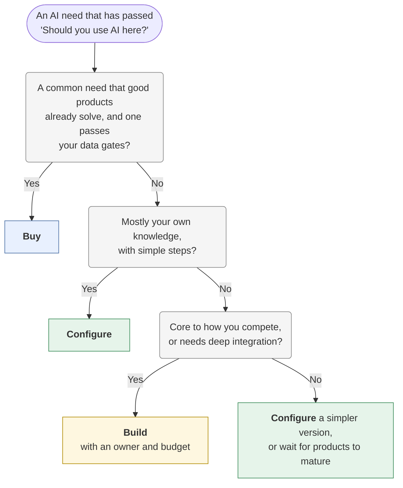
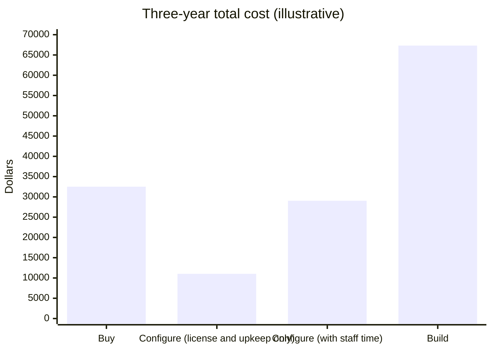

# Build, buy, or configure
{: .no_toc }

Three ways to get an AI capability (buy a product, configure a tool you already have, or build your own), and how to compare them on total cost, control, and who keeps them running.
{: .fs-6 .fw-300 }

<details open markdown="block">
  <summary>On this page</summary>
  {: .text-delta }
1. TOC
{:toc}
</details>

## Scenario

**Brightline Tax Advisors** (fictional), a 25-person accounting firm, wants AI help summarizing the documents clients send each season: engagement letters, prior-year returns, and notices from tax authorities. Three proposals reach the managing partner:

- **Buy:** a vendor's document-AI product that connects to the firm's document system.
- **Configure:** a custom assistant set up on the AI platform the firm already licenses.
- **Build:** a contractor builds a custom tool on an AI provider's API.

Each proposal comes with a price. None of the prices count the same things.

## Why it matters

The sticker price is usually the smallest part of the cost. What separates the options is everything around it: setup time, the staff time the tool saves or adds, upkeep, review, and what happens when you want to leave. Choosing on license price alone tends to pick the option whose costs are hidden best.

Control matters too. Each option gives you a different level of say over where data goes, how the tool behaves, and how quickly you can fix it.

## Key ideas

### The three options

| | Buy | Configure | Build |
|:--|:--|:--|:--|
| **Time to start** | Days to weeks | Hours to days | Weeks to months |
| **Upfront cost** | Low to medium (setup, contract) | Low (staff time) | High (developer time) |
| **Ongoing cost** | Subscription, often per user | Platform license you may already pay, plus upkeep time | API usage, hosting, and maintenance |
| **Fit to your process** | The vendor's design | Good for knowledge and simple workflows; limited integrations | Whatever you build |
| **Data control** | Vendor terms (a gate to check) | Your platform's terms | Highest, within the API provider's terms |
| **Who fixes it** | The vendor, on their schedule | Your staff | Your developers, or a contractor |
| **Exit** | Depends on export rights and contract | Instructions and files are portable | You own the code, and still depend on the API |

None of these is "safer" by default. Buying moves the build work to a vendor but keeps the checking and data decisions with you. Building gives you control and makes you the operator. See [Running AI]() for what each option needs in hardware and skills.

### Which one fits?

Start only once you've decided AI is the right approach at all; sometimes rules, plain automation, or a person is better (see [Should you use AI here?]()).



Rules of thumb:

- **Buy** common needs, such as meeting notes, transcription, and grammar, where products are mature and many organizations need the same thing.
- **Configure** when the value is in your own knowledge: policies, course materials, house style. See [Building a custom assistant]().
- **Build** only when the capability is core to what makes you different, needs integrations no product offers, or runs at a volume where per-user pricing gets expensive. Budget for the people to run it, not just to build it.

### Count the total cost

Compare options over the same period (often three years) and count the same things for each:

| Cost | Buy | Configure | Build |
|:--|:--|:--|:--|
| Licenses or subscriptions | ● | ● (if not already paid) | |
| AI usage (tokens) | Often included | Often included | ● |
| Setup and build time | ● | ● | ●● |
| Maintenance and updates | ● | ● | ●● |
| **Staff time to use it** (uploading, copying, reformatting) | ● | ● | ● |
| Review time for outputs | ● | ● | ● |
| Evaluation and testing | ● | ● | ● |
| Exit cost (migrating data and people) | ● | | ● |

Staff time is the line most often left out. A tool that's cheap to license but makes 25 people copy files by hand isn't cheap.

## Worked example

Brightline compares the three proposals over **three years (36 months)**. Staff time is valued at **$60 an hour** and contractor time at **$120 an hour**. All figures are illustrative.

| Cost item | Buy | Configure | Build |
|:--|--:|--:|--:|
| License | $30 per user × 25 users × 36 months = **$27,000** | Already licensed: **$0** | — |
| Setup or build | 20 hours × $60 = **$1,200** | 40 hours × $60 = **$2,400** | 300 hours × $120 = **$36,000** |
| AI usage | Included | Included | $150 a month × 36 = **$5,400** |
| Maintenance | 2 hours a month × $60 × 36 = **$4,320** | 4 hours a month × $60 × 36 = **$8,640** | 6 hours a month × $120 × 36 = **$25,920** |
| Staff upload time | Connects to the document system: **$0** | 25 staff × 10 documents a month × 2 minutes = 500 minutes ≈ 8.3 hours a month × $60 × 36 = **$18,000** | Connects: **$0** |
| **Three-year total** | **$32,520** | **$29,040** | **$67,320** |



**What the numbers show:**

- Counting only licenses and upkeep, **configure looks three times cheaper than buy** ($11,040 vs. $32,520). Counting the staff time spent uploading documents by hand, the gap shrinks to **$3,480**.
- **Build costs about twice as much as either** and gives Brightline nothing it needs: document summaries aren't how a tax firm competes.
- With cost nearly a tie, the decision turns on things the table doesn't show. The vendor's data terms must pass review for confidential client documents (see [Data classification]()). The configured assistant keeps documents in a platform the firm has already approved.

**Decision:** configure a custom assistant for a three-month pilot with one team, and run it through the [10-point check]() first. In parallel, ask the vendor for its data terms and test results on sample documents. If the pilot works and upload time proves to be the main pain, switch to buying, with a clear exit path.

## Prompt template

Use AI to structure the comparison, then fill in real figures yourself:

```text
We're deciding whether to buy, configure, or build an AI capability:
[WHAT IT SHOULD DO, WHO USES IT, AND HOW OFTEN].
Data involved: [DATA CLASS]. Comparison period: [e.g. 3 years].

1. Make a total-cost table for buy, configure, and build with these rows:
   licenses, AI usage, setup or build, maintenance, staff time to use it,
   review time, evaluation, and exit cost. Leave the amounts blank for me
   to fill in, and note what information I need for each.
2. List the non-cost questions for each option: data terms, fit, lock-in,
   who maintains it, and what happens if the vendor or builder disappears.
3. List the questions to ask a vendor before buying.
Don't estimate prices; I'll get real quotes.
```

## Verify checklist

- [ ] I first checked that AI is the right approach at all.
- [ ] All options are compared over the same period, with the same cost rows.
- [ ] Staff time to use each option, and review time, are included.
- [ ] Each option passed the data and approval gates before cost was compared.
- [ ] I know who maintains each option, and what happens if that person or vendor goes away.
- [ ] There's an exit plan: how to get our data and instructions out.
- [ ] The choice starts with a pilot and goes through the [demo-to-dependable check]().

## Common failure modes

| Failure | What it looks like | How to catch it |
|:--|:--|:--|
| **Sticker-price decisions** | Choosing the lowest license fee | Compare full totals, including staff time. |
| **Building what you could buy** | A custom tool for a common need | Ask whether it's core to how you compete. |
| **Buying what you can't check** | A vendor tool with no test results on your cases | Ask for evidence, and run your own test set. |
| **Forgetting maintenance** | A built tool that nobody updates after the contractor leaves | Budget ongoing hours and name an owner. |
| **Lock-in by default** | No way to export data or instructions | Check export rights before signing. |
| **Comparing different things** | One quote for one year, another for three | Same period, same cost rows for every option. |

## Disclose and decide notes

**Disclose:** Show the full comparison, including the assumptions, when you recommend an option: *"Configure is about $3,500 cheaper over three years once staff upload time is included; the deciding factor was data terms."* State which figures are estimates.

**Decide:** The numbers narrow the choice. The decision also weighs control, risk, and strategy, and belongs to the person accountable for the budget and the outcome.

## For educators: turn this into a challenge

Give teams a fictional organization, an AI need, and three proposals with deliberately inconsistent pricing: one quote per user per month, one as a one-time build fee, and one leaving out staff time. Teams build a three-year comparison with the same rows for every option, then make a recommendation that includes at least one non-cost factor. Plant one hidden cost, such as manual uploads or a missing maintenance line. Debrief: *Did the cheapest-looking option stay cheapest? What did the decision come down to?* See [Designing an AI-fluency challenge]().
