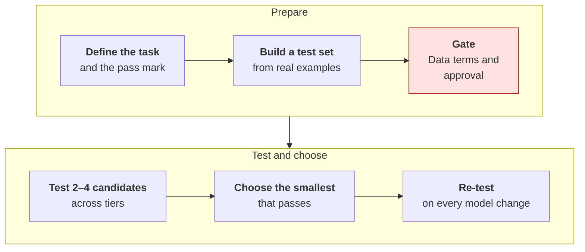
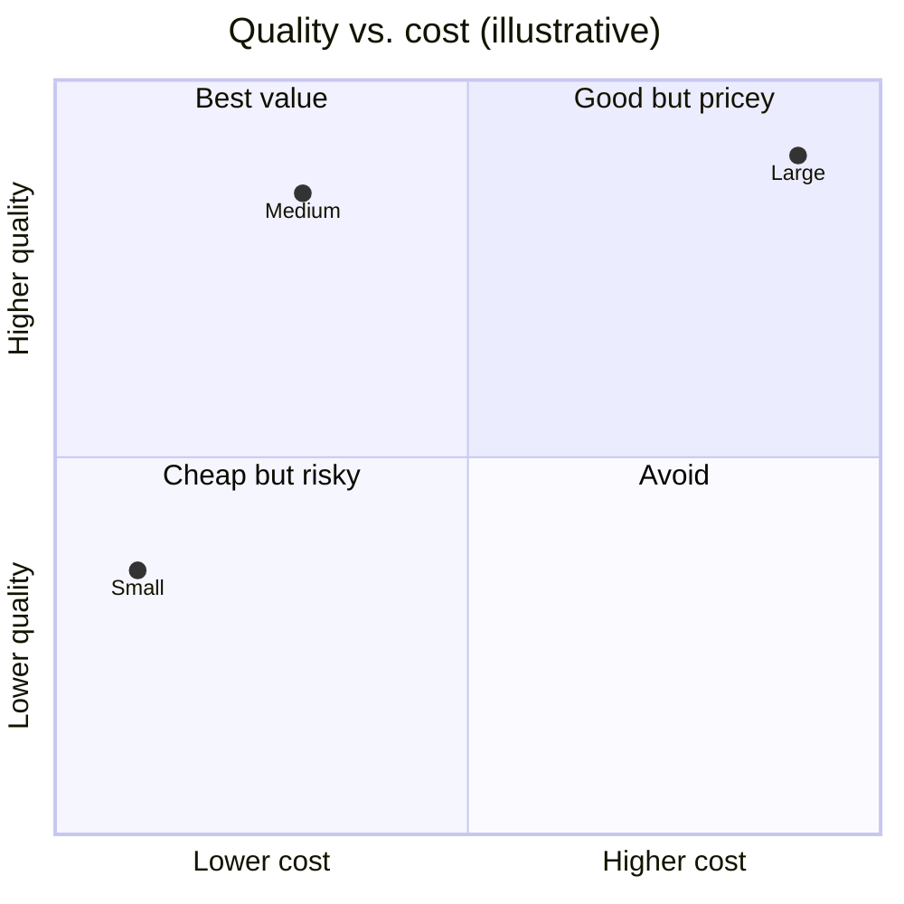
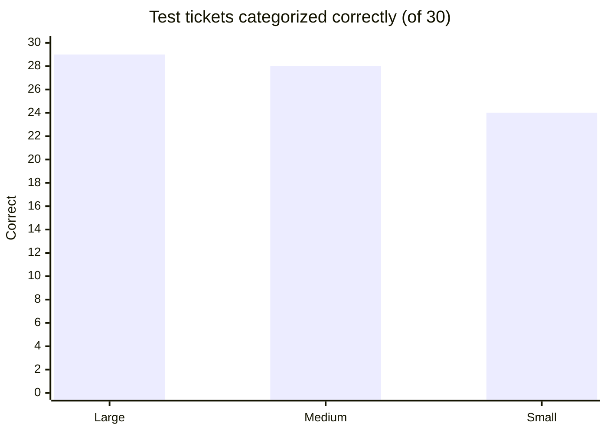

# Choosing a model
{: .no_toc }

A vendor-neutral way to pick an AI model for a task: define what "good enough" means, test a few candidates on your own examples, and choose the smallest one that passes.
{: .fs-6 .fw-300 }

<details open markdown="block">
  <summary>On this page</summary>
  {: .text-delta }
1. TOC
{:toc}
</details>

## Scenario

**Pinecrest Pet Supply** (fictional) wants AI to sort incoming support tickets into categories (order status, billing, product question, subscription change, urgent) so each one reaches the right team. The developer's first instinct is to use the newest, largest model available: "It's the best, so it's safest."

The operations manager asks three questions: *Best at what? How much more does it cost per ticket? How long will customers wait?* Nobody can answer yet.

## Why it matters

Model choice affects quality, cost, speed, and where your data goes, all at once. Leaderboards and launch announcements rank models on general tests, which may not resemble your task. A model that's best overall can be slower and more expensive than you need, and a cheaper model can be just as good on a narrow, well-defined job.

The question isn't "which model is best?" It's **"which model is good enough for this task, at a cost and speed we can live with, under data terms we can accept?"** Only your own examples can answer that.

## Key ideas

### What actually differs between models

| Dimension | What it means | Why it matters |
|:--|:--|:--|
| **Capability tier** | Providers usually offer large, medium, and small models | Larger models tend to handle harder reasoning and ambiguity. Smaller ones are faster and cheaper. |
| **Reasoning mode** | Some models can "think" longer before answering | Helps on multi-step problems, but adds time and tokens. |
| **Context window** | How much text it can consider at once | Matters for long documents. See [Tokens and usage](). |
| **Modalities** | Text only, or images, audio, and video too | See [Images, audio, and video](). |
| **Open-weight vs. hosted only** | Whether you can run it yourself | Affects data control and cost pattern. See [Running AI](). |
| **Data terms** | Retention, training on inputs, region | A gate, not a trade-off. See [Data classification](). |
| **Price and speed** | Cost per token, and time to respond | Multiply by your volume. |

### The selection process



1. **Define the task and the pass mark.** For example: "Categorize tickets correctly at least 90% of the time, with no misses on urgent tickets."
2. **Build a test set from real examples** (de-identified if needed), including hard and high-stakes cases. See [Building an evaluation test set]().
3. **Apply the gates first.** Models whose data terms you can't accept, or that your organization hasn't approved, are out before testing starts. See [Evaluating an AI tool]().
4. **Test two to four candidates across tiers**, using the same instructions for each.
5. **Choose the smallest model that passes** on quality, then compare cost and speed.
6. **Re-test whenever a model version changes.** See [Operating AI]().

{: .note }
This page doesn't name models or providers, because they change too quickly. For named, dated examples of current tools, see the [Product landscape]().

## Worked example

Pinecrest builds a **30-ticket test set** from last month's tickets, with names and order numbers removed. **Five** of the 30 are urgent (a pet health concern, a suspected fraudulent charge, and similar). The pass mark: **at least 27 of 30 correct (90%), and all 5 urgent tickets correct.**

They test three models from one approved provider, one from each tier. Prices are illustrative.

| Model tier | Correct (of 30) | Urgent correct (of 5) | Cost per 1,000 tickets | Typical response time | Passes? |
|:--|--:|--:|--:|--:|:--:|
| Large | 29 (96.7%) | 5 | $4.00 | 6 seconds | ✓ |
| Medium | 28 (93.3%) | 5 | $1.00 | 2 seconds | ✓ |
| Small | 24 (80.0%) | 3 | $0.20 | 1 second | ✗ |



**Reading the results:**

- **Small fails** on both counts. Worse than its overall score, it missed **two of five urgent tickets**. One high-stakes miss matters more than several minor ones.
- **Large and medium both pass.** Large got one more ticket right. Both missed the same ambiguous "billing or refund?" ticket, which the team decides to treat as a category-definition problem, not a model problem.
- **Cost:** at 20,000 tickets a month, large costs about **$80** a month and medium about **$20**, so medium is a quarter of the price. Here the money is small either way; the bigger difference is speed.
- **Speed:** tickets are routed while the customer waits for a confirmation, so 2 seconds vs. 6 matters.

**Decision:** use the medium model. Re-run the 30-ticket test whenever the provider updates it, and add every misrouted urgent ticket to the test set.



### Routing: when one model isn't the answer

Some teams send most requests to a smaller model and pass only hard or uncertain ones to a larger one. This can cut costs on high volumes, but it adds a decision point that must be tested too: *how does the system know a request is hard?* Start with one model, and add routing only when volume makes the savings worth the complexity.

## Prompt template

Use AI to help design the comparison, not to pick the winner:

```text
I need to choose an AI model for this task: [TASK, in one or two sentences].
Volume: [REQUESTS PER DAY/MONTH]. Response time needed: [SECONDS].
Data involved: [DATA CLASS, e.g. Internal, de-identified].
Pass mark: [e.g. 90% correct, and zero misses on CRITICAL CASES].

1. Suggest 25–40 test cases I should collect, including hard and high-stakes ones.
2. Give me a scoring sheet: columns for each test case, the expected answer,
   each model's answer, and correct/incorrect.
3. List what to compare beyond accuracy (cost, speed, data terms, consistency).
4. Don't recommend specific models. I'll test the ones my organization has approved.
```

## Verify checklist

- [ ] The pass mark was written down before testing, including any cases that must never be wrong.
- [ ] The test set uses real (de-identified) examples, including hard and high-stakes ones.
- [ ] Every candidate passed the data and approval gates before testing.
- [ ] All candidates got the same instructions and the same test cases.
- [ ] I chose the smallest model that passed, and calculated cost at our real volume.
- [ ] Response time was measured, not assumed.
- [ ] There's a plan to re-test when the model version changes.

## Common failure modes

| Failure | What it looks like | How to catch it |
|:--|:--|:--|
| **Leaderboard shopping** | "It ranked first on a benchmark, so it's best for us" | Test on your own examples. |
| **Biggest by default** | Paying for the large model on a simple sorting task | Always include a smaller candidate. |
| **Counting, not weighting** | Choosing on overall score while missing urgent cases | Set "must never miss" cases and check them separately. |
| **Testing one example** | "I tried it on one ticket and it was great" | Use a test set of 25 or more. |
| **Data terms after the fact** | Choosing the best performer, then discovering it can't take your data | Gates come first. |
| **Set and forget** | Quality drops silently after a provider update | Re-run the test set on every change. |

## Disclose and decide notes

**Disclose:** Record which model and version a workflow uses, the test results it was chosen on, and the date. When someone asks "why this model?", the answer is a table, not a preference.

**Decide:** The pass mark, which errors are unacceptable, and how much to pay for quality or speed are business decisions. Test results inform them, but someone has to own the trade-off.

## For educators: turn this into a challenge

Give teams a fictional task, a 20-item test set with expected answers, and pre-captured outputs from three anonymous "Model A, B, and C" at three illustrative prices and speeds. Teams set a pass mark first, then score the models and recommend one. The twist: the model with the best overall score misses one critical item. Debrief: *Did anyone set a "must never miss" rule before scoring? Did it change your choice?* See [Designing an AI-fluency challenge]().
