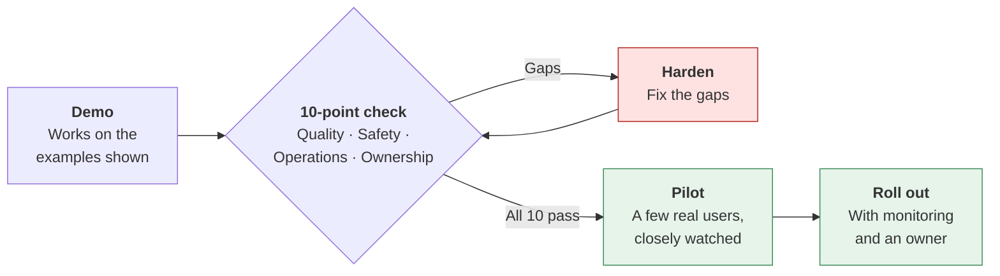
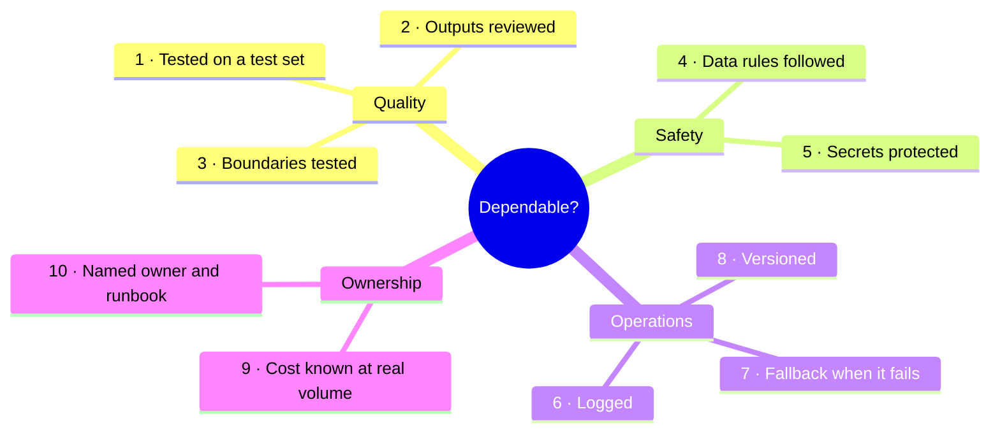
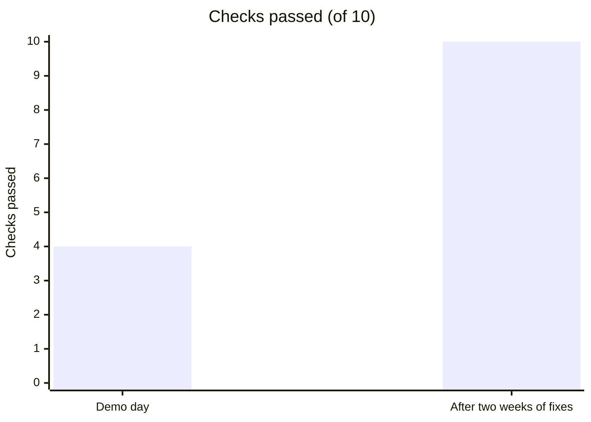

# From demo to dependable
{: .no_toc }

A 10-point check for managers, instructors, and buyers: how to tell an AI demo that impresses in a meeting from a tool people can rely on every day.
{: .fs-6 .fw-300 }

<details open markdown="block">
  <summary>On this page</summary>
  {: .text-delta }
1. TOC
{:toc}
</details>

## Scenario

At **Maplestone Insurance Agency** (fictional), a summer intern builds an AI tool that drafts follow-up emails to clients after a quote call. In the leadership meeting, they paste in three call notes, and three polished, friendly emails appear in seconds. The room is impressed. The office manager asks: *"Can all 12 agents start using it on Monday?"*

Nobody in the room asked how it was tested, where the client data went, what it costs at full volume, or who fixes it when it breaks. Those questions weren't part of the demo, and they're most of the work.

## Why it matters

Building a convincing AI demo is now easy. A few hours, one well-chosen example, and a good prompt will do it. Making it **dependable** takes much longer, because dependability is about the cases nobody demonstrated: unusual inputs, bad days, private data, rising costs, and the person who built it moving on.

You don't need to be an engineer to check this. You need to know what to ask. Most failures after launch trace back to a handful of shortcuts that are invisible in a demo:



## Key ideas

### The 10-point check



| # | Check | The demo-only version | The dependable version | Ask | Learn more |
|:--|:--|:--|:--|:--|:--|
| 1 | **Tested on a test set** | "I tried it a few times and it looked good." | 25 or more real cases with known good answers, including hard ones, re-run after every change | "Show me the test results." | [Evaluation test sets]() |
| 2 | **Outputs reviewed** | Output goes straight to clients | A person checks before anything is sent, published, or acted on, at least until the test record justifies less | "Who sees it before the client does?" | [Human-in-the-loop design]() |
| 3 | **Boundaries tested** | Never tried to break it | Tested with tricky, off-topic, and manipulative inputs; refuses what it should | "What happens if someone asks it to promise a discount?" | [AI security](), [AI personas]() |
| 4 | **Data rules followed** | Real client data pasted into a personal account | Only approved data, in an approved tool, with personal details minimized | "What data goes in, and which tool is it approved for?" | [Data classification]() |
| 5 | **Secrets protected** | API key written in a script or spreadsheet | Keys stored in a secure place, with limited access, and rotated if exposed | "Where is the key, and who can see it?" | [AI security]() |
| 6 | **Logged** | No record of what it produced | Inputs, outputs, and versions recorded (within data-retention rules), so problems can be traced | "If a client complains, can we see what it wrote?" | [Operating AI]() |
| 7 | **Fallback when it fails** | If the service is down, the tool just breaks | A clear manual path, and the tool fails visibly rather than silently | "What do agents do when it's down or gives nonsense?" | [Operating AI]() |
| 8 | **Versioned** | One giant prompt on one person's laptop | Prompts and settings stored in a shared, versioned place, with changes recorded | "If it gets worse next month, can we go back?" | [Software and infrastructure]() |
| 9 | **Cost known at real volume** | "It's only a few cents per email." | Monthly cost estimated at full volume, with a budget alert | "What does it cost per month at full use?" | [Tokens and usage]() |
| 10 | **Named owner and runbook** | The builder, informally, until they leave | An owner, a backup, and a one-page runbook: how to pause it, who to tell, how to roll back | "Who owns this in six months?" | [Skills and roles]() |

These checks apply whether the tool was built in-house, configured from a no-code assistant, or bought from a vendor. With a vendor, you ask them for the evidence. See [Build, buy, or configure]().

### Size the check to the stakes

Not every tool needs a heavy process. A personal drafting helper used by one person needs checks 2 and 4 at minimum. Anything shared, client-facing, or acting on its own needs all ten. The question is the same as in [Should you use AI here?](): what does it cost when it's wrong, and how quickly would you find out?

## Worked example

The office manager runs Maplestone's email drafter through the check with the intern:

| # | Check | Result | Finding |
|:--|:--|:--:|:--|
| 1 | Test set | ✗ | Tried on three call notes, all chosen for the demo |
| 2 | Outputs reviewed | ✓ | Drafts open in the agent's email for editing; nothing sends automatically |
| 3 | Boundaries tested | ✓ | Tested: it doesn't state coverage or prices that aren't in the notes |
| 4 | Data rules | ✗ | Real client notes went through the intern's personal account |
| 5 | Secrets | ✗ | API key typed into a shared spreadsheet script |
| 6 | Logged | ✗ | No record of drafts produced |
| 7 | Fallback | ✓ | Agents can write emails by hand, as they do now |
| 8 | Versioned | ✗ | The prompt lives in a notebook on the intern's laptop |
| 9 | Cost at volume | ✓ | Estimated (see below) |
| 10 | Owner and runbook | ✗ | The intern leaves at the end of the summer |

**Result: 4 of 10.** A great demo, and not ready for Monday.

**The cost estimate (check 9).** 12 agents × 30 emails a day × 21 working days = **7,560 emails a month**. At about 3,000 input tokens and 500 output tokens per email, that's 22.68 million input and 3.78 million output tokens. At illustrative prices of $3 and $15 per million, the monthly cost is about **$68 + $57 = $125**. Cost isn't the obstacle; the other gaps are.

**The fix plan (two weeks):**

- Moved to the agency's approved AI account. Client notes are trimmed to what the email needs (checks 4 and 5). The key now sits in the account's secure settings, and the old one was revoked.
- Built a 30-case test set from past calls, including complaints and incomplete notes. The first run scored 26 of 30; two prompt fixes brought it to 29 (check 1).
- Turned on logging with the agency's 90-day retention rule, and moved the prompt to a shared, versioned folder (checks 6 and 8).
- Named the office manager as owner, with a one-page runbook, before the intern's last day (check 10).

Then a **three-agent pilot** for two weeks before the full rollout.



## Prompt template

Use AI to prepare the questions before a demo or vendor meeting, not to answer them:

```text
I'm reviewing an AI tool before it's rolled out. Here's what it does:
[ONE-PARAGRAPH DESCRIPTION: inputs, outputs, who uses it, how often,
and what happens to the output].

Using these 10 checks: test set, output review, boundary testing, data
rules, secrets, logging, fallback, versioning, cost at real volume,
owner and runbook:

1. For each check, write the one question I should ask the builder or vendor.
2. Describe what a good answer and a worrying answer would sound like.
3. Say which checks matter most for this tool, and why, given what it does.

Don't assume anything about the tool beyond my description.
```

## Verify checklist

- [ ] I saw test results on 25 or more cases, not just the demo examples.
- [ ] A person reviews output before it reaches anyone outside the team, or there's evidence that less review is safe.
- [ ] Someone tried to break it, and it held its boundaries.
- [ ] The data is approved for the tool, and personal details are minimized.
- [ ] No keys or passwords are in code, spreadsheets, or shared documents.
- [ ] Outputs are logged within retention rules, and there's a manual fallback.
- [ ] Prompts and settings are versioned, so a bad change can be undone.
- [ ] I know the monthly cost at full volume.
- [ ] There's a named owner, a backup, and a runbook.
- [ ] It starts as a small pilot, not a full rollout.

## Common failure modes

| Failure | What it looks like | How to catch it |
|:--|:--|:--|
| **Demo-picked examples** | The three examples shown are the three that worked best | Ask to see it run on cases you choose. |
| **"It's just a prototype"** | A prototype quietly becomes the production tool | Set a date for the check before anyone uses it for real work. |
| **Builder as single point of failure** | Only one person knows how it works | Owner, backup, and runbook before launch. |
| **Cost surprise** | Fine at 10 requests a day, alarming at 1,000 | Estimate at full volume, and set a budget alert. |
| **Silent failure** | The tool produces blank or wrong output and nobody notices | Make failures visible. Sample outputs weekly. |
| **Vendor demo trust** | A polished vendor demo accepted as evidence | Ask vendors the same 10 questions. Ask for results on your cases. |

## Disclose and decide notes

**Disclose:** When you present an AI tool for approval, include the check results, not just the demo: *"Passes 10 of 10 checks; test set score 29 of 30; pilot with three agents for two weeks."* Be as clear about gaps as about strengths.

**Decide:** Whether a tool is ready is a management decision, made by someone who'll be accountable if it goes wrong. A good demo is a reason to run the check, not a reason to skip it.

## For educators: turn this into a challenge

Show teams a two-minute recorded demo of a fictional AI tool, along with a "builder's notes" page that quietly reveals four or five gaps (a key in a spreadsheet, three test examples, no owner). Teams act as the approving manager: they run the 10-point check, list their questions, and write a go, no-go, or pilot decision with conditions. Debrief: *Which gaps were invisible in the demo? Which question would you ask first next time?* See [Designing an AI-fluency challenge]().
