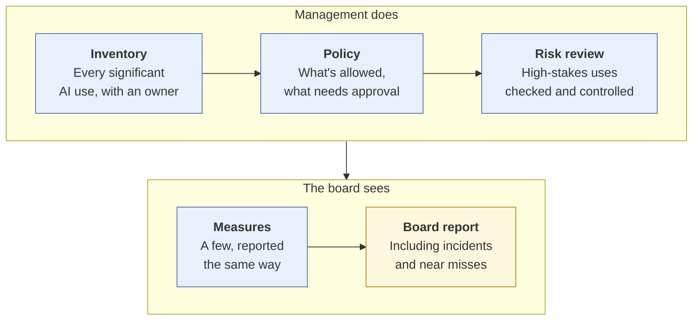
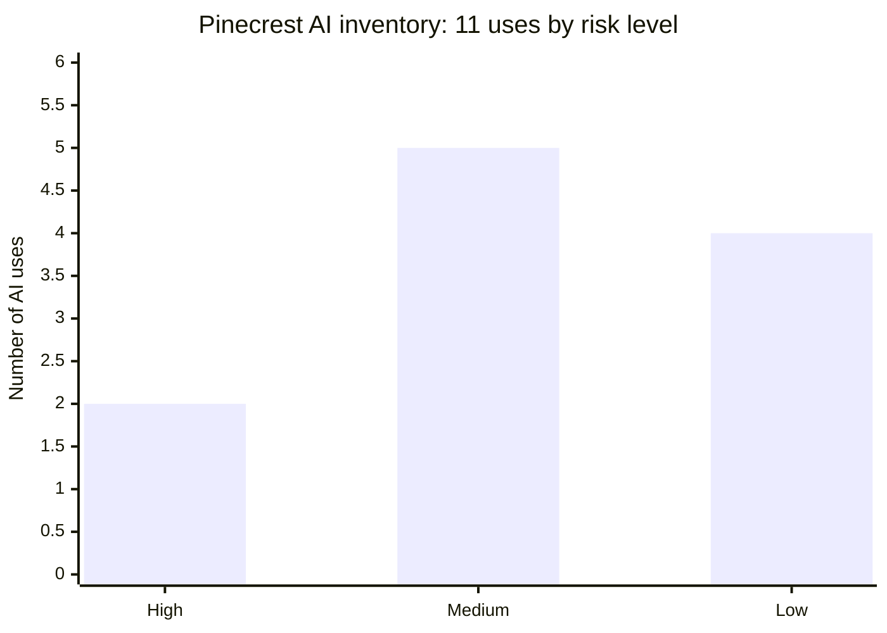

# Explaining AI to a board
{: .no_toc }

Leaders manage AI; a board oversees the people who manage it. How to give directors and trustees what they need: an inventory, an owner, a risk view, a few measures reported the same way each time, and honest incident reporting.
{: .fs-6 .fw-300 }

<details open markdown="block">
  <summary>On this page</summary>
  {: .text-delta }
1. TOC
{:toc}
</details>

## Scenario

The board of **Pinecrest Pet Supply** (fictional) asks for an AI briefing at its next quarterly meeting. A director has read about a company whose hiring tool was found to be screening out older applicants, and asks: *"Are we using anything like that? How would we know?"*

The chief operating officer prepares a 20-slide presentation on what AI is and how large language models work, with a demo of the customer-support assistant. Ten minutes in, the board chair interrupts: *"This is interesting, but I still don't know how many AI systems we have, who's responsible for them, or whether any of them could get us into trouble."*

## Why it matters

A board's job isn't to choose tools or run projects. It's **oversight**: making sure the organization has a sound approach, that someone is accountable, that risks stay within what the board has agreed to accept, and that problems reach the board when they should. Explaining AI to a board means answering those questions, not explaining the technology.

| Executive leaders ask | A board asks |
|:--|:--|
| Should we fund this pilot? | Where are we using AI at all, and who's accountable for it? |
| Does this tool work? | How do we know our AI uses are working, and how would we find out if one wasn't? |
| What does it cost? | Is our AI spending in line with our strategy? Are we behind, or overreaching? |
| What's the risk of this project? | What's our overall exposure, legal, reputational, data, and people? Is it within the risk we've agreed to? |
| — | What happens when something goes wrong, and when would we hear about it? |

Boards meet a few times a year and have limited time per topic. They need **a consistent picture over time**, not a new presentation each quarter. For briefing executives on a specific decision, see [Explaining AI to leaders](). For other audiences, see [Explaining AI to others]().

{: .note }
Boards differ. A company board, a nonprofit board, a school board, and a university's trustees have different duties and rules. Your organization's counsel or governance lead should confirm what applies to yours.

## Key ideas

### The oversight loop



It's a loop: the board's guidance, such as how much risk is acceptable or what it wants reported, feeds back into the inventory and policy. The [NIST AI Risk Management Framework]() calls this function **Govern**: the policies, accountability, and culture that the other risk-management activities depend on.

### What to bring

1. **An inventory.** Every significant AI use: what kind of system it is, what it does, who owns it, how risky it is, and its status. Most organizations don't have one, and building it usually turns up surprises: AI features switched on inside existing software, tools staff adopted on their own, and vendor systems nobody classified. See [Types of AI systems]().
2. **A policy and an accountable owner.** One named executive, and a short statement of what's allowed, what isn't, and what needs approval.
3. **A risk view.** Which uses are high-stakes: those that affect people's jobs, money, health, or rights, or that customers see directly. How each is controlled, and where regulation may apply. See [AI regulation and frameworks]().
4. **A few measures, reported the same way each time.** For example: AI uses by risk level, the share with a named owner and a recent test, incidents and near misses, and staff trained.
5. **Incidents, honestly.** Near misses too. A board that only hears good news can't do its job.
6. **What you need from the board.** Approving a policy, agreeing how much risk is acceptable, or setting a reporting schedule.

### How to explain it

- **Start with strategy, not technology.** "We use AI in four areas that support our goals" beats a tour of tools.
- **One plain comparison is enough.** Directors need to understand oversight, not how models work. If they want more, offer a separate session.
- **Be candid about what you don't know yet.** "We've found 11 AI uses; there are probably more inside vendor software, and we'll report back next quarter" builds more trust than a tidy, incomplete list.
- **Separate the material from the minor.** A spellchecker's AI feature doesn't need board time. A tool that screens job applicants does.
- **Show one near miss and what changed.** It shows the controls work, and that bad news reaches the board.
- **Make the next report predictable.** Same format, same measures, so directors can see trends.

## Worked example

The COO replaces the 20 slides with a four-page board paper.

**The inventory.** Pinecrest already knew about six AI systems: fraud flags, warehouse camera checks, website recommendations, the support chat assistant, the delivery route planner, and rule-based email sorting (see [Types of AI systems]()). A two-week survey of department heads, and a review of software contracts, found **five more**: a résumé-screening feature switched on in the hiring software, marketing staff drafting copy in personal chat accounts, an AI formula assistant in the finance team's spreadsheet software, meeting transcription in the video-call software, and a writing assistant inside the email system.



| Risk level | Uses | Why |
|:--|:--|:--|
| **High (2)** | Résumé screening; payment fraud flags | Affect people's jobs or block customers' orders. Hiring uses may be regulated. |
| **Medium (5)** | Support chat assistant; product recommendations; route planner; marketing copy in personal accounts; meeting transcription | Customer-facing, or handle personal or confidential data |
| **Low (4)** | Email sorting; warehouse camera checks; spreadsheet formula assistant; email writing assistant | Internal, checked by people, or low impact |

The résumé screener was the finding that answered the director's question. It had been switched on by default in a software update, and nobody had checked how it ranked applicants. The COO paused it pending a review.

**The measures** (to be reported every quarter in the same format):

| Measure | Now | Target by next quarter |
|:--|--:|--:|
| AI uses with a named owner | 6 of 11 | 11 of 11 |
| High- and medium-risk uses tested in the last 12 months | 2 of 7 | 5 of 7 |
| Incidents and near misses this quarter | 1 near miss | Reported, whatever the number |
| Staff who completed AI training | 34 of 80 | 60 of 80 |

**The near miss.** The support chat assistant told a customer their refund "has been approved," which it has no authority to do. A support agent caught it the same day. The fix was a rule that keeps the assistant from confirming refunds, plus a test for it in the assistant's test set.

**What the COO asked the board for:**

1. Approve a two-page AI policy, including a ban on putting customer or employee data into personal AI accounts.
2. Confirm the COO as the accountable executive for AI.
3. Agree that any new **high-risk** AI use needs the COO's approval and is reported to the board at its next meeting.
4. Agree to a one-page AI report each quarter, using the measures above.

The board approved all four, and asked for the résumé screener's review to be the first item in next quarter's report.

## Prompt template

**Draft the board paper from your inventory:**

```text
Draft a board paper on our organization's use of AI, for directors who
need oversight, not technical detail. Use only the facts below. If a
board would expect something that's missing, write "MISSING:" and what
I should find out.

Sections:
1. Summary (3 sentences): where we use AI, overall risk, what we need
   from the board.
2. Inventory: each use, its risk level, and its owner.
3. Risk view: high-risk uses and how each is controlled.
4. Measures: current value and target.
5. Incidents and near misses: what happened and what changed.
6. Decisions requested.

Don't make our position sound stronger than the facts show. Use plain
language; avoid technical terms.

FACTS:
[PASTE INVENTORY, POLICY STATUS, MEASURES, INCIDENTS]
```

**Rehearse with a skeptical director:**

```text
Act as an experienced independent director on our board, with a
background in audit and risk. Read the board paper below and ask me the
five questions you'd ask in the meeting, one at a time. Focus on
accountability, what we might not know, and whether bad news would
reach the board. After each answer, tell me whether it would satisfy you.

BOARD PAPER:
[PASTE]
```

Check every fact in an AI-drafted board paper against your inventory and records. Board papers become part of the organization's formal record.

## Verify checklist

- [ ] There's an inventory of significant AI uses, including AI features inside existing software.
- [ ] Every use has a named owner and a risk level, with reasons.
- [ ] High-risk uses (jobs, money, health, rights, or customer-facing) have described controls.
- [ ] One executive is accountable for AI across the organization.
- [ ] The report includes incidents and near misses, not just progress.
- [ ] The measures are few, defined, and reported in the same format each time.
- [ ] I've said what we don't know yet, and when we'll report back.
- [ ] The paper ends with the decisions or guidance we need from the board.
- [ ] Counsel or the governance lead has confirmed any legal or regulatory statements.

## Common failure modes

| Failure | What it looks like | How to catch it |
|:--|:--|:--|
| **The technology briefing** | A session on how models work, with no inventory | Lead with the inventory, owner, and risks. |
| **Only the known systems** | The inventory lists projects but misses AI features in existing software | Survey department heads and review software contracts and settings. |
| **No single owner** | "IT handles AI" | Name one accountable executive. |
| **Only good news** | No incidents in any board paper | Report near misses. Zero incidents for a year is a reason to ask questions. |
| **Hype or alarm** | "Transformational opportunity" or "existential risk" | Report facts, risk levels, and controls. |
| **A one-off session** | One presentation, then silence | Agree a regular report in a fixed format. |
| **Everything is material** | Board time spent on spellcheckers | Rate risk, and bring the board only what matters. |

## Disclose and decide notes

**Disclose:** Tell the board how the inventory was built, and its limits: *"Based on a survey of department heads and a review of software contracts; AI features in some vendor tools may be missing."* If AI helped draft the paper, say so, and confirm a person checked every fact.

**Decide:** Management decides how AI is used and controlled day to day. The board decides how much risk is acceptable, who is accountable, and what it needs to hear and when. Decisions affecting people's jobs, credit, or rights should always have a person who can review them. See [Human-in-the-loop design]().

## For educators: turn this into a challenge

Give teams a fictional organization's materials: a list of known AI projects, a software contract list hiding three AI features, a policy draft, and an incident report. Teams build an inventory, rate each use's risk, and write a four-page board paper. Then a panel plays the board: an audit-focused director, a customer advocate, and a chair with ten minutes. Score on whether teams found the hidden AI features, whether high-risk uses have controls, whether the near miss appears, and whether the paper ends with clear decisions. Debrief: *What did the inventory turn up that nobody knew about? What would a board need to see to trust that bad news reaches it?* See [Designing an AI-fluency challenge]().
