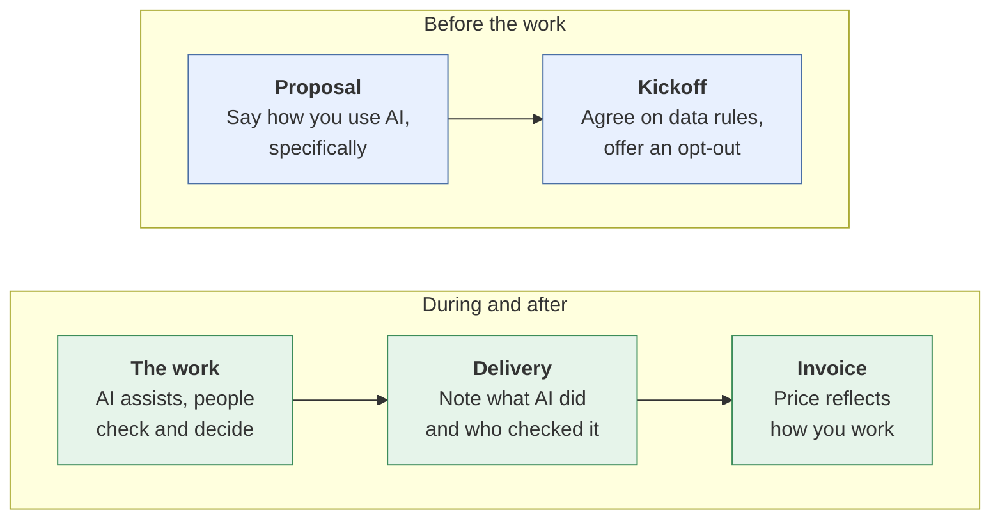
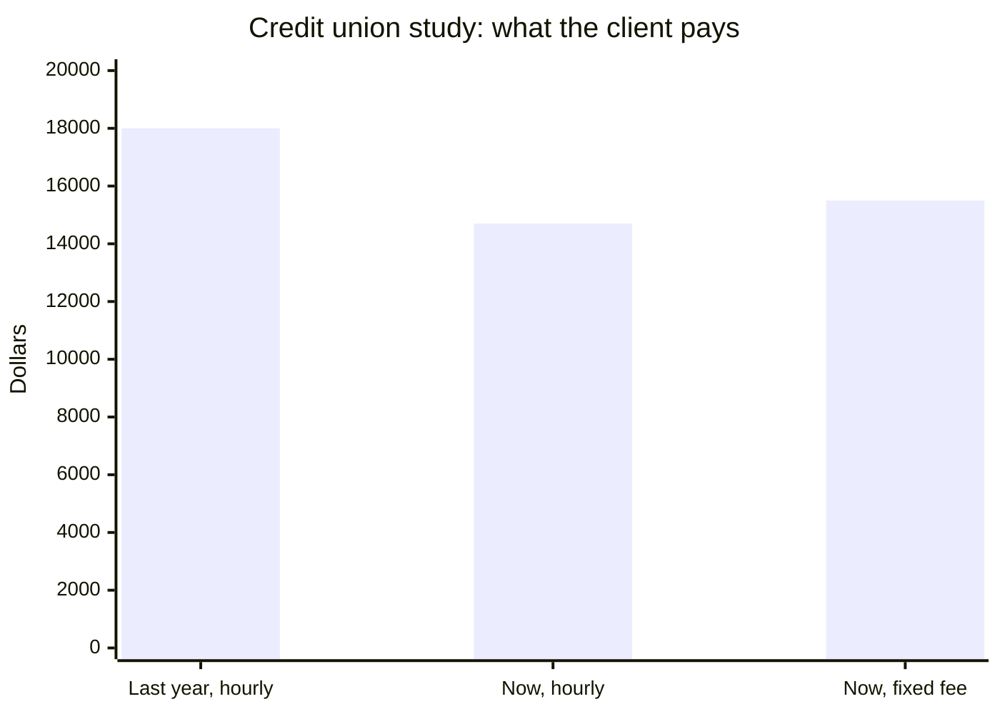

# Explaining AI to clients
{: .no_toc }

How to tell clients you use AI in work you do for them: what to disclose and when, how to protect their data, how to explain price, and how to show that the judgment they're paying for is still yours.
{: .fs-6 .fw-300 }

<details open markdown="block">
  <summary>On this page</summary>
  {: .text-delta }
1. TOC
{:toc}
</details>

## Scenario

**Bramble & Finch Research** (fictional) is a six-person consultancy that runs customer research for small and mid-sized organizations. Over the past year, the team has started using an approved AI tool to transcribe interviews, draft first-pass summaries, and sort open-ended survey answers into themes. Projects that took 120 hours now take about 90.

None of this appears in their proposals or invoices. Then a long-standing client, a regional credit union, reads a news story about AI and confidential data and emails: *"Are you putting our members' interviews into AI? And if it's faster now, why is this year's quote the same as last year's?"*

## Why it matters

Clients pay for **your judgment** and trust you with **their information**. AI touches both. Most clients don't object to AI use itself. What damages trust is finding out about it after the fact, especially when something goes wrong or the price doesn't seem to reflect it.

Explaining your AI use well does three things:

- **It protects the relationship.** Clients learn about it from you, on your terms, not from a mistake or a news story.
- **It protects their data,** because explaining your practices forces you to check what they actually are.
- **It can become a selling point.** A clear, specific account of how you use AI and check it signals a careful firm.

Some professions, including law, accounting, healthcare, and financial services, have their own rules or guidance on AI use, confidentiality, and disclosure, and some client contracts already cover it. Check those first. This page covers what applies everywhere else.

If you're advising a client on **adopting** AI rather than explaining your own use, see [Explaining AI to leaders](). The client is the decision-maker there. For other audiences, see [Explaining AI to others]().

## Key ideas

### Explain it at every stage of the engagement



The earlier a client hears about it, the less it feels like a confession.

### Answer what clients are really asking

| What they're thinking | What to tell them |
|:--|:--|
| "Is my information going into an AI?" | Which tools you use, what client data goes in and what never does, and whether the vendor trains on it or keeps it. Put it in writing. See [Data classification](). |
| "Is the work still yours?" | What AI does in your process and what people do. *"AI transcribes and drafts first summaries; our researchers check every quote and number and write the findings."* |
| "Who's responsible if it's wrong?" | *"We are, the same as before. AI doesn't change who signs off."* |
| "Am I paying for a machine's work?" | How AI affects price and speed, before they ask. See below. |
| "Will it sound generic?" | How you keep it specific: their data, their context, their voice, and your judgment. |
| "Can we say no?" | Yes, and what that would change in time or cost. |

### Be specific, not reassuring

Vague statements raise more questions than they answer.

| Vague | Specific |
|:--|:--|
| "We may use AI tools." | "We use one approved AI tool, on a business plan whose terms say it doesn't train on our data, to transcribe interviews and draft first summaries." |
| "Your data is safe." | "Names and account details are removed before any text goes into the AI tool. Recordings are deleted 30 days after the project ends." |
| "Everything is reviewed." | "A researcher checks every quote against the recording and every number against the source before you see it." |
| "AI-powered insights." | "AI sorts survey comments into themes; our team reviews every theme and writes the findings." |

### Be honest about price

If AI makes your work faster, clients will eventually ask why the price didn't change. Decide your answer before they ask:

- **Charge for the outcome, not the hours,** where that fits your business. Then speed is your efficiency, and the client pays for a defined result.
- **Or bill fewer hours,** and let the client see the saving.
- **Or reinvest the time in their project,** and say exactly what they get: more interviews, a deeper analysis, a faster turnaround.

What doesn't hold up is billing the same hours for work that took fewer, and hoping nobody asks.

### Show your quality checks

Clients trust your judgment, not the tool's. A short **"How we use AI" statement**, one page attached to proposals, does this once for every client. It covers: the tools you use, what they do in your work, what client data may and may not go into them, how output is checked and by whom, how pricing reflects it, and how a client can opt out.

## Worked example

Bramble & Finch answers the credit union's email with a call, then writes the one-page statement they should have had all along.

**Data.** The interview recordings include members' names and, occasionally, account details. The team checks its practice and finds it was sending full transcripts to the AI tool for summaries. They change the process: names and account details are removed from transcripts before anything goes to the AI tool, and the credit union is offered a full opt-out. The credit union opts out of AI **transcription** of recordings, since those can't be cleaned first, but accepts AI summaries of the cleaned transcripts. Manual transcription adds 8 hours.

**A quality check worth mentioning.** While preparing the report, a researcher catches an error in an AI-drafted summary: it described the credit union as having "over 40,000 members." The client's own figure is about **28,000**. The number had never appeared in any interview. The team adds it to the statement as an example of why every number is checked against a source.

**Price.** Last year's study was billed hourly: 120 hours at $150 = **$18,000**. This year's work takes about 90 hours with AI, plus the 8 hours of manual transcription, so 98 hours. The team compares three options:

| Option | Calculation | Client pays | Bramble & Finch earns per hour worked |
|:--|:--|--:|--:|
| Bill last year's hours | 120 × $150 | $18,000 | $183.67 |
| Bill actual hours | 98 × $150 | $14,700 | $150.00 |
| **Fixed project fee** | Defined scope: 20 interviews, a survey, a report, one revision round | **$15,500** | **$158.16** |

Billing last year's hours for 98 hours of work is the option that doesn't survive the client's question. The team chooses the fixed fee: the client pays **$2,500 less** than last year for the same scope, and the firm earns slightly more per hour than its old rate, which pays for the tool and the checking time.



**The statement** (attached to every proposal from now on):

```text
HOW WE USE AI AT BRAMBLE & FINCH

What we use: one approved AI tool, on a business plan whose terms say
it does not train on our data or keep it after processing.

What it does: transcribes interviews, drafts first summaries of
transcripts, and sorts open-ended survey answers into themes.

What it never does: write findings or recommendations, or decide what
goes in your report. Our researchers do that.

Your data: names, account numbers, and contact details are removed
before any text goes into the AI tool. You can opt out of any AI use
on your project; we'll tell you what that changes in time and cost.

How we check: every quote is checked against the recording and every
number against its source before you see it. Example: an AI draft once
gave a client's membership as "over 40,000"; their figure was 28,000.
We caught it because we check every number.

Pricing: we quote a fixed fee for a defined scope. Faster tools lower
our costs, and our fees reflect that.

Questions: ask your project lead at any time.
```

**What changed:** the credit union renewed, and its operations director asked for the statement to share with its own compliance team. Two other clients asked about AI use within the next quarter. Both received the same statement, and neither needed a call.

## Prompt template

**Draft your "How we use AI" statement from your real practices:**

```text
Draft a one-page "How we use AI" statement for clients of [TYPE OF
FIRM]. Use only the facts below. If something a client would expect to
know is missing, write "MISSING:" and what I should find out. Don't
make our practices sound stronger than they are.

Sections: what we use, what it does, what it never does, your data,
how we check, pricing, how to opt out, who to ask.

OUR PRACTICES:
- Tools and plans: [LIST, and what their terms say about training and retention]
- Tasks AI helps with: [LIST]
- Tasks only people do: [LIST]
- Client data that goes in / never goes in: [LIST]
- How output is checked, and by whom: [DESCRIBE]
- How we price: [DESCRIBE]
```

**Rehearse with a skeptical client** (see [AI personas]()):

```text
Act as the operations director of a [TYPE OF CLIENT] that's worried
about confidential data and cost. You've just learned your consultant
uses AI. Read our statement below, then ask me your five toughest
questions one at a time, including one about price. After each answer,
tell me whether it would satisfy you and what was missing.

STATEMENT:
[PASTE STATEMENT]
```

Before you send the statement, check every line against what your team actually does, and the tool terms against the vendor's current documents. A statement that's more confident than your practice is worse than none.

## Verify checklist

- [ ] I checked my profession's rules and the client contract for anything on AI use.
- [ ] The client hears about our AI use in the proposal or at kickoff, not after delivery.
- [ ] The statement names the tasks AI does and the ones only people do.
- [ ] It says what client data goes into AI tools, what never does, and what the vendor's terms say.
- [ ] Every claim in the statement matches what the team actually does today.
- [ ] Clients can opt out, and know what that changes.
- [ ] Our pricing makes sense if the client asks how AI affected it.
- [ ] Every number and claim about the client's own business in AI-assisted work was checked against a source.

## Common failure modes

| Failure | What it looks like | How to catch it |
|:--|:--|:--|
| **Hiding it** | The client finds out from a mistake or a news story | Disclose in the proposal, every time. |
| **Vague assurance** | "Your data is safe" | Name the tool, the data, and the terms. |
| **Statement ahead of practice** | A policy that says names are removed, when they aren't | Check the statement against the real process before sending it. |
| **Overselling** | "AI-powered insights" | Describe what AI does, and what your people do. |
| **Same hours, less work** | Last year's invoice for this year's faster work | Decide your pricing answer before the client asks. |
| **Invented client facts** | A wrong figure about the client's own business | Check every number about the client against a source. |
| **One answer for every client** | The same data terms for a bakery and a hospital | Ask about each client's data rules at kickoff. |

## Disclose and decide notes

**Disclose:** Say what AI did in each deliverable when it's relevant, for example: *"Interview summaries were drafted with AI from de-identified transcripts and checked against the recordings by our team."* The statement covers the general practice; a line in the deliverable covers the specific work.

**Decide:** Your firm decides which tools are approved, what data may go into them, and how you price. The client decides whether to accept AI use on their project. What goes into the client's report, and the recommendations in it, are always your people's decisions.

## For educators: turn this into a challenge

Give teams a fictional firm's real practices, including one gap (for example, client names are sent to an AI tool), and a client email asking about AI and price. Teams write a "How we use AI" statement and a reply to the client, then role-play a call with a skeptical client played by the instructor or an AI persona. Score on honesty (did they find and fix the gap before writing the statement?), specificity, and how well they handle the price question. Debrief: *What did writing the statement reveal about the firm's actual practice?* See [Designing an AI-fluency challenge]().
