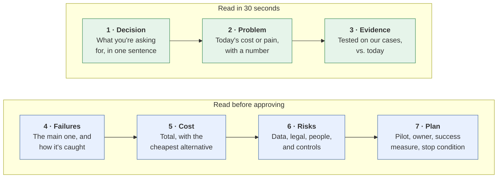
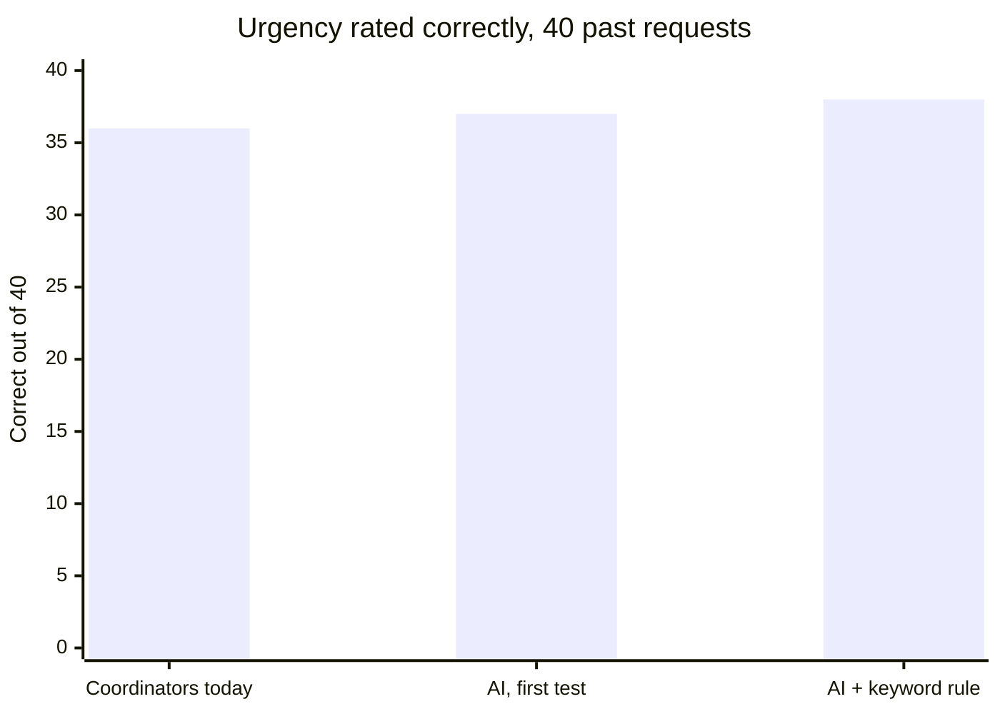

# Explaining AI to leaders
{: .no_toc }

How to brief executives, managers, and boards on an AI idea so they can make a decision: what to say, which numbers to bring, and how to talk honestly about failure, cost, and risk.
{: .fs-6 .fw-300 }

<details open markdown="block">
  <summary>On this page</summary>
  {: .text-delta }
1. TOC
{:toc}
</details>

## Scenario

At **Alder Creek Property Management** (fictional), an operations analyst has spent three weeks testing an AI tool that reads tenant maintenance requests, suggests how urgent each one is, and drafts a reply. The results look good. They get 15 minutes with the chief operating officer and the chief financial officer.

They open with how the tool works: a large language model, grounded in the maintenance handbook, with a carefully tuned prompt. Ten minutes in, the CFO asks, *"What does it cost, and what happens when it gets one wrong?"* The analyst knows both answers, but they're buried on slide 9. The meeting ends with "Interesting. Send us something." Nothing happens for two months.

## Why it matters

Leaders don't need to know how a model works. They need enough to make a decision: **fund it, approve it, limit it, or stop it.** Most AI pitches fail for one of two reasons. Either they explain the technology instead of the decision, or they oversell, and the first visible failure costs the team its credibility.

Leaders also hear two stories about AI all day: that it will transform everything, and that it's a risk to be avoided. A plain account of *what it does well, what it doesn't, and how we know* stands out from both.

For oversight across the whole organization, see [Explaining AI to a board](). For other audiences, see [Explaining AI to others]().

## Key ideas

### Five questions every leader is really asking

Whatever they say out loud, leaders are usually trying to answer these, in roughly this order:

| They're asking | What to give them | What to avoid |
|:--|:--|:--|
| **What problem does this solve?** | One business problem in their terms: hours, errors, revenue, risk | "We're using an LLM with retrieval" |
| **Does it actually work?** | Results on **our own** cases, compared with how we do it today | Demo screenshots, vendor claims, "95% accurate" with no baseline |
| **What happens when it's wrong?** | How often, how we'd notice, what it costs, who fixes it | "It rarely makes mistakes" |
| **What does it cost?** | A total over one to three years, including staff time and checking | Per-token prices with no monthly total |
| **What's the risk to us?** | Data, legal, and reputation risks, and the control for each | Either "no risk" or a wall of worst cases |

Each question maps to a page in this guide: [Types of AI systems]() for what it is, [Building an evaluation test set]() for whether it works, [Human-in-the-loop design]() for what happens when it's wrong, [Build, buy, or configure]() for cost, and [Data classification]() and [AI regulation and frameworks]() for risk.

### The one-page decision brief

Put the decision first and the details after. A leader who reads only the top three lines should still know what you're asking for and why.



A **stop condition** is the result that would make you pause or end the project, agreed before you start. It tells leaders you've thought about failure, and it makes the pilot easy to approve: they're agreeing to a limited experiment, not a permanent commitment.

### Translate jargon into consequences

Leaders don't need the vocabulary. They need to know what each technical fact means for the business.

| Instead of | Say |
|:--|:--|
| "It hallucinates sometimes." | "It can state wrong facts confidently, so a person checks every reply before it goes to a tenant." |
| "It's grounded in our handbook with RAG." | "It answers from our maintenance handbook, not from the internet, and shows which section it used." |
| "Accuracy is 90%." | "On 40 past requests, it rated urgency correctly 38 times. Our current process got 36." |
| "We need to manage the context window and token costs." | "Running costs are about $40 a month at our volume, and they rise only if volume does." |
| "It's an agent." | "It can take actions on its own, such as sending emails, so we've limited what it's allowed to do." |
| "The model may drift." | "Quality can change when the vendor updates the tool, so we recheck it every month." |

### Know who's in the room

Different leaders weigh the same proposal differently. Prepare the answer each one will look for first.

| Leader | Usually looks first for | Bring |
|:--|:--|:--|
| Chief executive | Fit with strategy, customer impact, reputation | The problem in customer terms, and the worst realistic failure |
| Finance | Total cost, payback, and what happens if it's wrong | A three-year total, the cheapest alternative, and a capped pilot budget |
| Operations | Workload, process changes, who does the checking | Time saved, the new steps people take, and who owns it |
| Legal, risk, or compliance | Data handling, regulation, accountability | What data goes where, the vendor's terms, and the human review step |
| Technology | Security, integration, upkeep | Access controls, where it connects, and who maintains it |
| Board | Oversight: is this governed? | The owner, the stop condition, and how results are reported |

### Habits that build trust

- **Lead with the recommendation.** "I recommend a 60-day pilot with two coordinators, capped at $2,500." Then give the reasons.
- **Always give a baseline.** A number means little without a comparison. "90% correct" invites the question "compared with what?" Answer it before they ask.
- **Say what kind of system it is.** "It's keyword rules, not a model" is a good thing to say when it's true. "AI" on its own tells leaders nothing.
- **Show one failure on purpose.** A real mistake, and the check that caught it, builds more trust than a flawless demo. It also shows you're not selling.
- **Separate hours from dollars.** Time saved is only a cost saving if the time is used for something else or staffing changes. Say which.
- **Name an owner and a stop condition.** Someone specific is responsible, and everyone knows what would pause the project.
- **Ask for something specific.** "An AI strategy" is hard to approve. A testable pilot with a budget and an end date is easy.

## Worked example

The analyst rewrites the pitch as a one-page brief. First, they pull the numbers together from their testing.

**The problem.** Alder Creek handles about **1,800** maintenance requests a month. Four coordinators spend about **6 minutes** on each one, reading it, deciding urgency, and replying: **180 hours a month**.

**The evidence.** The analyst ran the tool on **40 past requests** whose correct urgency had been confirmed by the maintenance manager, and compared it with what coordinators had originally decided:

| | Urgency correct | Emergencies rated routine |
|:--|--:|--:|
| Coordinators (original decisions) | 36 of 40 | 0 |
| AI tool, first test | 37 of 40 | **1** |
| AI tool + emergency keyword rule | 38 of 40 | 0 |

The first test looked better than today's process overall, but it rated one emergency as routine: a tenant who wrote about a *"weird smell in the kitchen,"* which turned out to be a gas leak. That's the failure leaders most need to hear about. The analyst added a simple rule that sends any request mentioning gas, smoke, smell, flooding, sparks, or no heat straight to the emergency line, and reran the test. Every reply is still reviewed by a coordinator before it's sent.



**Time.** Reviewing an AI draft took coordinators about **3 minutes** instead of 6, on the same 40 requests. At 1,800 requests a month, that frees about **90 hours a month**, a little over half of one full-time role. The analyst is careful to say this is **time, not cash**: nobody's job is being cut, and the plan is to use the hours to clear the backlog of preventive maintenance.

**Cost** (a configured tool, not a custom build; see [Build, buy, or configure]()):

| Item | Amount |
|:--|--:|
| Setup and testing: 40 hours of staff time at $45 an hour | $1,800 one-time |
| Tool licenses: 4 coordinators at $30 a month | $120 a month |
| Usage fees at current volume | $40 a month |
| Monthly quality check: 4 hours at $45 | $180 a month |
| **Running cost** | **$340 a month** |
| **Three-year total** | $1,800 + 36 × $340 = **$14,040** |

Even at the full running cost, a 60-day pilot comes to at most $1,800 + 2 × $340 = **$2,480** (it will be a little less, since only two coordinators need licenses), so the analyst asks for a cap of $2,500.

The bars are close, and the chart's axis starts at zero so it doesn't exaggerate the gap. The case for the tool is the **time saved at equal or better accuracy**, not a big jump in accuracy. Saying so plainly is part of the pitch.

**The brief:**

```text
DECISION NEEDED
Approve a 60-day pilot of AI-drafted replies for maintenance requests,
with 2 of our 4 coordinators, capped at $2,500.

PROBLEM
Coordinators spend about 180 hours a month triaging and replying to
1,800 maintenance requests. Preventive maintenance is 6 weeks behind.

EVIDENCE
On 40 past requests checked by the maintenance manager, the tool rated
urgency correctly 38 times (coordinators today: 36). Reviewing its draft
took 3 minutes instead of 6.

WHERE IT FAILS
In the first test it rated a gas leak as routine. We added a rule that
sends any mention of gas, smoke, smell, flooding, sparks, or no heat
straight to the emergency line, and a coordinator approves every reply.

COST
$1,800 setup, then $340 a month. Three-year total: $14,040. Frees about
90 coordinator hours a month for preventive maintenance. No staffing
changes.

RISKS AND CONTROLS
Tenant names and addresses go to the vendor; its business plan does not
train on our data (confirmed in writing). No reply is sent without a
coordinator's approval. Emergencies bypass the tool entirely.

PLAN
Owner: coordinator team lead. Success: no emergency misrouted, review
time under 4 minutes, tenant complaints no higher than today.
Stop condition: any emergency rated routine pauses the pilot.
Report back at day 30 and day 60.
```

**What changed:** the same facts, in a different order. The decision is in the first line, the failure is in plain sight with its fix, the cost has a total, and the pilot has an end date and a stop condition. The COO and CFO approved the pilot in the next meeting, and asked for the day-30 report to include a sample of the drafts coordinators rejected.

## Prompt template

**Draft the brief from your notes:**

```text
I need to brief [WHO: e.g. our COO and CFO] on an AI project and get a
decision. Turn my notes below into a one-page decision brief with these
sections: DECISION NEEDED, PROBLEM, EVIDENCE, WHERE IT FAILS, COST,
RISKS AND CONTROLS, PLAN (owner, success measure, stop condition).

Rules:
- Use only facts and numbers from my notes. If a section has nothing to
  support it, write "MISSING:" and what I'd need to find out.
- No technical jargon. Where I've used a technical term, translate it
  into what it means for the business.
- Put the decision in the first sentence.
- Do not make the results sound better than my notes show.

MY NOTES:
[PASTE YOUR TEST RESULTS, COSTS, AND OBSERVATIONS]
```

**Rehearse with a skeptical leader** (see [AI personas]()):

```text
Act as a skeptical chief financial officer at a [SIZE AND TYPE OF
ORGANIZATION]. You've seen several AI projects overpromise. Read the
brief below and ask me the five hardest questions you'd ask in the
meeting, one at a time. After I answer each, tell me whether my answer
would satisfy you and what was missing. Don't soften your questions.

BRIEF:
[PASTE BRIEF]
```

Check the draft line by line against your notes. Models tend to round numbers up, drop caveats, and add confident claims that weren't in your evidence.

## Verify checklist

- [ ] The decision I'm asking for is in the first sentence.
- [ ] Every result is from testing on our own cases, compared with how we do it today.
- [ ] I name the most important failure we found and how it's caught.
- [ ] Costs are totaled over at least a year, including staff time and checking.
- [ ] I've said whether time saved is a cash saving, and why or why not.
- [ ] Data handling, legal requirements, and human review are addressed.
- [ ] There's a named owner, a success measure, and a stop condition.
- [ ] Every number in an AI-drafted brief matches my notes.
- [ ] I could explain any line of the brief without notes.

## Common failure modes

| Failure | What it looks like | How to catch it |
|:--|:--|:--|
| **The technology lecture** | Ten minutes on how it works, one on the business case | Put the decision first. Cut anything that doesn't help them decide. |
| **The flawless demo** | Hand-picked examples, no failures shown | Show one real failure and its fix. |
| **Numbers without a baseline** | "90% accurate" | Always add "compared with today." |
| **Hours counted as dollars** | "Saves $48,600 a year" when no costs change | Say what happens to the freed time. |
| **The sticker price** | License cost only | Use a total that includes setup, staff time, and checking. |
| **Asking for a strategy** | "We need an AI strategy" | Ask for one specific pilot, with a budget and an end date. |
| **AI-polished overstatement** | A drafted brief that's more confident than your evidence | Check every claim and number against your notes. |
| **No decision** | The meeting ends with "interesting" | End with the exact decision you need, and by when. |

## Disclose and decide notes

**Disclose:** Say how the evidence was gathered: *"Tested on 40 past requests, with correct urgency confirmed by the maintenance manager."* If AI helped draft the brief, follow your organization's norms. The numbers and the recommendation should be yours, and you should be able to defend every line.

**Decide:** You recommend, leaders decide. Make it easy for them to say yes to something limited and reversible, and make it clear what would make you recommend stopping. After the decision, report back on schedule, including the results that weren't good. See [From demo to dependable]() for what to check before a pilot becomes a rollout, and [Explaining AI to your team]() for introducing it to the people who'll use it.

## For educators: turn this into a challenge

Give teams a technical write-up of a fictional AI project: test results, costs, a vendor's terms, and one buried serious failure. Teams have 30 minutes to write a one-page decision brief, then pitch it in three minutes to a panel playing a CEO, a CFO, and a risk officer. Students can rehearse beforehand with the skeptical-CFO prompt above. Score on whether the decision is clear, whether the buried failure appears with a control, whether costs are totaled, and how well they answer the panel's questions. Debrief: *Which question from the panel was hardest, and which section of your brief should have answered it?* See [Designing an AI-fluency challenge]() and [Presentations]().
