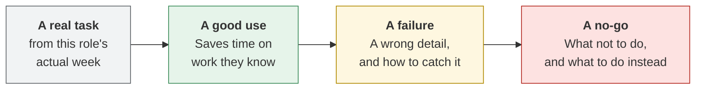
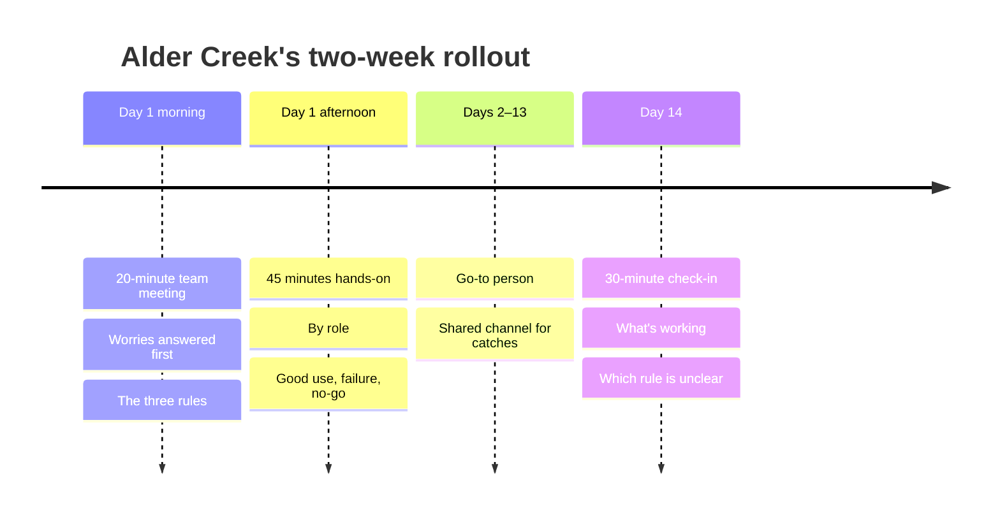

# Explaining AI to your team
{: .no_toc }

How to introduce AI to non-technical staff so they can use it safely and with confidence: answer their worries first, show it on their real work, and keep the rules short.
{: .fs-6 .fw-300 }

<details open markdown="block">
  <summary>On this page</summary>
  {: .text-delta }
1. TOC
{:toc}
</details>

## Scenario

**Alder Creek Property Management** (fictional) has approved an AI tool for its office staff, after a successful pilot with maintenance coordinators (see [Explaining AI to leaders]()). The office manager now has to introduce it to all 12 office staff: maintenance coordinators, leasing agents, and accounting.

Their first plan is a one-hour presentation: how large language models work, a tour of the tool's features, and twenty minutes on the data policy. A coordinator who was in the pilot warns them that half the room will hear "AI" and assume their job is next, and that at least a few people are already using AI on their own, with tenant information, in personal accounts.

## Why it matters

Leaders need enough understanding to make a **decision**. Staff need enough to **do their work safely and with confidence**. That's a different explanation.

Introductions to AI often fail in one of two directions:

- **Too much hype.** "This will change everything" makes skeptics tune out and worried people more worried.
- **Too much risk.** A long compliance talk teaches people either to avoid the tool, or to keep using personal AI accounts quietly and not tell anyone.

Either way, the result is the same: people use AI badly or not at all, and mistakes stay hidden. The goal is a team that uses approved tools on the right tasks, checks the output, and feels safe saying "it got this wrong."

For other audiences, see [Explaining AI to others]().

## Key ideas

### Answer the unspoken questions first

Staff often have questions they won't ask out loud. Until those are answered, they won't take in anything else you say.

| What they're thinking | What to say (only if it's true) |
|:--|:--|
| "Is this replacing me?" | Be honest and specific: which tasks change, which don't, and what's decided about roles. Vague reassurance ("AI won't replace anyone") gets ignored. If roles *will* change, say what you know and when you'll know more. |
| "Will I look stupid?" | "Nobody's an expert yet. Here's a safe way to practice, and questions are expected." |
| "Am I allowed to use it?" | The rules on one page: which tools, which data is off-limits, what needs a second look. |
| "Who's blamed if it's wrong?" | "You're responsible for what you send, so you check it. If the tool gets something wrong and you catch it, that's the system working." |
| "Is it watching me?" | What the tool logs, who can see it, and what it's used for. |
| "I've already been using it. Am I in trouble?" | "Thank you for experimenting. From today, use the approved tool, and here's why." Punishing past use can push future use out of sight. |

### Explain it with one plain comparison

Skip how models work. One comparison covers most of what staff need, and matches the one in [What is AI?]():

> **AI is a fast, widely read assistant who has never met our company, can't see anything we don't show it, and will sometimes state a guess as if it were a fact.**

Then make it practical: *you'd check a new colleague's draft before it went to a tenant. Check this too.* If people want to know more, point them to [What is AI?]() and [AI myths and realities]().

### Show it on their own work

A demo of writing a poem doesn't help someone who reconciles rent payments. For each role, pick a real task from their week and show three things:



Showing one real failure teaches more than a list of warnings, and it gives people permission to find failures themselves.

### Three rules, not a policy manual

People remember a few clear rules. Keep the full policy linked, but don't make anyone read it to get started:

1. **Use only approved tools, and keep confidential data out of everything else.** Name the tools and the data types (for example, tenant names, addresses, payment details).
2. **Check anything you'll send, sign, or decide on.** Facts, numbers, names, dates, and tone.
3. **Say when AI helped**, following the team's norm.

See [Data classification]() for deciding which data goes where, and [Writing a course AI policy]() for how to write rules people can follow.

### Make it safe to learn

- **Hands-on beats slides.** Twenty minutes trying it on their own tasks teaches more than an hour of presentation. See [Running an AI workshop]() for a full session design.
- **Name a go-to person** for questions, ideally a peer rather than the manager.
- **Share mistakes openly**, starting with your own: *"Here's what it got wrong for me last week."*
- **Check back after two weeks.** Questions only appear once people have tried it.
- **Don't measure success by how often people use it.** Measure whether the work got faster or better without new errors.

## Worked example

The office manager replaces the one-hour presentation with a short meeting, a hands-on session by role, and a check-in two weeks later.



**The team meeting.** The office manager starts with the job question, because the pilot made an honest answer possible: leadership approved the tool with **no staffing changes**, and the time saved goes to the preventive-maintenance backlog. Then the personal accounts: *"Some of you have been experimenting on your own. Thank you. From today, use the approved tool, because tenant information can't go into personal accounts."* Then the comparison and the three rules, on one page.

**Hands-on by role.** Each group works on its own tasks:

| Role | A good use | The failure they found | The no-go |
|:--|:--|:--|:--|
| Maintenance coordinators | Drafting replies to repair requests | A draft promised a "same-day" repair the policy doesn't guarantee | Letting it rate emergencies: those go straight to the emergency line |
| Leasing agents | Turning showing notes into a follow-up email | The email gave the wrong pet deposit amount | Pasting an applicant's credit report into any AI tool |
| Accounting | Explaining a confusing spreadsheet formula | It described the formula correctly but got the late-fee date wrong | Asking it to calculate balances that go to tenants |

**Before and after.** The office manager runs the same anonymous four-question pulse check on day 1 and day 14 (12 staff each time):

| Statement | Agreed on day 1 | Agreed on day 14 |
|:--|--:|--:|
| "I know what I'm allowed to use AI for." | 3 | 11 |
| "I'm worried AI will replace my job." | 7 | 4 |
| "I'd feel comfortable telling my manager about an AI mistake." | 5 | 10 |
| "In the past two weeks, I've put tenant information into a personal AI account." | 3 | 0 |

The answers are anonymous and self-reported, and 12 people is a small group, so the office manager treats this as a direction, not a measurement. Two results matter most. The share who knew the rules rose from 3 of 12 to 11 of 12. And **four people still worried about their jobs**, which tells the office manager that one meeting doesn't settle that worry. They added it to the agenda for each monthly team meeting.

At the check-in, staff had shared six catches in the team channel, including the pet-deposit error, which led the leasing team to add the current fee sheet to their prompts. One rule needed rewording: people weren't sure whether a tenant's first name alone counted as confidential. The answer (treat it as confidential) was added to the one-page rules.

## Prompt template

**Draft role-specific examples for the session:**

```text
I'm introducing an approved AI tool to [ROLE, e.g. leasing agents] at
[TYPE OF ORGANIZATION]. Their main tasks are: [LIST 4–6 REAL TASKS].
Data they must never put into an unapproved tool: [LIST].

For each task, suggest:
1. One realistic, useful way to use the tool.
2. One likely failure (a wrong detail, an invented fact, a tone problem)
   and how they would catch it.
3. One thing they should not do, and what to do instead.

Use plain language with no technical terms. Don't exaggerate what the
tool can do.
```

**Draft the one-page rules:**

```text
Turn the policy below into a one-page guide for non-technical staff.
Include: (1) three rules in plain language, (2) the approved tools by
name, (3) the types of data that must stay out of AI tools, with
examples from our work, (4) who to ask with questions, (5) where the
full policy lives. Don't add rules that aren't in the policy. Flag
anything in the policy that's unclear.

POLICY:
[PASTE POLICY]
```

Check every example against how your team actually works, and every rule against the real policy. Models tend to invent plausible tasks and tidy up ambiguities that your staff will run into.

## Verify checklist

- [ ] I can answer "Is this replacing me?" honestly and specifically.
- [ ] Past use of personal AI accounts is addressed without blame.
- [ ] Each role sees examples from its own work: a good use, a failure, and a no-go.
- [ ] The rules fit on one page and name the approved tools and the off-limits data.
- [ ] Staff practiced hands-on, not just watched.
- [ ] There's a named go-to person and a place to share catches and questions.
- [ ] A check-in is scheduled, and success is measured by the quality of work, not usage counts.

## Common failure modes

| Failure | What it looks like | How to catch it |
|:--|:--|:--|
| **The technology lecture** | Twenty minutes on how models work | Use one comparison, then show their own tasks. |
| **Hype** | "This will change everything" | Show a real failure alongside a real win. |
| **Compliance first** | A long risk talk before anyone touches the tool | Three rules up front, full policy linked. |
| **Empty reassurance** | "Nobody's job is at risk" with nothing behind it | Say only what's been decided, and when you'll know more. |
| **One session for everyone** | Generic examples that fit no one's job | Group by role and use their tasks. |
| **Usage as success** | Celebrating logins | Ask whether the work got faster or better without new errors. |
| **Train once, then silence** | No follow-up after the launch | Schedule a check-in. Keep a channel for questions. |
| **Hidden mistakes** | Errors fixed quietly and never shared | Share catches openly, starting with the manager's own. |

## Disclose and decide notes

**Disclose:** Be open with staff about how the tool is used and monitored, what's logged and who sees it, and what's been decided about roles. If AI helped draft your session materials, say so. It models the habit you're asking them to adopt.

**Decide:** Managers decide which tools are approved, which tasks are in scope, and what gets reviewed. Staff decide how to use the tool within those limits, and they're responsible for what they send. Decisions about roles and staffing are made by people, and should be communicated by people, not left for staff to guess.

## For educators: turn this into a challenge

Students play a manager introducing AI to a fictional team. Give each group a team description (roles, tasks, the data they handle), an approved tool, and a short policy. Groups prepare a 10-minute introduction and a one-page rules sheet. Then the instructor, or an AI playing anxious and skeptical staff (see [AI personas]()), asks the unspoken questions: *"Is this replacing me?"* *"I've been using my own account. Am I in trouble?"* Score on honesty, clarity of the rules, and whether the examples fit the roles. Debrief: *Which question was hardest to answer honestly, and what would you need to know to answer it well?* See [Designing an AI-fluency challenge]().
