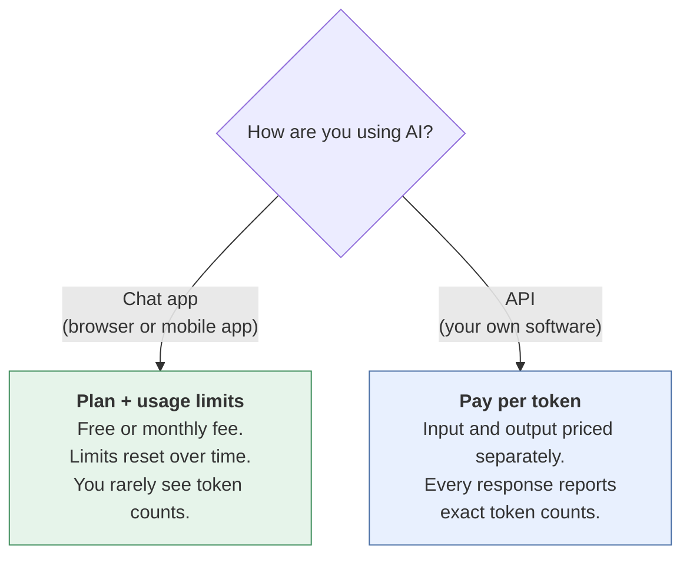
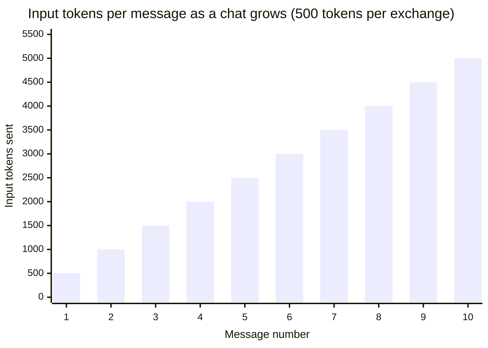
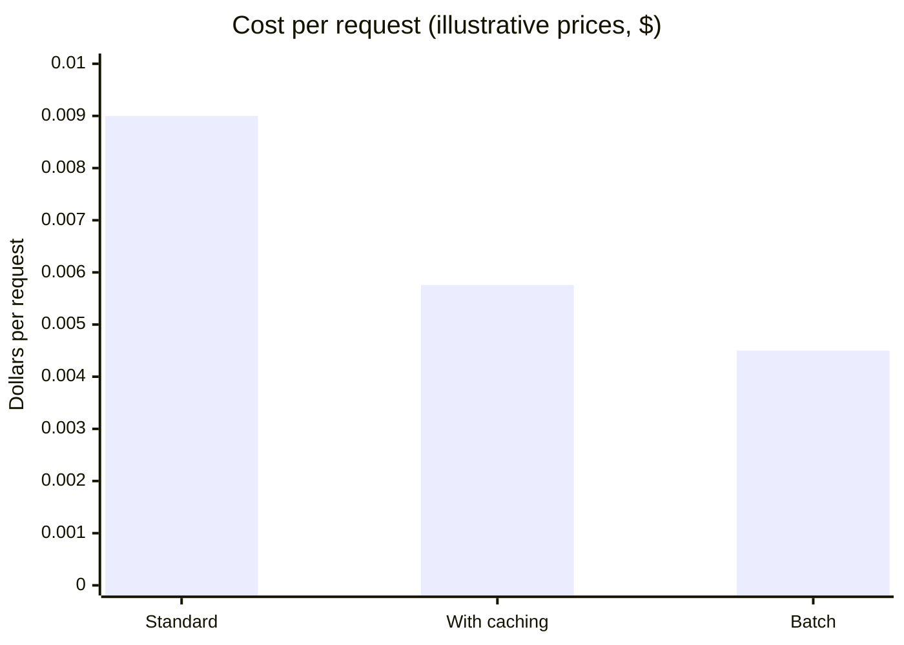

# Tokens and usage, explained
{: .no_toc }

What tokens are, how chat-app limits and API billing use them, and how to answer "what does it cost?" clearly in a meeting or a networking conversation.
{: .fs-6 .fw-300 }

  
On this page

  {: .text-delta }
1. TOC
{:toc}

## Scenario

At an industry event, three people ask the same kind of question:

- *"How many tokens do you use a month?"*
- *"Which one's cheaper per token?"*
- *"Why do I keep hitting my limit?"*

Each question mixes up two different things: **chat apps**, which you pay for with a plan that has usage limits, and **APIs**, which you pay for by the token. Once you separate them, all three have short, clear answers.

## Why it matters

Tokens are how AI usage is measured, limited, and billed. Misunderstanding them leads to surprise bills, budgets that fall apart at scale, and frustration when a chat suddenly stops working. Explaining them clearly is also a quick way to show AI fluency to a manager, a client, or a new contact.

## Key ideas

### The 30-second version

> A **token** is the unit AI models read and write: a chunk of text, often part of a word. Everything is measured in tokens: what you send, what the model writes back, and how much it can consider at once. **Chat apps** charge a plan with **usage limits**. **APIs** charge **per token**, with input and output priced separately and output usually costing more.

### Five ideas behind every token question

**1. A token is a chunk of text.** It's often part of a word. One vendor's guidance puts a token at about 4 characters, with 100 tokens equal to about 60–80 English words. So a typical page of about 500 words is roughly **600–850 tokens**. Treat this as a rule of thumb only. Another vendor warns that estimates like "characters ÷ 4" are inaccurate, so use the vendor's counting tool when it matters.

**2. Input and output are counted separately.** Input is everything you send: your message, files, instructions, and the conversation so far. Output is everything the model generates, which can include reasoning the model does before answering that you never see.

**3. The context window is how much the model can consider at once.** It's measured in tokens and varies by model and plan. A bigger window doesn't mean better answers: models can miss details in the middle of long inputs (see [How LLMs fail]()), and on an API you pay for every token you send.

**4. There are two ways to pay:**

| | Chat app | API |
|:--|:--|:--|
| You pay | A plan: free or monthly | Per token |
| What runs out | Usage limits, which reset over time | Budget or spending cap |
| Do you see tokens? | Mostly no. You see "limit reached." | Yes, in every response |
| Who asks about this | Individual users | Developers, finance, IT |

**5. Token counts aren't comparable across vendors, or even across models.** Each vendor splits text differently, so the same paragraph gives different counts. Even within one vendor, a newer model can count the same text as noticeably more tokens. Compare **cost per finished task**, not price per token.

### Why chat limits run out

Every new message resends the **whole conversation** as input. If each exchange adds about 500 tokens:

- Your 10th message carries about **5,000 tokens** of history.
- Across those 10 messages, you've used about **27,500 input tokens** (500 × (1 + 2 + … + 10)).

Long conversations, large attachments, research modes, and higher-effort reasoning all use more of a limit. **The fix:** start a fresh chat for a new task, and keep reusable material in a project rather than one endless thread.

## Worked example

**"So what would it cost?"**

{: .warning }
The prices below are **illustrative, not any vendor's actual rates**, and match the example on [Operating AI](). Check current price sheets before quoting real numbers. For how each vendor counts tokens, see [Tokens and usage by vendor]().

Assume **$3 per million input tokens** and **$15 per million output tokens**. One request with **1,500 tokens in** and **300 tokens out**:

- Input: 1,500 × $3 ÷ 1,000,000 = **$0.0045**
- Output: 300 × $15 ÷ 1,000,000 = **$0.0045**
- **Total: $0.009 per request.** At 1,000 requests a day, that's **$9 a day**, or about **$270 a month**.

**Two cost levers most people haven't heard of:**

| Lever | What it does | Effect on this example |
|:--|:--|:--|
| **Prompt caching** | A repeated opening part of the prompt (long instructions, a reference document) is billed at a much lower rate on later requests. Assume cached reads cost 10% of the normal input price. | If 1,200 of the 1,500 input tokens are cached: $0.0009 + $0.00036 + $0.0045 = **$0.00576**, which is **36% cheaper** |
| **Batch processing** | Requests that don't need an instant answer are processed later at a discount. Assume 50% off. | **$0.0045** per request, **half price** |

### Quick answers to the usual questions

| Question | Short answer |
|:--|:--|
| "How many tokens is a page?" | Roughly 600–850 for about 500 English words. Use the vendor's counter when it matters. |
| "Which is cheapest?" | It depends on the model tier and the task. Compare cost per *completed* task, since a cheap model that needs retries isn't cheap. |
| "Why do I keep hitting my limit?" | Long chats resend everything. Big files, research modes, and heavy reasoning use more. Start new chats. |
| "Is a bigger context window better?" | Not automatically. It's useful for long documents, but you pay for what you send, and details in the middle can be missed. |
| "Is my data used for training?" | That's not a token question. It depends on the vendor, plan, and settings. See [Data classification](). |

## Verify checklist

Before you quote a token figure or a cost:

- [ ] I said whether I mean a **chat app** (plan and limits) or an **API** (per-token).
- [ ] I separated input from output, and remembered that output can include hidden reasoning.
- [ ] I used the vendor's own counting tool, not just a rule of thumb, for anything that matters.
- [ ] I counted with the **same model** I'll actually use.
- [ ] I labeled any price as current list price, with a date, or as illustrative.
- [ ] I compared cost per finished task, not just price per token.

## Common failure modes

| Failure | What it looks like | How to catch it |
|:--|:--|:--|
| **Mixing up apps and APIs** | "My chat app costs $X per token" | Ask: plan or API? |
| **Forgetting conversation history** | Budgeting only for each new message, not the resent history | Model input as the whole conversation so far. |
| **Comparing tokens across vendors** | "Vendor A uses fewer tokens, so it's cheaper" | Counts differ by tokenizer. Compare cost per task. |
| **Reusing old counts** | Estimating a new model's cost from an old model's counts | Recount with the model you plan to use. |
| **Ignoring output** | Budgeting for input only | Output is usually priced higher, and can include hidden reasoning. |
| **Quoting stale prices** | Last year's rates in a budget | Date every price, and check the vendor's sheet. |

## Disclose and decide notes

**Disclose:** When you share a cost estimate, state your assumptions: tokens per request, prices and their date, caching and batch assumptions, and whether it's an app or an API.

**Decide:** Token math tells you what something costs. Whether it's *worth* it depends on time saved, including review time (see [Should you use AI here?]()). That's your call.

## For educators: turn this into a challenge

Give learners a short scenario, such as "a support team drafting 800 replies a day," with illustrative prices. Teams estimate tokens per request (input including instructions, plus output), compute daily and monthly cost, then apply caching and batch assumptions. **Twist:** reveal that each reply is part of a 6-message thread, so history is resent each time. Debrief: *How much did conversation history change the estimate? Which lever saved the most?* See [Designing an AI-fluency challenge]().
