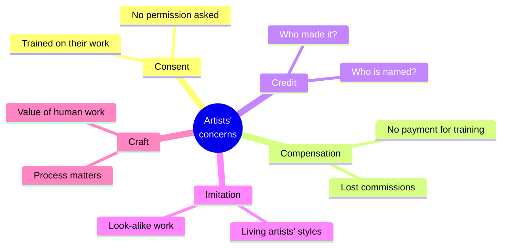
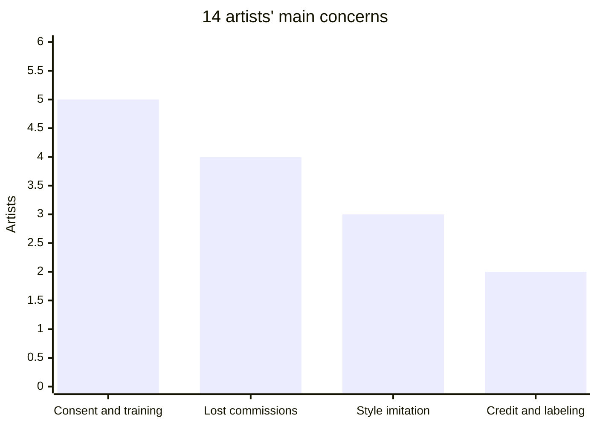

# Talking about AI with artists
{: .no_toc }

For organizations, educators, and teams who work with artists, designers, writers, musicians, and other creative professionals: what they're concerned about, what's actually settled and what isn't, and the commitments that build trust.
{: .fs-6 .fw-300 }

<details open markdown="block">
  <summary>On this page</summary>
  {: .text-delta }
1. TOC
{:toc}
</details>

## Scenario

**Tidewater Arts Center** (fictional) is a community arts nonprofit that runs classes, exhibitions, and an annual summer festival. Short on time and budget, the marketing coordinator uses an AI image generator to create the festival poster. It looks polished, and it's on bus shelters within a week.

Then local artists notice. Several have taught at the center for years. One posts that the poster "looks like it was trained on our work, by the organization that's supposed to support us." Others ask whether the center plans to replace its artist-designed materials altogether. The board chair asks the executive director to meet with the artist community and "explain our position." The center doesn't have one.

## Why it matters

For many creative professionals, generative AI isn't a neutral productivity tool. It touches their work in ways other professions don't feel the same way:

- **Consent and compensation.** Many image, music, and text models were trained on large amounts of creative work without the creators' permission or payment. Whether that training is lawful is the subject of lawsuits and policy debates in several countries. Whether it's fair is a values question many artists feel strongly about.
- **Livelihood.** Commissions for illustration, stock imagery, copywriting, and music for media are exactly the kind of work generated content competes with.
- **Imitation.** Generators can produce work "in the style of" a specific living artist, which many artists experience as having their identity copied.
- **Authorship and credit.** Who made the work, and who gets named?
- **The value of craft.** Many artists see the process, not only the result, as the point of the work.

An organization that works with artists, such as an arts center, a design school, a publisher, an agency, or a marketing team, has to take these concerns seriously to keep their trust. That doesn't mean any use of AI is off-limits. Some artists use AI tools themselves, for reference, ideas, or tedious tasks. It means being honest, specific, and careful about where and how.

For other audiences, see [Explaining AI to others](). For skeptics more generally, see [Talking about AI with skeptics]().

## Key ideas

### What artists are concerned about



### What's settled, what isn't, and what's a values question

| Question | Where things stand | Source |
|:--|:--|:--|
| Can purely AI-generated images or music be protected by copyright in the U.S.? | No. The U.S. Copyright Office requires human authorship, and says AI-generated material beyond a trivial amount must be excluded from a registration claim. | Copyright Office registration guidance (2023) |
| Can work that includes AI-generated material be protected? | Yes, for the human contribution: a person's creative selection and arrangement of material, or creative modification of it, can be protected. | Copyright Office registration guidance (2023) |
| Does writing detailed prompts make someone the author? | Not on its own, according to the Copyright Office: "prompts do not alone provide sufficient control" with current technology. Decided case by case. | Copyright Office report on copyrightability (2025) |
| Is training AI on copyrighted work without permission lawful? | **Unsettled.** It's the subject of ongoing lawsuits and policy work in several countries, and answers may differ by country. | — |
| Is it fair to use tools trained this way? | **A values question.** Reasonable people disagree. Don't present your answer as fact. | — |
| Must AI-generated media be labeled? | Depends on where and what. The EU AI Act requires disclosure of deepfakes, and platforms have their own rules. See [AI regulation and frameworks](). | — |

Copyright rules differ by country, and this isn't legal advice. Check with a lawyer for anything you plan to sell, license, or register.

### Commitments that build trust

If your organization works with artists, decide your commitments and say them publicly. For example:

1. **No imitation of living artists.** No prompts naming a living artist or asking for their style, and no outputs that closely resemble a specific artist's work.
2. **No artists' work as input without permission.** Don't upload an artist's work to an AI tool to vary, extend, or imitate it unless they've agreed.
3. **Commission people for public creative work** where creativity is the point: posters, exhibition materials, book covers, original music. Decide where AI is and isn't acceptable, such as internal mockups.
4. **Label AI-generated media** where people could mistake it for human-made or real. See [Images, audio, and video]().
5. **Credit honestly.** Name the people who made the work, and say what AI contributed when it matters.
6. **Respect artists' own choices.** Artists who use AI in their practice and artists who refuse it are both legitimate. Don't require either.

### How to have the conversation

- **Listen before explaining.** Ask what they're concerned about, and let them finish.
- **Acknowledge the consent problem directly.** Don't argue that training is "just like a human learning from art." Many artists find that framing dismissive, and the legal question isn't settled.
- **Don't call generated output art made "by AI" in a way that equates it with their work,** and don't argue about whether it "counts as art." That debate rarely helps.
- **Be specific about what you do.** "We use AI to resize images for different screens" is very different from "we generate our illustrations."
- **Own mistakes.** If you published something you shouldn't have, say so, and say what changes.
- **Separate facts from values.** Copyright registration rules are facts you can cite. Whether AI art is "real art" is a values question.

## Worked example

Tidewater's executive director meets with fourteen local artists who teach at or exhibit with the center. They start by apologizing, specifically: the poster was generated without considering the center's relationship with local artists, and without any policy to check it against.

They then ask each artist to name their main concern, and sort the answers:

| Concern | Artists who raised it | What the center committed to |
|:--|--:|:--|
| Consent and training on artists' work | 5 | No imitation of living artists' styles; no uploading artists' work to AI tools without permission. |
| Lost commissions | 4 | Public creative work is commissioned from artists. |
| Imitation of local artists' styles | 3 | The same no-imitation rule, plus a review step before anything generated is published. |
| Credit and labeling | 2 | Artists are credited on all materials; AI-generated media is labeled. |
| **Total** | **14** | |



**The cost decision.** The marketing coordinator points out, fairly, that the generated poster cost almost nothing, and the budget is tight. The center compares options for the festival's three main pieces (poster, program cover, and banner):

| Option | Cost | Trade-off |
|:--|--:|:--|
| AI-generated | About $0 | Fast and cheap, but conflicts with the center's mission and its relationship with local artists |
| Commission three local artists at $400 each | $1,200 | Costs money, supports the artists the center exists to serve, and gives the festival original work |

The board approves the $1,200 by moving money from the print-advertising budget. The center's reasoning was about mission and trust, not about AI images being lower quality: an arts center that generates its own posters undermines the case it makes for artists.

**The center's published statement** (on its website and in artist agreements):

```text
HOW TIDEWATER ARTS CENTER USES AI

We commission artists for our posters, program covers, exhibition
materials, and other public creative work, and we credit them by name.

We may use AI tools for internal tasks, such as drafting schedules,
resizing images for different screens, or early mockups that are never
published.

We never ask an AI tool to imitate a living artist's style, and we never
upload an artist's work to an AI tool without their permission.

If we publish anything AI-generated, we label it.

Artists who work with us decide for themselves whether to use AI in
their own practice. We don't require it, and we don't penalize it.

Questions or concerns: [contact].
```

**What happened.** The center replaced the poster with an artist's commissioned design two weeks later and credited the artist on every placement. One of the artists who had raised the concern publicly shared the new statement. Two artists said they use AI tools for reference in their own work, and were glad the statement didn't treat that as wrong.

## Prompt template

**Draft your organization's AI statement for creative work:**

```text
Draft a short public statement for [TYPE OF ORGANIZATION] explaining
how we do and don't use AI in creative work. Use only the commitments
below. Plain, direct language; no marketing tone. Don't claim anything
about copyright law. If something artists would expect us to address
is missing, write "MISSING:" and what it is.

OUR COMMITMENTS:
- Work we commission from people: [ ]
- Where we may use AI: [ ]
- Imitation of living artists: [ ]
- Use of artists' work as input: [ ]
- Labeling: [ ]
- Credit: [ ]
- Artists' own choices: [ ]
- Contact: [ ]
```

**Prepare for the conversation:**

```text
I'm meeting with artists who are upset that [WHAT HAPPENED]. Give me
the strongest version of their concerns, in their terms, without
counterarguments. Then list which concerns I could address with
specific commitments, and which are values questions I should
acknowledge rather than argue.
```

Have an artist you trust read the statement before you publish it, and check any statement about law with a lawyer.

## Verify checklist

- [ ] I listened to artists' concerns before explaining anything.
- [ ] I acknowledged the consent and training question directly, without claiming it's settled.
- [ ] Our commitments cover imitation, use of artists' work as input, commissioning, labeling, and credit.
- [ ] Any statement about copyright matches the source, says which country, and isn't presented as legal advice.
- [ ] Artists who use AI and artists who refuse it are both respected.
- [ ] Cost comparisons are honest, including what the cheaper option costs in trust.
- [ ] An artist reviewed our public statement before publication.
- [ ] Mistakes were acknowledged specifically, with what's changing.

## Common failure modes

| Failure | What it looks like | How to catch it |
|:--|:--|:--|
| **"It's just like human inspiration"** | Arguing that training is the same as an artist learning | Acknowledge the consent concern; the question isn't settled. |
| **The "is it art?" debate** | Arguing about whether generated images count as art | Talk about specific uses and commitments instead. |
| **Legal overconfidence** | "AI images are copyright-free, so it's fine" | Cite the actual rules, for the right country, and check with a lawyer. |
| **Style prompts** | "In the style of [living artist]" | Ban naming living artists in prompts. |
| **Vague reassurance** | "We value artists" | Specific, published commitments. |
| **Treating all artists the same** | Assuming every artist opposes AI, or that every artist should use it | Respect both choices. |
| **Hiding AI use** | Generated images published without a label | Label anything that could be mistaken for human-made or real. |

## Disclose and decide notes

**Disclose:** Label AI-generated images, audio, and video where people could mistake them for human-made or real, and say what AI contributed when it matters. Credit people by name for what they made.

**Decide:** Each organization decides where AI fits in its creative work, and its mission should guide that, not only cost. Each artist decides whether to use AI in their own practice. Legal questions belong with lawyers; values questions belong in an open conversation with the people affected.

## For educators: turn this into a challenge

In an art, design, media, or marketing course, give teams a scenario: an organization published an AI-generated image that upset its creative community. Teams sort the community's concerns (consent, compensation, imitation, credit, craft), separate settled facts from open questions and values, and write a public statement of commitments. Then they role-play a meeting with artists played by classmates, including at least one artist who uses AI in their own work. Score on whether teams acknowledged the consent issue, cited copyright rules accurately, made specific commitments, and respected both artists who use AI and those who refuse it. Debrief: *Which concern couldn't be resolved with a commitment, and how did you handle it?* See [Designing an AI-fluency challenge]().

---

**References**

- U.S. Copyright Office. (2023). Copyright registration guidance: Works containing material generated by artificial intelligence. *Federal Register, 88*, 16190–16194. https://www.federalregister.gov/documents/2023/03/16/2023-05321/copyright-registration-guidance-works-containing-material-generated-by-artificial-intelligence
- U.S. Copyright Office. (2025). *Copyright and artificial intelligence, Part 2: Copyrightability*. https://www.copyright.gov/ai/Copyright-and-Artificial-Intelligence-Part-2-Copyrightability-Report.pdf
