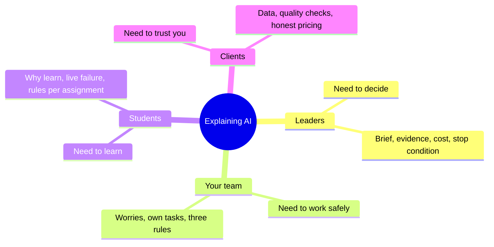

# Explaining AI to others
{: .no_toc }

The same few habits work for any audience: start with what they're worried about, use one plain comparison, show a real failure, be specific, and end with what they need to do. Then adjust for who's listening.
{: .fs-6 .fw-300 }

  
On this page

  {: .text-delta }
1. TOC
{:toc}

## Scenario

In one week, a small-business manager has to explain the same AI tool four times: to the owner, who has to approve the cost; to the staff who'll use it; to a client, who asks whether their data goes into it; and to an intern, who wants to know whether they're allowed to use AI on their training tasks. They give roughly the same explanation each time, about how the tool works. Each audience leaves with a different unanswered question.

## Why it matters

People don't need the same thing from an explanation of AI. A leader needs enough to **decide**. Staff need enough to **work safely**. A student needs enough to **learn**. A client needs enough to **trust you**. The technology is the same; the question each person brings is different.

Explaining AI well is also a test of your own understanding. If you can't say plainly what it does, how it fails, and how you check it, that's worth knowing before someone else asks.

## Key ideas

### Five habits for any audience

1. **Start with their worry, not the technology.** Every audience has a question they're really asking. Answer it first.
2. **Use one plain comparison.** For example, from [What is AI?](): *a fast, widely read assistant who has never met your organization and sometimes states a guess as if it were a fact.* Skip how models work unless someone asks.
3. **Show a real failure.** One mistake people watch happen, and the check that caught it, does more than any warning. It also shows you're not selling.
4. **Be specific.** Name the tool, the task, the data, the numbers, and who checks. Vague reassurance ("it's safe," "it's accurate") invites doubt.
5. **End with what they need to do.** A decision, a rule, a habit, or a choice. Otherwise the explanation ends with "interesting," and nothing changes.

### Pick the page for your audience

| Audience | What they need | What they're usually worried about | Page |
|:--|:--|:--|:--|
| **Leaders** | Enough to decide: fund, approve, limit, or stop | Cost, risk, and whether it actually works | [Explaining AI to leaders]() |
| **Your team** | Enough to use it safely and with confidence | Their jobs, blame, and what's allowed | [Explaining AI to your team]() |
| **Students** | Enough to learn with it, not instead of learning | Being accused of cheating, falling behind | [Explaining AI to students]() |
| **Clients** | Enough to trust your work and your handling of their data | Confidentiality, quality, and price | [Explaining AI to clients]() |

### For an audience not listed

Ask three questions before you explain anything:

1. **What do they need to do afterward?** Decide, comply, learn, trust, or just understand?
2. **What are they worried about?** If you don't know, ask them before you explain.
3. **What's the one failure they should see?** Pick the one most relevant to their situation.

For example, **parents** of students usually worry about cheating and about whether their child is still learning; the [students page]() adapts well. A **board** needs the leaders' brief, focused on oversight: who owns it, how results are reported, and what would stop it. **Customers** using an AI assistant need to know it's AI, what it can and can't do, and how to reach a person.

## Worked example

The manager from the scenario takes one fact about their AI tool, that **it can state wrong information confidently**, and explains it four ways:

| Audience | How the same fact is explained |
|:--|:--|
| Owner | "In our test of 40 cases it got 3 wrong, one of them serious. A person reviews every output before it's used, and if a serious error gets through, we pause the tool." |
| Staff | "It will sometimes sound sure and be wrong. Here's one it got wrong last week. Check names, numbers, and dates before anything leaves your hands." |
| Intern | "It's great for explaining a concept, but it got this calculation wrong. Do the exercise yourself first, then use it to check your understanding." |
| Client | "Every number in what we send you is checked against a source by a person. Here's an error we caught that way." |

Same fact, four different purposes: a **decision**, a **habit**, a **learning approach**, and **trust**. Each version ends with something the listener can act on.

## Verify checklist

- [ ] I know what this audience needs to do after hearing my explanation.
- [ ] I've answered their main worry before explaining anything else.
- [ ] I used one plain comparison, not a technical lecture.
- [ ] I showed or described a real failure and how it's caught.
- [ ] Every claim is specific: tools, tasks, data, numbers, and who checks.
- [ ] I could explain any part of it without notes.

## Common failure modes

| Failure | What it looks like | How to catch it |
|:--|:--|:--|
| **One explanation for everyone** | The same technical overview for the owner and the intern | Ask what each audience needs to do afterward. |
| **Hype or fear** | "It changes everything" or "it's dangerous" | Describe what it does well, what it doesn't, and how you know. |
| **No failure shown** | Only success stories | Include one real mistake and the check that caught it. |
| **Vague reassurance** | "It's safe and accurate" | Name the data, the test, and the numbers. |
| **No ending** | The explanation stops without a next step | Close with the decision, rule, or habit you want. |

## Disclose and decide notes

**Disclose:** If AI helped you prepare an explanation, such as slides, a brief, or a handout, say so. It shows the habit you're explaining.

**Decide:** You decide what to emphasize for each audience. You don't decide what's true. The facts, including the failures, stay the same whoever you're talking to.

## For educators: turn this into a challenge

Give teams one short description of a fictional AI tool, with test results, costs, data handling, and one serious failure. Each team member explains it to a different audience in two minutes: an executive, a staff member, a student, and a client. The rest of the team plays that audience and asks one hard question. Score on whether each explanation answered that audience's real worry and ended with a clear next step, and on whether the facts stayed the same across all four. Debrief: *What changed between versions, and what should never change?* See [Designing an AI-fluency challenge]().
