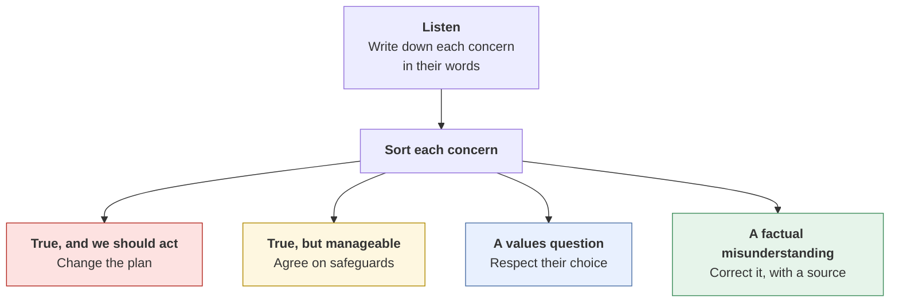

# Talking about AI with skeptics
{: .no_toc }

Many objections to AI are well founded. How to talk with people who distrust or oppose it: listen first, sort their concerns, concede what's true, correct only what's factually wrong, and look for shared safeguards rather than agreement.
{: .fs-6 .fw-300 }

<details open markdown="block">
  <summary>On this page</summary>
  {: .text-delta }
1. TOC
{:toc}
</details>

## Scenario

The development director at **Fernhollow Community Trust** (fictional), a small nonprofit, wants the team to start using AI to draft grant applications. The senior grant writer, who has written the organization's most successful proposals for twelve years, refuses. In a team meeting, they say: *"It makes things up, it was built on writers' work without permission, it burns huge amounts of energy, and funders can tell. I'm not using it, and I don't think we should either."*

The director's first instinct is to explain how much time it would save. The meeting ends badly.

## Why it matters

People who distrust AI are often right about something. AI tools do state false things confidently. Questions about training data, consent, and copyright are unresolved in many places. Data centers' energy and water use is a real and growing concern. And over-reliance on AI is associated with less critical thinking: in a survey of 319 knowledge workers, higher confidence in AI went with less critical thinking (Lee et al., 2025).

Treating skeptics as people who "don't get it" fails twice. It loses the argument, because people dig in when they feel dismissed. And it loses the information: skeptics often see risks that enthusiasts miss.

The goal of the conversation isn't to convert anyone. It's to **share the same facts, take the real concerns seriously, and agree on what happens next**, which may include not using AI for some things. Sometimes the skeptic's answer is the right one. See [Should you use AI here?]().

For other audiences, see [Explaining AI to others]().

## Key ideas

### Listen first, then sort the concerns

Before responding to anything, ask what specifically worries them, and write it down. Then sort each concern:



Most concerns land in the first three groups. Only the last calls for correction, and even then, correct the specific fact rather than the person's overall view.

### Common objections, answered honestly

| Objection | What's true | What you can honestly add |
|:--|:--|:--|
| **"It makes things up."** | Yes. Fluent, confident errors are built into how these tools work. See [How LLMs fail](). | That's why every use needs a check by someone who knows the subject. If a task can't be checked, AI may not be the right tool for it. |
| **"It was built on people's work without permission."** | Many models were trained on large amounts of material whose creators didn't consent. Whether that's legal is the subject of lawsuits and policy debates in several countries. | Concede the point. Some organizations limit which tools they use, or how, partly for this reason. It's a fair values question. |
| **"It uses too much energy and water."** | Data centers' energy and water use is real and growing. Estimates for individual tasks vary widely and are disputed. | Using AI only where it adds clear value, and choosing smaller models where they're good enough, reduces the footprint. See [Choosing a model](). |
| **"It'll take our jobs."** | Some tasks will change, and some roles may shrink. Nobody knows the full effect. | Say honestly what's decided about roles in your organization, and what isn't. See [Explaining AI to your team](). |
| **"It makes people stop thinking."** | Over-reliance is a real risk, with evidence behind it. | Agree, and design for it: think first, then use AI; check its work. See [Trusting your own judgment](). |
| **"It's biased."** | Models can reflect and amplify bias in their data. | Test for it on your own cases before relying on it for decisions about people. See [Bias, fairness, and ethics](). |
| **"It's all hype."** | A lot of it is. | Look at results on your own tasks, compared with how you work today, rather than claims. |
| **"I just don't want to use it."** | That's a legitimate choice for many tasks. | Ask whether there are tasks where they'd accept others using it with safeguards, and respect the answer. |

### How to have the conversation

- **Ask, don't pitch.** "What worries you most about it?" before anything else.
- **Concede what's true, out loud.** "You're right that it makes things up" opens the conversation. Defending the indefensible closes it.
- **Correct facts, not values.** If someone believes AI tools are always connected to the internet, or that everything typed in is published, correct that with a source. If someone believes using AI for creative work is wrong, that's a value, not an error.
- **Talk about specific uses, not "AI."** "Should we use AI?" is unanswerable. "Should we use it to summarize funder guidelines, with you checking the summary?" isn't.
- **Offer choice where you can.** Opting out of using AI personally, while reviewing others' use, is often a workable middle ground.
- **Ask them to help set the safeguards.** Skeptics are often the best people to design the checks, because they're the ones looking for failures.
- **Don't oversell.** Every exaggeration confirms their concern about hype.

## Worked example

The development director tries again, one-on-one this time. They start by asking the grant writer to list every concern, and write each one down without responding. Then they go through the list together and sort it:

| Concern | Sorted as | What they agreed |
|:--|:--|:--|
| "It makes things up: statistics, citations, program details." | True, act | No AI-generated facts, figures, or citations in any proposal. Every figure comes from the organization's own records. |
| "It could invent stories about the people we serve." | True, act | No AI-written beneficiary stories, ever. Stories come from real, consented accounts. |
| "Funders' data and our donors' details would go into it." | True, manageable | Only the organization's approved tool, and no donor or beneficiary personal data in prompts. See [Data classification](). |
| "Funders can tell, and some won't accept it." | True, manageable | Check each funder's rules on AI use; some ask applicants to disclose it. Follow them. |
| "It was trained on writers' work without permission." | Values question | The grant writer won't use AI for drafting. The director accepts that, without pressure to change. |
| "It writes everything in the same bland voice." | Partly a misunderstanding | It tends to, without examples. The director shows that giving it past successful proposals as examples changes the voice, and agrees the writer's edit is still what makes a proposal work. |

They agree on a three-month trial. The director and a program officer use AI for **two tasks only**: summarizing long funder guidelines into a checklist, and producing a first outline from the program team's notes. The grant writer doesn't use it, but reviews every AI-assisted section before submission, with the authority to remove anything.

**After three months.** The grant writer caught two errors in AI-produced funder checklists, including a missed eligibility requirement that would have disqualified one application. They proposed a new rule: every checklist is compared line by line with the funder's original guidelines. The team adopted it. The grant writer still doesn't use AI, and the director doesn't expect them to. Both agree the safeguards are better because the person most skeptical of AI designed several of them.

## Prompt template

**Prepare for the conversation by steelmanning their view:**

```text
I'm about to talk with a colleague who strongly opposes using AI for
[TASK] at [TYPE OF ORGANIZATION]. Make the strongest honest case
against using AI for this task, covering accuracy, ethics, data,
quality, and effects on people's skills and jobs. Don't include
counterarguments. Then list which of these concerns could be addressed
with safeguards, and which are values questions where reasonable people
disagree.
```

Read the case against carefully before the conversation. If any part of it changes your mind about the task, say so in the meeting.

**Check a factual claim before correcting someone:**

```text
A colleague said: "[CLAIM]". Is this accurate? Separate what's well
established, what's disputed, and what's unknown. Point me to the kind
of source I should check (official documentation, a peer-reviewed
study, a government report) rather than giving me a final answer.
```

Then check the source yourself. Correcting a skeptic with a wrong "fact" from an AI tool is the fastest way to prove their point.

## Verify checklist

- [ ] I asked what worried them, and wrote it down, before saying anything for AI.
- [ ] I sorted each concern: true and act, true but manageable, values, or factual misunderstanding.
- [ ] I conceded the concerns that are true, out loud.
- [ ] I corrected only factual errors, with a source I checked myself.
- [ ] We discussed specific uses, not "AI" in general.
- [ ] Their choice not to use AI personally is respected where it's possible.
- [ ] They had a hand in setting the safeguards.
- [ ] Nothing I said overstated what AI can do.

## Common failure modes

| Failure | What it looks like | How to catch it |
|:--|:--|:--|
| **The pitch** | Leading with time saved and features | Ask what worries them first. |
| **Dismissal** | "You just don't understand it" | Concede what's true before anything else. |
| **Arguing values as facts** | Trying to "prove" someone's ethical objection wrong | Name it as a values question and respect it. |
| **Overselling** | "It hardly ever makes mistakes" | Every exaggeration confirms their concern. Stick to what you've measured. |
| **All or nothing** | "Either the team uses AI or it doesn't" | Talk about specific uses, and allow personal opt-outs. |
| **Winning the argument** | The skeptic goes quiet, and stops raising problems | Measure success by shared safeguards, not agreement. |
| **Correcting with an unchecked fact** | Quoting an AI tool's answer to rebut them | Check the source yourself. |

## Disclose and decide notes

**Disclose:** Be open about where AI is used in shared work, so colleagues who object know what they're reviewing or signing. *"Sections 2 and 4 were outlined with AI from the program team's notes; all facts are from our records."*

**Decide:** Organizations decide which uses are allowed and what safeguards apply. Individuals often get to decide whether they personally use AI, and where that's possible, the choice should be respected. Values disagreements don't need to be resolved for a team to agree on what's safe and what's off-limits.

## For educators: turn this into a challenge

Pair students. One plays a thoughtful AI skeptic with three to five specific concerns, drawn from a card that includes at least one well-founded concern, one values question, and one factual misunderstanding. The other has ten minutes to listen, sort the concerns, and agree on next steps for one specific task, without trying to win. Then swap. Score on whether the listener conceded what was true, distinguished values from facts, corrected only the misunderstanding (with a source), and reached a concrete agreement. Debrief: *Which concern was hardest to concede? Did you end up changing your own view on anything?* See [Designing an AI-fluency challenge]().

---

**References**

- Lee, H., Sarkar, A., Tankelevitch, L., Drosos, I., Rintel, S., Banks, R., & Wilson, N. (2025). The impact of generative AI on critical thinking: Self-reported reductions in cognitive effort and confidence effects from a survey of knowledge workers. In *Proceedings of the 2025 CHI Conference on Human Factors in Computing Systems* (pp. 1–22). https://doi.org/10.1145/3706598.3713778
