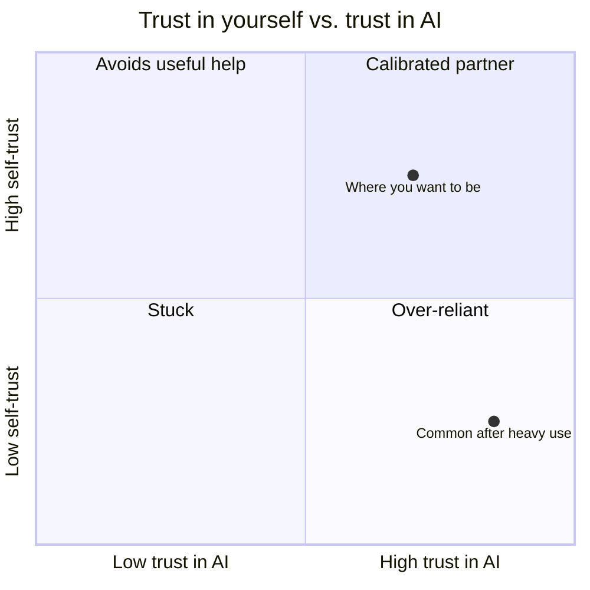
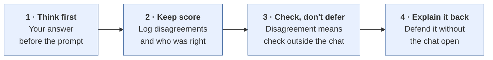
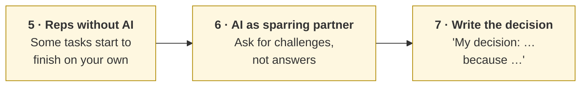
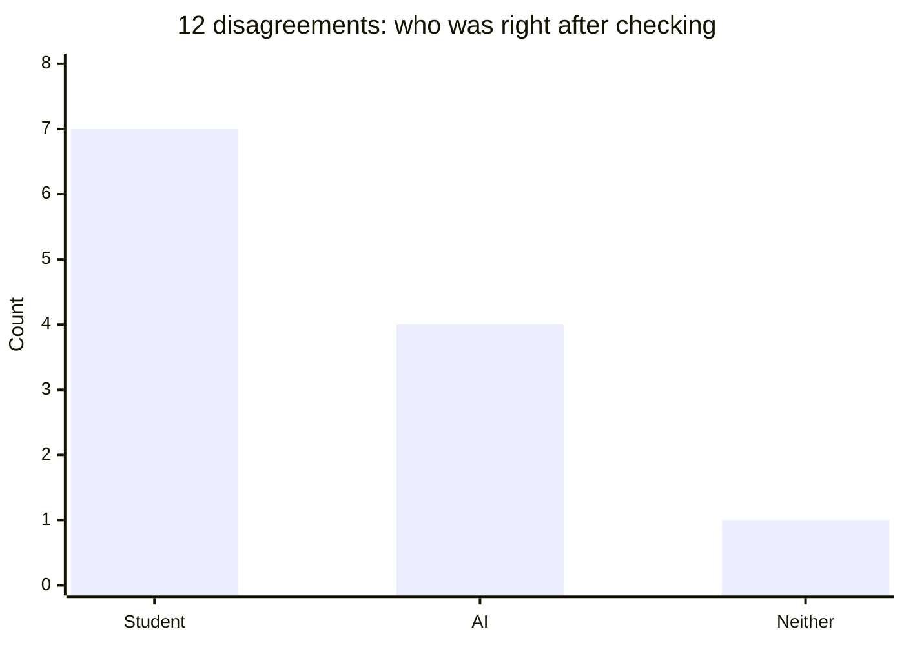

# Trusting your own judgment
{: .no_toc }

If you rely on AI for most of your work, here's how to rebuild confidence in your own thinking: not by using AI less, but by trusting both of you based on your track record.
{: .fs-6 .fw-300 }

<details open markdown="block">
  <summary>On this page</summary>
  {: .text-delta }
1. TOC
{:toc}
</details>

## Scenario

A second-year business student has used AI for almost everything this year: emails, case write-ups, spreadsheet formulas, interview prep. Their grades are fine. But they've noticed something uncomfortable. They can't start an assignment without opening a chat first. When the AI disagrees with them, they change their answer without checking. In a class discussion with no laptops, they freeze, even on a case they "wrote."

They don't want to stop using AI. They want to trust their own judgment again.

## Why it matters

Handing mental work to tools is normal and often smart. People have always used notes, calendars, and calculators to reduce mental effort, which researchers call **cognitive offloading** (Risko & Gilbert, 2016). The problem starts when the offloading becomes total, so you stop practicing the skill and stop noticing what you actually know.

Two findings explain why this matters for AI in particular:

- **Confidence shapes how much you think.** In a survey of 319 knowledge workers, higher confidence in AI was associated with *less* critical thinking, while higher self-confidence was associated with *more* (Lee et al., 2025). Trusting yourself isn't just about feeling better. It's linked to whether you check the work at all.
- **Over-trusting automation is a well-known human pattern.** A review of research on automated decision aids found that people make both omission and commission errors when the aid is imperfect: missing problems the aid didn't flag, and following its wrong advice. This happened to novices and experts alike, and training or instructions alone didn't prevent it (Parasuraman & Manzey, 2010).

AI makes this harder in one more way: its answers are fluent and confident whether they're right or wrong ([First principles]()), and it tends to agree with whoever pushes hardest ([How LLMs fail]()). Neither its confidence nor its agreement tells you who's right.

## Key ideas

### The goal is calibrated trust

Trusting yourself more doesn't mean ignoring AI. It means trusting **each** of you as much as your track record justifies, task by task.



"Calibrated" means your trust follows evidence. You might rely on AI heavily for recalling formulas and formatting, and on yourself for anything that depends on context AI doesn't have: your course, your team, your client, your values.

### Signs you're leaning too hard

| Sign | What it sounds like |
|:--|:--|
| You can't start without it | "Let me just see what the AI says first." |
| You accept what you can't explain | "I'm not sure why, but that's what it gave me." |
| You give in when it disagrees | "It said I was wrong, so I changed it." |
| You check by asking again | "I asked if it was sure, and it said yes." |
| You freeze without it | Struggling in discussions, interviews, or exams on work you "did" |

### Seven habits that rebuild self-trust





1. **Think first, then ask.** Before you prompt, spend two minutes writing your own answer: a rough estimate, an outline, or a gut call. Afterward, compare. Without this step you never find out what you'd have done on your own.
2. **Keep score.** Each time your first answer and AI's differ, log it, then find out who was right by checking a source, doing the math, or seeing the outcome. The scorecard template is below.
3. **Treat disagreement as a reason to check, not a verdict.** When AI contradicts you, ask for its reasoning, then check outside the chat: a source, a spreadsheet, a person ([second principle D]()). The same goes for agreement.
4. **Explain it back.** If you can't explain or defend an output without the chat open, it isn't your work yet. Restate it in your own words, or work through why it's right, until you can.
5. **Do some work without AI.** Do some tasks start to finish yourself: one problem per study session, one email a day, one analysis a week. Skills you don't practice fade, and confidence follows them. See [Setting up an AI tutor]().
6. **Use AI as a sparring partner.** Ask for the strongest counterargument, the weak spots in your draft, or a [persona panel]() of critics. You stay the author.
7. **Write the decision line yourself.** End important work with *"My decision: … because …"* in your own words. That's the **Decide** habit from [the rubric]().

## Worked example

The student keeps a **"me vs. AI" scorecard** for three weeks. For each task, they write a first answer before prompting. They log 30 tasks.

- On **18**, their first answer and AI's matched.
- On **12**, they differed. After checking each one against a source, a calculation, or the outcome:

| Who was right | Count | Typical tasks |
|:--|--:|:--|
| The student | 7 | Reading what a professor or team actually wanted; judging tone for a specific person; a cost that AI held constant but that changes with price |
| The AI | 4 | Recalling a definition; a formula's exact syntax; a formatting convention |
| Neither | 1 | A market-size figure both got wrong; the source said otherwise |



Before the scorecard, the student had deferred to AI every time they disagreed. That habit would have produced **8 wrong answers out of 12**: the 7 where they'd been right, plus the 1 where both were wrong.

The pattern was clearer than the count. AI was more reliable at **recall and convention**. The student was more reliable at **context**: what this professor, this team, or this client needed. They kept using AI for the first kind of task, and started trusting their first answer on the second kind, checking it rather than replacing it.

Three weeks of data isn't a law of nature. The point is that the student's self-trust now rests on evidence and is specific about where it applies.

## Prompt template

**The "me vs. AI" scorecard** (keep it in a spreadsheet or notebook):

```markdown
| Date | Task | My first answer (before AI) | AI's answer | Differ? | How I checked | Who was right | Task type |
|---|---|---|---|---|---|---|---|
| | | | | Y/N | source / math / outcome / person | Me / AI / Both / Neither | recall / context / calculation / writing |
```

Review it weekly: *Where am I usually right? Where is AI? Where do we both need a source?*

**A prompt that keeps you thinking first:**

```text
Here's my own answer to [TASK], written before asking you:
[YOUR ANSWER]

Don't rewrite it. Instead:
1. Say where you'd answer differently, and why.
2. For each difference, tell me how I could check who's right without
   relying on you (a source, a calculation, or a person to ask).
3. Point out anything in my answer that's stronger than what you'd have
   written.
I'll make the final decision.
```

## Verify checklist

- [ ] I wrote my own answer before prompting on at least some tasks this week.
- [ ] I logged the times AI and I disagreed, and checked who was right outside the chat.
- [ ] When AI contradicted me, I checked before changing my answer.
- [ ] I can explain the key points of my recent AI-assisted work without the chat open.
- [ ] I did at least one task this week start to finish without AI.
- [ ] My important work ends with a decision written in my own words.

## Common failure modes

| Failure | What it looks like | How to catch it |
|:--|:--|:--|
| **Swinging to distrust** | Refusing AI help, even where it's reliably better | Use the scorecard. Trust follows evidence in both directions. |
| **Confidence without checking** | "I trust myself now," so nothing gets verified | Self-trust means checking your own work too. |
| **Scorecard theater** | Logging only the times you were right | Log every disagreement, including the ones you lost. |
| **Thinking first, then ignoring it** | Writing your answer, then discarding it the moment AI replies | Compare point by point before you decide. |
| **All-or-nothing breaks** | "No AI for a month," then a return to total reliance | Small, regular reps without AI work better than a big detox. |

## Disclose and decide notes

**Disclose:** Being specific about AI's role is easier when you know what was yours: *"The analysis and recommendation are my own. AI checked my formulas and suggested two counterarguments, one of which I addressed."* The think-first habit makes this kind of disclosure honest and easy.

**Decide:** AI can inform a decision. It can't make you confident in it. That comes from doing the thinking, checking it, and seeing over time that your judgment holds up.

## For educators: turn this into a challenge

Ask students to keep the "me vs. AI" scorecard for two weeks on their regular coursework, then submit a one-page reflection: how many disagreements, who was right after checking, which task types favored whom, and one habit they'll keep. Don't grade the scores, only the honesty and quality of the reflection. In class, pool the anonymous task-type data and discuss where AI was reliably better and where students were. Debrief: *What surprised you about your own track record?* See [Designing an AI-fluency challenge]().

---

**References**

- Lee, H., Sarkar, A., Tankelevitch, L., Drosos, I., Rintel, S., Banks, R., & Wilson, N. (2025). The impact of generative AI on critical thinking: Self-reported reductions in cognitive effort and confidence effects from a survey of knowledge workers. In *Proceedings of the 2025 CHI Conference on Human Factors in Computing Systems* (pp. 1–22). https://doi.org/10.1145/3706598.3713778
- Parasuraman, R., & Manzey, D. (2010). Complacency and bias in human use of automation: An attentional integration. *Human Factors, 52*(3), 381–410. https://doi.org/10.1177/0018720810376055
- Risko, E., & Gilbert, S. (2016). Cognitive offloading. *Trends in Cognitive Sciences, 20*(9), 676–688. https://doi.org/10.1016/j.tics.2016.07.002
