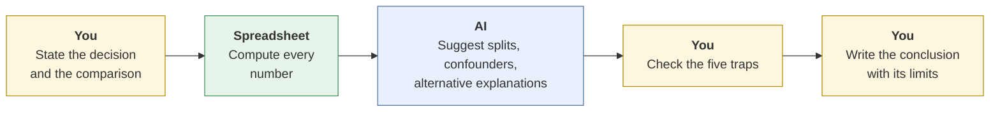
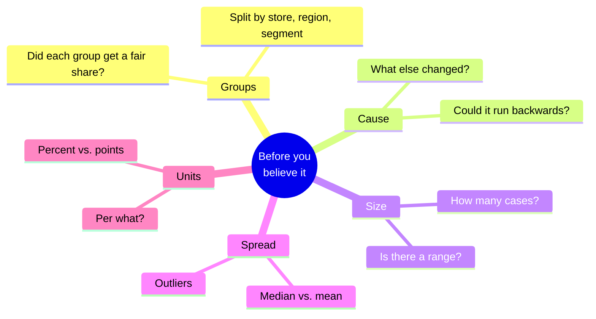
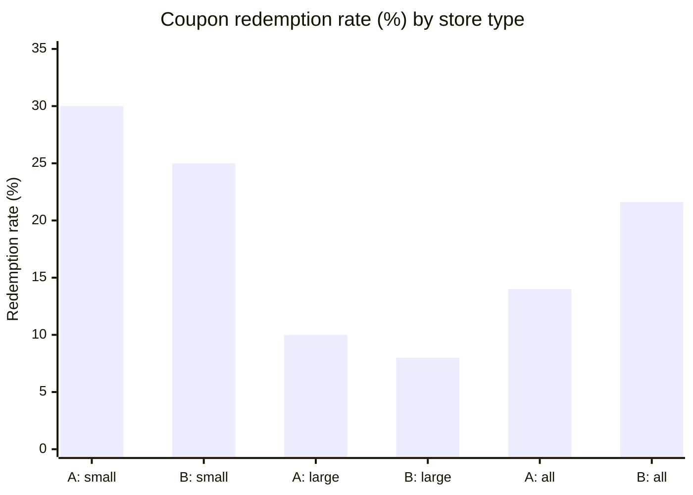

# Reading data and statistics with AI
{: .no_toc }

Catch the reasoning errors that make a data summary sound right and lead to the wrong decision: hidden groups, causes that aren't causes, small samples, and averages that hide the story.
{: .fs-6 .fw-300 }

<details open markdown="block">
  <summary>On this page</summary>
  {: .text-delta }
1. TOC
{:toc}
</details>

## Scenario

**Cedar Lane Grocers** (fictional) tested two coupon designs across its stores for a month. Coupon A went mostly to large suburban stores, and Coupon B mostly to small neighborhood stores. The marketing analyst uploads the results and asks an AI tool to summarize them.

The summary is crisp: *"Coupon B clearly outperforms Coupon A, with a 21.6% redemption rate versus 14.0%. B's design drives a 54% increase in redemptions. Recommend rolling out Coupon B to all stores."*

The arithmetic is right. The conclusion is wrong: **Coupon A did better in every type of store.**

## Why it matters

The [Spreadsheet and data analysis]() page is about getting the numbers right. This page is about the next step, **reasoning from numbers**, where AI is especially risky. Language models write fluent, confident interpretations, and they tend to describe patterns as causes ("drives," "leads to," "because"). They rarely ask on their own whether a comparison is fair.

Most bad data decisions in business don't come from a wrong calculation. They come from a correct calculation that answers the wrong question.

## AI-assisted approach



1. **State the decision first (Use).** "Should we roll out Coupon B?" is clearer than "analyze this data."
2. **Compute in the spreadsheet (Use).** Rates, averages, and differences come from formulas you can check, not from the chat. See [second principle C]().
3. **Use AI as a skeptic (Use, Verify).** Ask it for groups to split by, other explanations, and what data would change the conclusion. That's a job it does well.
4. **Check the five traps below (Verify).**
5. **Write the conclusion with its limits (Decide).** Say what the data shows, what it doesn't, and what you'd test next.

### The five traps

| Trap | What it sounds like | The question to ask |
|:--|:--|:--|
| **1 · Hidden groups** (Simpson's paradox) | "B beats A overall" | Does the result hold within each group, or did the groups differ? |
| **2 · Correlation as cause** | "Training drives higher sales" | What else differs between the groups? Could it run the other way? |
| **3 · Small samples** | "60% of customers loved it" (3 of 5) | How many cases is this based on? Would one more change it a lot? |
| **4 · Averages that hide the spread** | "The average basket is $50" | What's the median? Are a few extreme values pulling the average? |
| **5 · Percent vs. percentage points** | "Redemptions rose 54%" | Is that a relative change or a difference in rates? Say both. |



## Worked example

The analyst splits Cedar Lane's results by store type:

| Store type | Coupon A redeemed | Coupon A rate | Coupon B redeemed | Coupon B rate |
|:--|--:|--:|--:|--:|
| Small neighborhood | 30 of 100 | **30.0%** | 100 of 400 | 25.0% |
| Large suburban | 40 of 400 | **10.0%** | 8 of 100 | 8.0% |
| **All stores** | 70 of 500 | 14.0% | 108 of 500 | **21.6%** |



**Trap 1, hidden groups.** Coupon A wins in small stores (30% vs. 25%) *and* in large stores (10% vs. 8%). B wins overall only because 400 of B's 500 coupons went to small stores, where customers redeem far more coupons of any kind. The "B is better" result comes from **where** the coupons went, not their design.

**Trap 5, percent vs. points.** The AI's "54% increase" compares 21.6% with 14.0%: a difference of **7.6 percentage points**, which is a **54% relative increase** (7.6 ÷ 14.0). Both are correct descriptions of the overall numbers. But since the overall comparison is misleading, neither belongs in the recommendation.

**Trap 2, correlation as cause.** The AI said B's design "drives" redemptions. The data can't show that: store type, not design, explains the gap. A fair test would assign each coupon to a similar mix of stores.

**Trap 4, averages.** While checking basket sizes, the analyst notices one store's average basket is $50. Its ten coupon baskets were nine at $20 and one catering order at $320, so the **mean is $50** ($500 ÷ 10) but the **median is $20**. The typical customer spent $20.

**The analyst's conclusion:** *"Coupon A redeemed at a higher rate in both small stores (30% vs. 25%) and large stores (10% vs. 8%). B's higher overall rate reflects that most B coupons went to small stores. I recommend a re-test with both coupons assigned to the same stores before any rollout."*

## Prompt template

Use AI as a skeptic after you've computed the numbers yourself:

```text
Here are results I've already calculated in a spreadsheet:
[PASTE THE SUMMARY TABLE, including counts, not just percentages]

The decision: [WHAT WE'RE DECIDING].
My tentative conclusion: [YOUR CONCLUSION].

Act as a skeptical analyst. Don't recalculate anything. Instead:
1. List groups I should split the results by, and why each might matter.
2. List other explanations for the pattern besides my conclusion.
3. Flag any causal language in my conclusion that the data can't support.
4. Say whether any result rests on a small number of cases.
5. Say what additional data or test would most change the conclusion.
```

## Verify checklist

- [ ] Every number came from a formula I can check, not from the chat.
- [ ] I split the results by the most likely groups (segment, region, store, time period) and the conclusion still holds.
- [ ] I can explain why the groups being compared are comparable, or I said they aren't.
- [ ] Causal words ("drives," "causes," "because") are supported by a fair test, or replaced.
- [ ] Every percentage shows its count ("3 of 5," not just "60%").
- [ ] I reported the median as well as the mean where a few values could be extreme.
- [ ] I used "percentage points" for differences in rates, and "percent" for relative change.

## Common failure modes

| Failure | What it looks like | How to catch it |
|:--|:--|:--|
| **Fluent wrong conclusion** | A clear, confident summary built on an unfair comparison | Split by group before believing an overall result. |
| **Causal language by default** | "X drives Y," "X leads to Y" | Ask what else differs. Use "is associated with" unless you ran a fair test. |
| **Percentages without counts** | "Satisfaction rose 20%" from 5 responses | Always show the count. |
| **Mean-only reporting** | An "average customer" who doesn't exist | Report the median and look at the extremes. |
| **Asking AI to "find insights"** | A list of patterns found by searching until something turns up | Start with a question. Treat anything found by fishing as a hypothesis to test. |
| **Survivorship** | Studying only customers who stayed to learn why customers stay | Ask who's missing from the data. |

## Disclose and decide notes

**Disclose:** Say where AI helped: *"AI suggested splitting by store type and flagged causal wording. All figures were calculated in the spreadsheet."* Include the counts behind your percentages so readers can judge for themselves.

**Decide:** Which comparison is fair, which caveats matter, and whether the evidence is strong enough to act on are judgment calls. Data rarely makes a decision by itself; someone decides how much uncertainty is acceptable.

## For educators: turn this into a challenge

Give teams the Cedar Lane overall table only, plus an AI summary recommending Coupon B. Provide the store-level breakdown only to teams that ask for it. Score teams on whether they asked for the split, how they worded their conclusion, and whether they proposed a fair re-test. Plant a second trap: one "60% loved it" figure based on 5 responses. Debrief: *What made the AI summary convincing? Which question unlocked the real answer?* See [Designing an AI-fluency challenge]().
