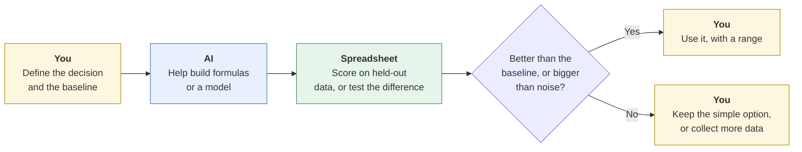
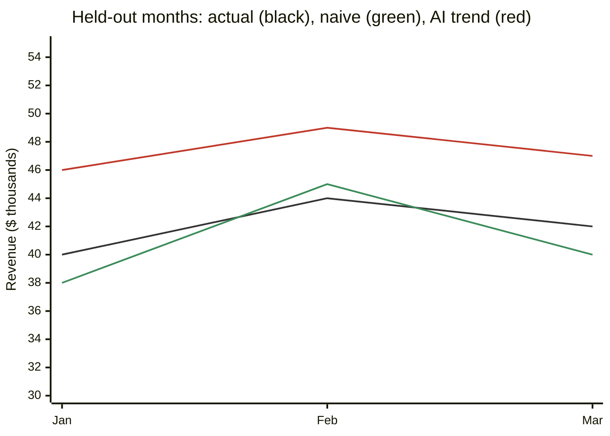
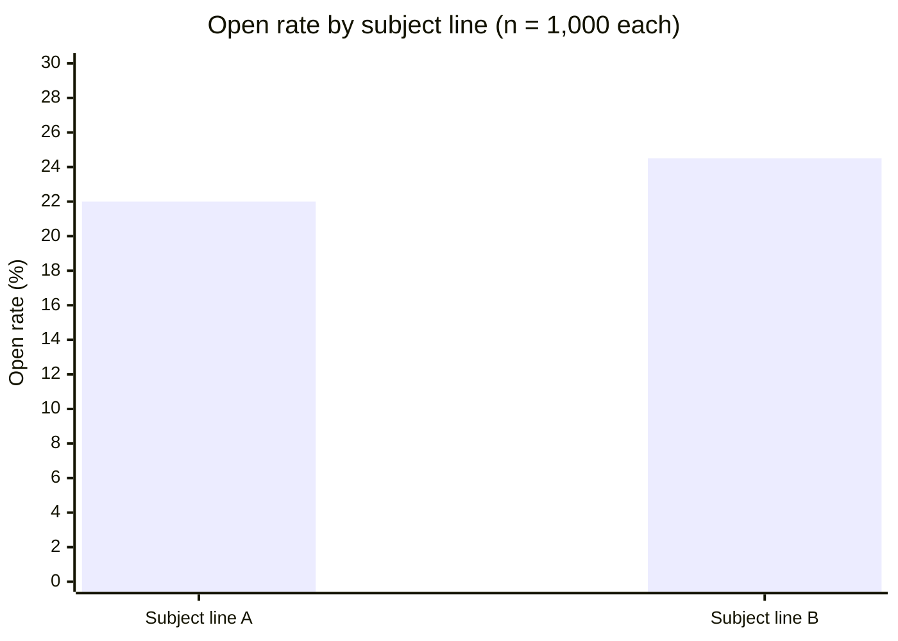

# Forecasting and A/B tests
{: .no_toc }

Check whether an AI-built forecast beats a simple baseline, and whether an A/B test result is real or just noise, with the math done in a spreadsheet.
{: .fs-6 .fw-300 }

<details open markdown="block">
  <summary>On this page</summary>
  {: .text-delta }
1. TOC
{:toc}
</details>

## Scenario

Two questions reach the analyst at **Ridgeway Coffee Roasters** (fictional) in the same week:

1. **Operations:** "How much wholesale revenue should we plan for in January through March?" An AI tool builds a forecast from two years of monthly sales. It shows a clear upward trend.
2. **Marketing:** "Subject line B got more opens than A. Can we use B for every email from now on?" (The test is from [Marketing content]().)

Both come with confident numbers. Neither has been checked against the simplest alternative: *nothing is different*.

## Why it matters

Forecasts set inventory, staffing, and cash plans (see [Cash-flow analysis]()). A/B tests decide which version a business uses from then on. AI makes both easy to produce: it will build a forecast model or declare a test winner in seconds. What it doesn't do unprompted is ask whether the result is better than a naive guess or bigger than random variation. Those two checks are where most of the value is.

## AI-assisted approach



1. **Name the baseline first (Use).** For forecasts: "same month last year" or "same as last month." For A/B tests: "there's no real difference."
2. **Let AI help build, not judge (Use).** AI is good at writing forecast formulas, explaining methods, and setting up test calculations.
3. **Score the forecast on months it didn't see (Verify).** Hold back the most recent months, forecast them, and compare errors with the baseline's.
4. **Test whether a difference is bigger than noise (Verify).** Compute the test in the spreadsheet, not the chat.
5. **Report a range, not just a number (Decide).**

## Part 1: Is the forecast better than a naive one?

The analyst holds back the most recent January–March, which the AI model didn't see, and compares two forecasts with what actually happened. Revenue is in thousands of dollars.

| Month | Actual | Seasonal naive (same month last year) | Error | AI trend model | Error |
|:--|--:|--:|--:|--:|--:|
| Jan | 40 | 38 | 2 | 46 | 6 |
| Feb | 44 | 45 | 1 | 49 | 5 |
| Mar | 42 | 40 | 2 | 47 | 5 |
| **Mean absolute error** | | | **1.7** | | **5.3** |

The seasonal naive forecast misses by about **$1.7k** a month on average (5 ÷ 3). The AI trend model misses by about **$5.3k** (16 ÷ 3), more than three times worse. It had extended a strong fall, driven by holiday orders, into the new year.



**Mean absolute error in a spreadsheet**, with actuals in B2:B4 and forecasts in C2:C4:

```text
=AVERAGE(ARRAYFORMULA(ABS(B2:B4 - C2:C4)))     Google Sheets
=AVERAGE(ABS(B2:B4 - C2:C4))                   Excel (current versions)
```

Or add an "Error" column with `=ABS(B2-C2)` and average it, which works everywhere.

**Decision:** plan on the seasonal naive forecast, give operations a range based on past errors, and revisit the AI model only if it beats the baseline on a longer test.

## Part 2: A/B tests

Marketing's subject-line test:

| | Sent | Opened | Open rate |
|:--|--:|--:|--:|
| Subject line A | 1,000 | 220 | 22.0% |
| Subject line B | 1,000 | 245 | 24.5% |

B is ahead by **2.5 percentage points**. Is that a real difference, or the kind of gap you'd see between two identical emails by chance?

### The check: a two-proportion z-test

| Step | Calculation | Result |
|:--|:--|--:|
| Pooled open rate | (220 + 245) ÷ 2,000 | 0.2325 |
| Standard error | √(0.2325 × 0.7675 × (1/1,000 + 1/1,000)) | 0.0189 |
| z-score | 0.025 ÷ 0.0189 | 1.32 |
| p-value (two-sided) | 2 × (1 − NORM.S.DIST(1.32, TRUE)) | **≈ 0.19** |
| 95% range for the difference | 2.5 points ± 1.96 × 1.89 points | **−1.2 to +6.2 points** |

A p-value of about 0.19 means a gap this size would turn up fairly often even if the two subject lines performed identically. The range for the true difference **includes zero** (and even a small advantage for A). The honest answer to marketing: **"B might be better, but this test can't tell yet."**



**How big would the test need to be?** To reliably detect a 2.5-point lift from a 22% open rate (the usual standard of 80% power at 5% significance), each version needs roughly **4,500 recipients**, about four and a half times this test. Ask AI to explain the sample-size formula, then compute it yourself or with a reputable calculator.

**Spreadsheet formulas**, with opens in B2:B3 and sends in C2:C3:

```text
Pooled rate:     =(B2+B3)/(C2+C3)
Standard error:  =SQRT(P*(1-P)*(1/C2+1/C3))          (P = pooled rate cell)
z-score:         =(B3/C3 - B2/C2) / SE                (SE = standard error cell)
p-value:         =2*(1-NORM.S.DIST(ABS(Z),TRUE))      (Z = z-score cell)
```

`NORM.S.DIST` works in both Excel and Google Sheets.

### Three A/B test rules

1. **Decide the sample size and the metric before you start.** Checking every day and stopping as soon as B looks ahead makes false winners much more likely.
2. **Randomize who gets which version.** Otherwise you may be comparing audiences, not versions (see [hidden groups]()).
3. **Test what matters.** Opens are easy to count, but clicks, orders, and unsubscribes are closer to the business outcome.

## Prompt template

```text
I'm checking [A FORECAST / AN A/B TEST] for [DECISION].
Here are the numbers: [PASTE TABLE WITH COUNTS].

Don't give me a verdict. Instead:
1. Suggest the simplest sensible baseline to compare against, and why.
2. Give me spreadsheet formulas (Excel and Google Sheets) to compute
   [mean absolute error on held-out months / a two-proportion z-test and
   a 95% range for the difference].
3. Explain in plain language what each result would mean for the decision.
4. List anything about how the data was collected that could make the
   comparison unfair.
```

## Verify checklist

- [ ] The forecast was scored on months it didn't see, and compared with a naive baseline.
- [ ] Forecasts are reported as a range, using past errors.
- [ ] Seasonal or one-off spikes (holidays, a big one-time order) aren't extended as a trend.
- [ ] The A/B test randomized who got which version.
- [ ] Sample size and the success metric were set before the test started.
- [ ] The test math was done in a spreadsheet, and I can explain the p-value and range.
- [ ] I reported the difference with its range, not just "B won."

## Common failure modes

| Failure | What it looks like | How to catch it |
|:--|:--|:--|
| **No baseline** | A sophisticated forecast that's never compared with "same as last year" | Always score the naive forecast too. |
| **Trend from a spike** | Holiday sales extended into January | Look at the same month in previous years. |
| **Single-number forecasts** | "Q1 revenue will be $142k" | Give a range from past errors. |
| **Declaring a winner from noise** | "B won by 2.5 points" with 1,000 per group | Compute the p-value and range. |
| **Peeking** | Stopping the test the day B pulls ahead | Fix the sample size in advance. |
| **AI-computed statistics** | A p-value produced in the chat | Recompute in the spreadsheet. See [How LLMs fail](). |

## Disclose and decide notes

**Disclose:** *"AI helped write the forecast formulas and explain the test. All calculations were done in the spreadsheet. The seasonal naive forecast outperformed the AI trend model on held-out months, so we used it."* Show the baseline comparison. It builds trust in the number you chose.

**Decide:** How much uncertainty is acceptable, whether to run a bigger test or decide now, and how to plan for the bottom of a forecast range are business judgments, not statistical ones.

## For educators: turn this into a challenge

Give teams two years of fictional monthly sales and an AI-generated forecast that extends a holiday spike. Teams build a seasonal naive forecast, score both on three held-out months, and recommend one. Then give them an A/B result like the one above and ask for a one-paragraph reply to a manager who wants to "switch to B today." Debrief: *Was the fancier method ever better? How did you explain "not yet" to a manager?* See [Designing an AI-fluency challenge]().
