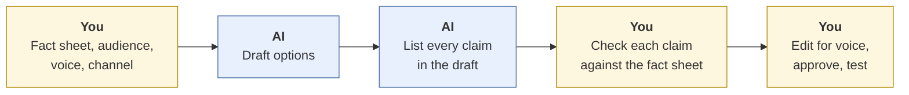
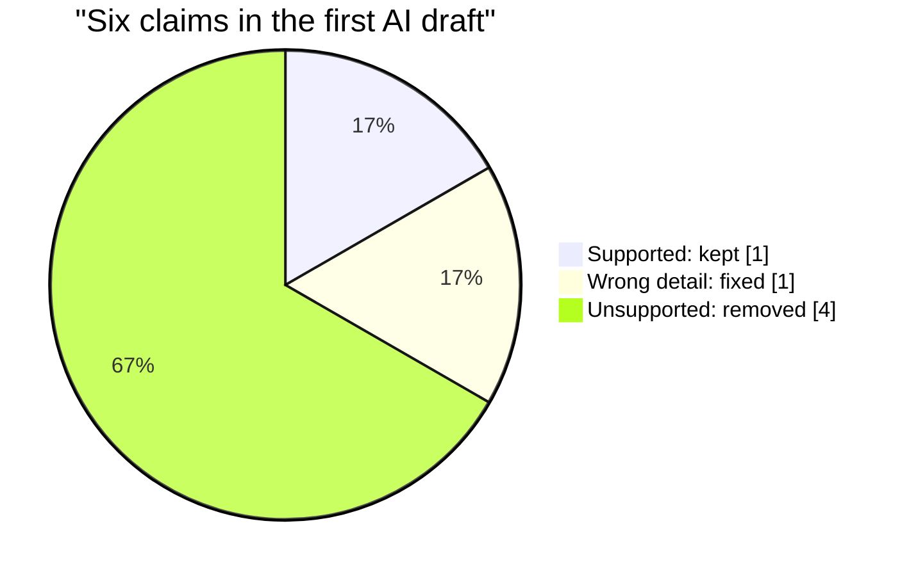

# Marketing content
{: .no_toc }

Draft product copy, social posts, and email campaigns with AI, then make sure every claim is true, supported, and in the brand's voice.
{: .fs-6 .fw-300 }

<details open markdown="block">
  <summary>On this page</summary>
  {: .text-delta }
1. TOC
{:toc}
</details>

## Scenario

**Ridgeway Coffee Roasters** (fictional) is launching a seasonal **Harvest Blend**. The marketing coordinator needs a product description for the website, three social posts, and two email subject lines to test, all by Friday. They give an AI tool the product name and ask for "exciting copy that sells."

The draft is lively and on time. It also says the blend is organic (it isn't), quotes a customer who doesn't exist, and claims more than three times as many customers as Ridgeway has.

## Why it matters

Marketing copy is public, persuasive, and attached to your company's name. AI is excellent at producing it quickly, and that's the risk: given little information, it fills gaps with the kind of claims that appear in marketing everywhere. "Award-winning," "organic," "loved by thousands," and glowing reviews are what such copy usually contains, so that's what the model predicts.

Unsupported claims can mislead customers, damage trust, and create legal exposure. In many places, advertising claims must be truthful and backed by evidence, and fake reviews and testimonials are prohibited. <!-- TODO: source --> Your job is to make sure every claim is something the business can stand behind.

## AI-assisted approach



1. **Start with a fact sheet (Use).** List what's true and approved: product details, sourcing, certifications, prices, offers, customer numbers, and any approved quotes. If it isn't on the fact sheet, it doesn't go in the copy. See [Context engineering]().
2. **Give voice and audience (Use).** Paste two or three examples of past copy the brand liked, and describe the audience in one sentence.
3. **Ask for several options (Use).** Ask for three short versions in different directions rather than one "perfect" draft. You choose.
4. **Run a claim inventory (Verify).** Have AI list every factual claim in its own draft. Then check each against the fact sheet yourself.
5. **Check images and rights (Verify).** Generated images shouldn't show real people or misrepresent the product. See [Images, audio, and video]().
6. **Edit and approve (Decide).** Make it sound like your brand. A person with authority signs off before anything is published.
7. **Test, don't guess (Decide).** For subject lines or ads, run a real test. See [Forecasting and A/B tests]().

## Prompt template

```text
Write [CONTENT TYPE, e.g. a 120-word product description] for [PRODUCT].
Audience: [WHO, in one sentence]. Channel: [WEBSITE / EMAIL / SOCIAL PLATFORM TYPE].
Brand voice: [3 ADJECTIVES]. Here are examples we liked: [PASTE 2–3 EXAMPLES].

Use ONLY the facts below. Do not add certifications, awards, statistics,
customer counts, health claims, comparisons with competitors, or testimonials
that are not listed.

FACTS:
[PASTE FACT SHEET]

Give me 3 options in different directions. Then, under "CLAIMS," list every
factual claim in each option and the fact-sheet line that supports it.
Mark any claim without a supporting line as UNSUPPORTED.
```

Even with this prompt, check the claims list yourself. Models sometimes mark an invented claim as supported.

## Worked example

The first draft, written without a fact sheet, contained six factual claims. The coordinator checked each one against the facts Ridgeway could support:

| # | Claim in the AI draft | What's actually true | Action |
|:--|:--|:--|:--|
| 1 | "Notes of cherry and dark chocolate" | Matches the roaster's tasting notes | ✓ Keep |
| 2 | "Roasted within 48 hours of shipping" | Ridgeway roasts within **72** hours of shipping | Fix |
| 3 | "100% organic beans" | The beans aren't certified organic | ✗ Remove |
| 4 | "Loved by over 10,000 customers" | Ridgeway has about **3,200** customers | ✗ Remove |
| 5 | "Low-acid and gentle on your stomach" | A health claim with no evidence behind it | ✗ Remove |
| 6 | "'Best coffee I've ever had!' — Sarah M." | No such review exists | ✗ Remove |



Only **one of six** claims survived as written. The second draft, using the prompt template and a fact sheet, had five claims, all on the fact sheet. The coordinator replaced the fake quote with a real review from a customer who had agreed to be quoted, and added one line that customers actually ask about: *"Whole bean or ground, shipped free on orders over $35."*

For the email, the team tested two subject lines on 1,000 subscribers each. Line B was opened by 24.5% of recipients versus 22.0% for line A. Whether that difference is real or just noise is worked out in [Forecasting and A/B tests](#part-2-ab-tests). (Spoiler: not yet.)

## Verify checklist

- [ ] Every factual claim matches a line on the fact sheet.
- [ ] No invented testimonials, reviews, customer counts, awards, or certifications.
- [ ] No health, safety, environmental, or "best" claims without evidence the business can show.
- [ ] Prices, offers, and dates match what's actually running.
- [ ] No competitor named or disparaged without approval.
- [ ] Images don't show real people without permission, and AI-generated images are labeled where they could be mistaken for photos.
- [ ] The copy sounds like the brand, not like generic marketing.
- [ ] Someone with authority approved it before publishing.

## Common failure modes

| Failure | What it looks like | How to catch it |
|:--|:--|:--|
| **Plausible inventions** | "Award-winning," "organic," "loved by thousands" | Claim inventory against a fact sheet. |
| **Fake social proof** | A made-up review or a "customer" quote | Use only real, permitted quotes. Remove all others. |
| **Health and green claims** | "Gentle on your stomach," "eco-friendly packaging" | Require evidence. These claims draw the most scrutiny. |
| **Generic voice** | Copy that could be for any coffee brand | Give examples of your voice. Edit for specifics only you can say. |
| **Stale offers** | A discount code from last season | Check offers and dates against the current promotion calendar. |
| **Hype that overpromises** | "Guaranteed to transform your mornings" | Ask: could a customer reasonably hold us to this? |
| **Testing by opinion** | Choosing a subject line because the team liked it | Run a test, and check that the difference is real. |

## Disclose and decide notes

**Disclose:** Inside the business, note that AI drafted the copy and who checked the claims. Publicly, label AI-generated images or video where viewers could mistake them for real, and follow your platform's and company's rules on AI labels. In the EU, AI-generated deepfakes must be disclosed (see [AI regulation and frameworks]()).

**Decide:** Which claims the business will make in public, what the brand sounds like, and when copy is ready to publish are human calls. So is the decision to leave out a claim that's technically true but misleading.

## For educators: turn this into a challenge

Give teams a one-page fact sheet for a fictional product and an AI-written launch kit (product page, three posts, an email) containing six planted unsupported claims: one certification, one statistic, one health claim, one fake testimonial, one competitor comparison, and one wrong price. Teams submit a claim inventory and a corrected kit. Score on claims caught, plus quality of the final copy. Debrief: *Which claims felt so normal that you almost missed them?* See [Designing an AI-fluency challenge]().
