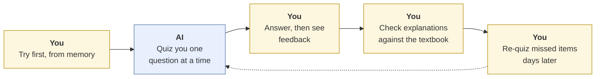
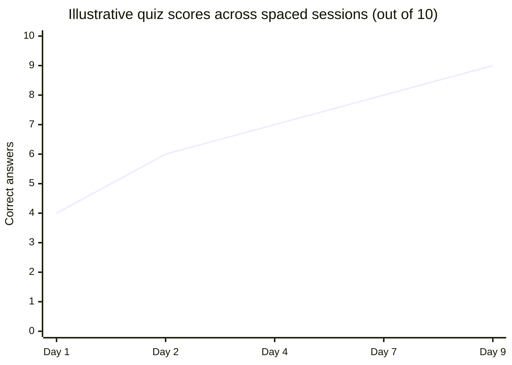

# Studying with AI
{: .no_toc }

Use AI as a quizzer and a patient explainer, not a summarizer, so you actually remember the material on exam day.
{: .fs-6 .fw-300 }

<details open markdown="block">
  <summary>On this page</summary>
  {: .text-delta }
1. TOC
{:toc}
</details>

## Scenario

You have an accounting exam in **10 days**. One chapter covers depreciation, and you're shaky on it. Your first instinct is to ask an AI tool to "summarize Chapter 7," read the summary twice, and feel ready.

The summary is clear. Reading it feels like learning. But three days later, faced with a practice problem, you can't remember which formula subtracts salvage value, and the summary had one explanation wrong.

## Why it matters

The way you use AI to study decides whether you learn or just feel like you did. Two of the best-supported findings in learning research point the same way:

- **Retrieval practice:** recalling something, for example by answering a question, strengthens long-term memory more than re-reading it (Roediger & Karpicke, 2006).
- **Spaced practice:** spreading practice out over time leads to better retention than cramming it into one session (Cepeda et al., 2006).

A polished AI summary is the opposite of both: it's re-reading, in one sitting, with no effort to recall. AI is far more useful when it makes **you** do the remembering, and when you check its explanations against your course materials.

## AI-assisted approach



1. **Check your course policy first (Use).** Most courses allow AI for studying, but some restrict uploading course materials such as slides or exams. If in doubt, ask. See [Writing a course AI policy]() for what instructors typically decide.
2. **Try before you ask (Use).** Write down what you remember about the topic, or attempt a problem, before AI explains anything. Your gaps become the study plan.
3. **Ask to be quizzed, not told (Use).** Have AI ask one question at a time and wait for your answer. Mix question types: definitions, calculations, and "what would change if…" scenarios.
4. **Get explanations for what you miss (Use).** Ask for a different explanation or a worked example, not just the right answer. A [Socratic tutor prompt]() works well here.
5. **Verify against your materials (Verify).** Check every formula and definition against your textbook or lecture notes. Courses differ in terms and conventions, and AI can be confidently wrong.
6. **Space it out (Use).** Come back to the missed questions after a day, then a few days later. Keep a short list of what you missed.

### A 10-day plan

| Day | Session (20–30 minutes) |
|:--|:--|
| 1 | Brain-dump what you know, then a 10-question AI quiz. Log misses. |
| 2 | Re-quiz yesterday's misses, plus new questions. |
| 4 | Mixed quiz across all topics, including calculations. |
| 7 | Practice problems under time pressure, without AI help. AI reviews your work afterward. |
| 9 | Final mixed quiz on your miss list. Then stop and sleep. |



## Worked example

You ask AI to quiz you on depreciation. One question:

> A company buys equipment for **$50,000**. It expects a **$5,000** salvage value after **5 years**. What is the annual straight-line depreciation?

You answer **$9,000**. The AI marks you wrong and says the answer is **$10,000** ($50,000 ÷ 5).

You check the textbook formula: straight-line depreciation = (cost − salvage value) ÷ useful life = ($50,000 − $5,000) ÷ 5 = **$9,000**. You were right. The AI ignored the salvage value.

You push the AI on it, and it agrees. That's a useful moment, but don't let "it agreed with me" be the check, because AI also tends to agree when you're wrong. The textbook was the check. See [How LLMs fail]().

You ask for a harder follow-up and get double-declining balance:

| Year | Opening book value | Rate (2 ÷ 5 years) | Depreciation | Closing book value |
|:--|--:|--:|--:|--:|
| 1 | $50,000 | 40% | $20,000 | $30,000 |
| 2 | $30,000 | 40% | $12,000 | $18,000 |

You work these out yourself first, then compare. You note one more textbook rule to check: depreciation stops when book value reaches the salvage value. That goes on your miss list for day 4.

## Prompt template

```text
I'm studying [TOPIC] for [COURSE LEVEL, e.g. an intro accounting exam].
Quiz me, one question at a time. Wait for my answer before giving feedback.

- Mix question types: definitions, short calculations, and "what if" scenarios.
- Start at [EASY / MEDIUM] difficulty and adjust based on how I do.
- When I'm wrong, don't just give the answer. Give a hint first, and let me try again.
- If I'm right, ask a harder follow-up.
- After 10 questions, list the concepts I missed so I can review them later.

Use these terms and conventions from my course: [KEY DEFINITIONS OR FORMULAS,
if your course uses specific ones].
```

To revise later, paste your miss list and say: *"Quiz me only on these, in a different order, with new numbers."*

## Verify checklist

- [ ] I checked that my course allows this use of AI, including uploading any course materials.
- [ ] I tried to recall or solve before asking AI to explain.
- [ ] I checked every formula and definition against my textbook or notes.
- [ ] I recalculated any worked numbers myself.
- [ ] I kept a miss list and came back to it on a later day.
- [ ] I did at least one practice session without AI, under exam-like conditions.

## Common failure modes

| Failure | What it looks like | How to catch it |
|:--|:--|:--|
| **Summary as studying** | Reading AI summaries and feeling ready | Ask to be quizzed instead. Track your score. |
| **Wrong explanations** | A formula that differs from your course's | Check against the textbook. Your course's conventions win. |
| **Answer-hunting** | Asking for answers to the actual homework | That's usually not studying, and may break course rules. Use practice questions. |
| **Agreement as proof** | "It changed its answer when I pushed back, so I'm right" | Check the source, not the chat. |
| **Cramming with AI** | A three-hour quiz session the night before | Spread shorter sessions over days. |
| **Never practicing without help** | Doing fine with AI, freezing on the exam | Do at least one timed session without AI. |

## Disclose and decide notes

**Disclose:** Studying usually doesn't need a disclosure, but if a submitted assignment drew on an AI explanation, follow your course policy. A simple note works: *"I used an AI tool to quiz myself on these concepts. The analysis is my own."*

**Decide:** You decide when you know something well enough. The test of that is whether you can do it without AI, not whether AI can do it.

## For educators: turn this into a challenge

Ask students to run two study sessions on the same topic a week apart: one reading an AI summary, one being quizzed by AI with a miss list. Then give an unannounced five-question check on both topics. Students compare their scores and their confidence beforehand. Plant one wrong formula in a provided "AI study guide" and award a bonus to anyone who flags it. Debrief: *Which method felt more productive? Which worked better?* See [Designing an AI-fluency challenge]() and [Scenario knowledge checks]().

---

**References**

- Cepeda, N. J., Pashler, H., Vul, E., Wixted, J. T., & Rohrer, D. (2006). Distributed practice in verbal recall tasks: A review and quantitative synthesis. *Psychological Bulletin, 132*(3), 354–380.
- Roediger, H. L., & Karpicke, J. D. (2006). Test-enhanced learning: Taking memory tests improves long-term retention. *Psychological Science, 17*(3), 249–255.
