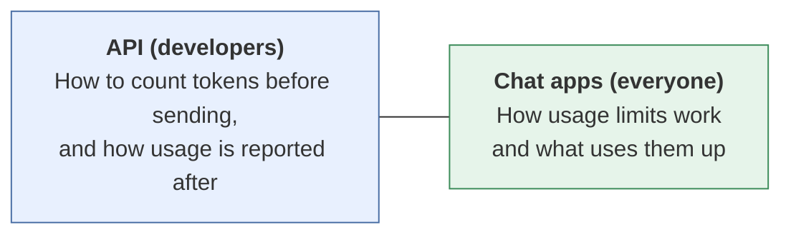

# Tokens and usage by vendor: product landscape
{: .no_toc }

How three major AI vendors count tokens, report usage, and limit their chat apps, as a companion to [Tokens and usage, explained]().
{: .fs-6 .fw-300 }

{: .note }
**Last reviewed:** 2026-10-19. Every entry below links to the vendor's official documentation and states only what that source said on the review date. In line with the guide's rules, this page lists **no prices or plan limits**. Those change often, so follow the links. Listing is not endorsement, and there is no ranking.

  
On this page

  {: .text-delta }
1. TOC
{:toc}

## What this page covers

Two different things, matching the two ways to pay:

## API: counting and reporting tokens

| | Anthropic (Claude) | OpenAI | Google (Gemini) |
|:--|:--|:--|:--|
| **Count before sending** | Token counting endpoint: "determine the number of tokens in a message before you send it." The count "is an **estimate**." | Input token counting endpoint: `POST /v1/responses/input_tokens`. The open-source `tiktoken` library is "a fast BPE tokeniser for use with OpenAI's models." | `count_tokens`, which "returns the total number of tokens in the input only." |
| **Reported after a call** | `usage` in the response, including tokens used by server tools | Responses report `input_tokens` and `output_tokens`. Output usage "includes all tokens generated by the model, not only the text visible in a response." | `usage` on the response, with counts for input (`total_input_tokens`) and output (`total_output_tokens`) |
| **Rule of thumb** | Not given in the docs we checked. | OpenAI warns that "estimates like `characters / 4` are inaccurate." The `tiktoken` README says "each token corresponds to about 4 bytes" on average. | "A token is equivalent to about 4 characters. 100 tokens is equal to about 60-80 English words." |
| **Counts change by model?** | Yes. Claude 4.7 and later models use a newer tokenizer, so "the same input text produces approximately 30 percent more tokens than on earlier models." | Not confirmed in the docs we checked. | Not confirmed in the docs we checked. |
| **Is counting free?** | Yes: "free to use but subject to requests per minute rate limits." | Not confirmed in the docs we checked. | Not confirmed in the docs we checked. |
| **Cost levers documented** | Prompt caching (cache hits cost a fraction of base input) and the Batch API ("a 50% discount on both input and output tokens") | Not reviewed for this page | Input and output tokens both affect cost: "the cost of a call to the Gemini API is determined in part by the number of input and output tokens." |
| **Official sources** | [Token counting](https://platform.claude.com/docs/en/build-with-claude/token-counting) · [Pricing](https://platform.claude.com/docs/en/about-claude/pricing) | [Counting tokens](https://developers.openai.com/api/docs/guides/token-counting) · [tiktoken](https://github.com/openai/tiktoken) | [Understand and count tokens](https://ai.google.dev/gemini-api/docs/tokens) |
| **Checked** | 2026-10-19 | 2026-10-19 | 2026-10-19 |

## Chat apps: how usage limits work

| | Claude apps | ChatGPT | Gemini apps |
|:--|:--|:--|:--|
| **How limits work** | Factors that affect limits include "message length," "file attachment size," "current conversation length," "tool usage (e.g., Research, web search)," "model choice," and "effort level." | Free users have "unlimited everyday text chats, subject to abuse-prevention safeguards." File uploads, image generation, voice, data analysis, and other tools "have separate usage limits." | "Compute-based usage limits" that "factor in the complexity of your prompt, the models and features you use, and the length of your chat." |
| **Resets** | The docs point to checking when your plan's "weekly usage limit resets." | "ChatGPT shows the reset timing in-product." | "Your limit refreshes every 5 hours until you reach your weekly limit." |
| **Free vs. paid** | Limits vary by plan. See the official page. | "Users on ChatGPT Plus have access to higher rate limits." | Users without a plan get "standard limits," and paid plans get higher multiples. |
| **Useful tip from the docs** | "If you come back to a project after a long break, your first message counts that content in full again." | "The default model and available limits can change over time." | Context window also varies by plan (see the official page). |
| **Official sources** | [Usage limit best practices](https://support.claude.com/en/articles/9797557-usage-limit-best-practices) | [ChatGPT Free Tier FAQ](https://help.openai.com/en/articles/9275245-chatgpt-free-tier-faq) | [Gemini Apps limits](https://support.google.com/gemini/answer/16275805) |
| **Checked** | 2026-10-19 | 2026-10-19 | 2026-10-19 |

## What this means in a conversation

- All three vendors count **input and output separately**, so "how many tokens?" always needs a follow-up: "In or out, and on which model?"
- One vendor's docs warn that a simple characters-÷-4 estimate is inaccurate, and another's say counts changed by about 30% between model generations. **Count with the vendor's tool, on the model you'll use.**
- In chat apps, limits depend on conversation length, attachments, tools, and model, not just how many messages you send. "Start a new chat" really is the first fix.

## Try it: count the same text three ways

1. Take one page of your own writing, about 500 words.
2. Estimate its tokens with the rule of thumb (roughly 600–850).
3. If you have API access, count it with **two vendors' counting tools** (each requires an account and API key), or with the open-source `tiktoken` library.
4. Compare the counts, and write down the difference in an [AI-use log](#ai-use-log).

The point isn't which number is "right." It's that **token counts are vendor- and model-specific**, which is why cost comparisons should use cost per finished task.

## Disclosure

The author has no paid, affiliate, or sponsorship relationship with any vendor or project listed on this page. This page was drafted with the help of an AI assistant made by Anthropic, one of the vendors listed. Each entry was checked against the official sources linked above, and every quoted phrase comes from those sources.

## Change log

| Date | Change |
|:--|:--|
| 2026-10-19 | Page created. |
