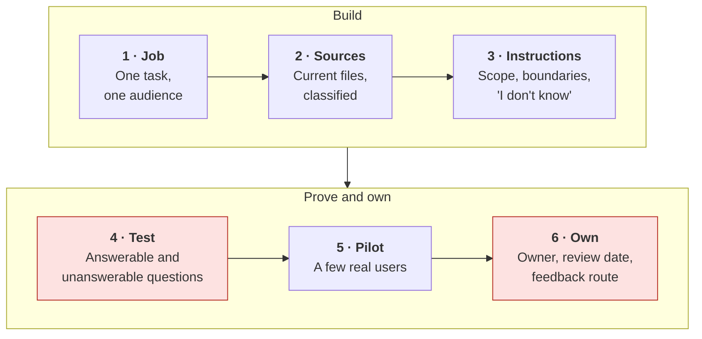
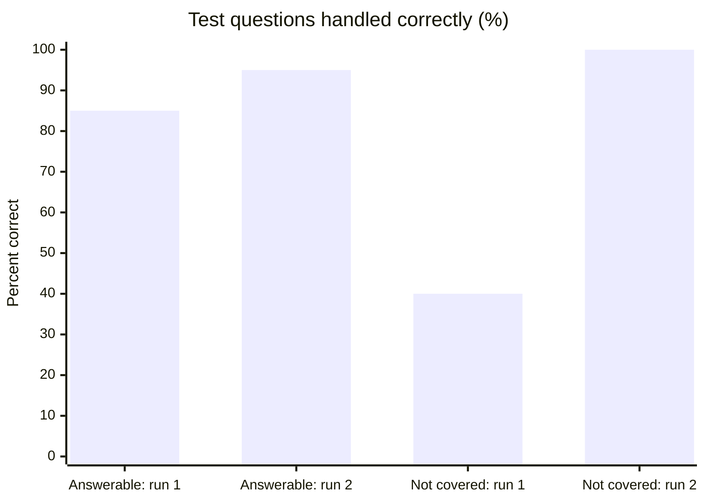

# Building a custom assistant
{: .no_toc }

Set up a no-code assistant with standing instructions and reference files, test it before anyone relies on it, and give it an owner.
{: .fs-6 .fw-300 }

<details open markdown="block">
  <summary>On this page</summary>
  {: .text-delta }
1. TOC
{:toc}
</details>

## Scenario

New staff at **Ridgeway Coffee Roasters** (fictional) ask the same questions every week: *How do I request time off? What's the dress code for farmers' markets? Who approves a wholesale discount?* The operations lead wants a custom assistant that answers from the 40-page employee handbook, set up with the "custom assistant" or "project" feature many AI tools now offer: a name, standing instructions, and uploaded files, with no coding.

It takes 20 minutes to build. In its first week, it confidently tells a new hire they get **15** paid days off. The handbook says **10** for the first year.

## Why it matters

Custom assistants turn a good prompt into something reusable, which is rung 1 and rung 4 of the [learning ladder](). They're one of the most practical AI tools for a team or a course. They also **scale mistakes**: one wrong answer in a chat affects one person, while one wrong answer in a shared assistant affects everyone who asks.

Because they look official ("the handbook assistant"), people trust them more than a general chat. That means they need what any shared tool needs: a clear job, tested answers, sensible access, and an owner.

## AI-assisted approach



1. **Give it one job (Use).** "Answer new-staff questions from the employee handbook" is testable. "Help with anything at Ridgeway" isn't.
2. **Choose and classify the sources (Use).** Upload only current, approved files. Check the data class of each, and who will be able to use the assistant. See [Data classification]().
3. **Write the instructions (Use).** Cover scope, tone, boundaries, what to do when the files don't answer the question, and how to cite. If users will see a named persona, follow the [persona spec]().
4. **Test before sharing (Verify).** If it fails, go back to step 3. Write questions with known answers, including questions the files *don't* answer. See [Building an evaluation test set]().
5. **Pilot with a few users (Verify).** Watch what they actually ask. It's never quite what you expected.
6. **Assign an owner and a review date (Decide).** Someone updates the files when policies change, reviews feedback, and retires the assistant if it's no longer needed.

### Check the access before you share

| Question | Why it matters |
|:--|:--|
| Who can use it? | A shared link may be wider than you think. |
| Can users see or download the uploaded files? | In some tools, they can. Don't upload anything users shouldn't read. |
| Can it browse the web or use connectors? | More reach means more risk. See [AI security and prompt injection](). |
| Are conversations retained, and can the owner see them? | Tell users, so they don't paste private information. |

## Prompt template

Standing instructions for a source-based assistant:

```text
You are [NAME], an AI assistant that answers questions from [AUDIENCE]
about [TOPIC], using only the attached files: [LIST FILES AND THEIR DATES].

How to answer:
- Answer only from the attached files. Quote or name the section you used.
- If the files don't answer the question, say: "The [SOURCE] doesn't cover
  that. Please ask [CONTACT]." Don't guess, and don't use general knowledge.
- If the question is ambiguous, ask one clarifying question.
- Keep answers short: [LENGTH]. Use plain language.

Boundaries:
- Never [e.g. approve requests, make exceptions, or interpret policy for an
  individual case]. For those, refer to [CONTACT].
- Don't ask for or store personal information.
- If asked, say clearly that you're an AI assistant.

These files were last updated on [DATE]. If someone mentions a policy change,
refer them to [CONTACT].
```

## Worked example

The operations lead pauses the assistant and writes **25 test questions**: 20 the handbook answers, and 5 it doesn't (for example, "Can I bring my dog to the roastery?", which the handbook never mentions).

**Run 1** (original instructions: *"Answer staff questions about Ridgeway."*):

- **17 of 20** answerable questions correct. The three misses: the paid time off error (it had mixed in "typical" policies from general knowledge), an outdated dress code from an old file that was still uploaded, and a wrong approver for wholesale discounts.
- **2 of 5** unanswerable questions handled correctly. For the other three, it **made up a policy**, including "Dogs are welcome in the office on Fridays."

**Fixes:**

1. Replaced the instructions with the template above, including the "doesn't cover that" rule.
2. Removed the outdated dress-code file and added the file date to the instructions.
3. Asked the handbook owner to clarify the discount-approval section, which really was ambiguous.

**Run 2:** **19 of 20** answerable correct and **5 of 5** unanswerable handled correctly. The one remaining miss is a question about the holiday schedule, which the handbook covers only in a table the tool didn't read well. The fix: add the schedule as plain text.



The assistant launched with a line at the top of every answer, *"AI assistant. Answers come from the Employee Handbook (updated [DATE]). For anything about your own situation, ask Operations."*, plus a named owner and a review every quarter or whenever the handbook changes.

{: .note }
**Educators:** the same pattern works for a course FAQ assistant built from your syllabus and schedule. Test it with the questions students actually ask, including ones the syllabus doesn't answer, and tell students what it can and can't do. See [AI in course operations]().

## Verify checklist

- [ ] The assistant has one clearly defined job and audience.
- [ ] Uploaded files are current, approved, and suitable for everyone who can access the assistant.
- [ ] The instructions say what to do when the files don't answer the question.
- [ ] It was tested on at least 20 questions, including several the files don't answer, and it passed.
- [ ] Access settings (who can use it, file visibility, web access, connectors) were checked.
- [ ] Users are told it's AI, what its sources are, and where to go for anything else.
- [ ] It has a named owner, a review date, and a way for users to report wrong answers.

## Common failure modes

| Failure | What it looks like | How to catch it |
|:--|:--|:--|
| **Filling gaps from general knowledge** | A "typical" policy instead of yours | Test unanswerable questions. Add an explicit "don't guess" rule. |
| **Stale files** | Last year's dress code, still uploaded | Date every file. Review on a schedule and whenever policies change. |
| **Scope creep** | A handbook assistant asked for legal or medical advice | State the boundaries, and test them. |
| **Over-trust** | "The assistant said so" in a dispute | Label answers as AI-generated, and name the official source and contact. |
| **Oversharing files** | Users can download a file with salary bands | Upload only what every user may read. |
| **Orphaned assistant** | Its creator left; nobody updates it | Name an owner and a backup. Retire it if no one owns it. |
| **Tables and images ignored** | Wrong answers from content in charts or tables | Test those sections. Add key tables as plain text. |

## Disclose and decide notes

**Disclose:** The assistant should say it's AI, name its sources and their dates, and point to a person for anything official. When it's used for decisions, such as whether someone has leave left, the official record and the responsible person still decide.

**Decide:** What the assistant may answer, which files it uses, who can access it, and when it's retired are owner decisions. The assistant informs. It doesn't approve, grant, or interpret policy for individual cases.

## For educators: turn this into a challenge

Teams build a custom assistant from a short fictional policy document (three to five pages) in whatever approved tool you use. Then they swap: each team writes 15 test questions for another team's assistant, including at least 5 the document doesn't answer and 2 that push its boundaries. Teams score the results, fix their instructions, and re-test. Debrief: *What did your assistant do when it didn't know? Which single instruction made the biggest difference?* See [Designing an AI-fluency challenge]().
